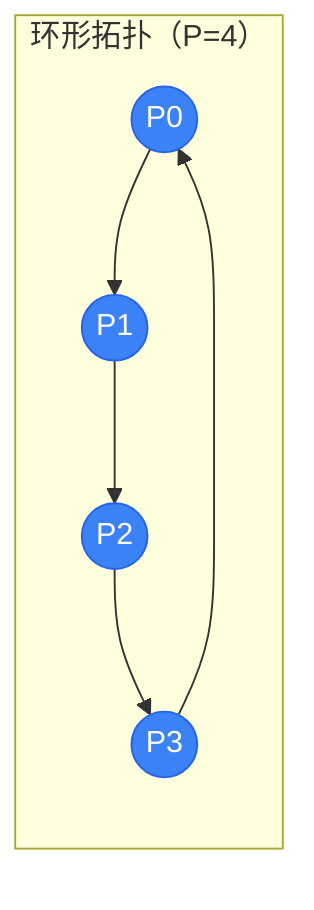
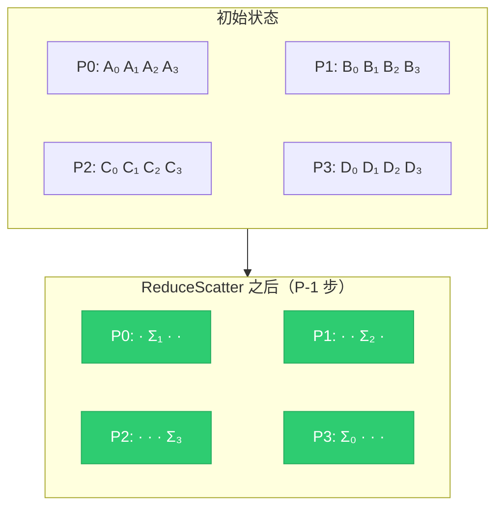
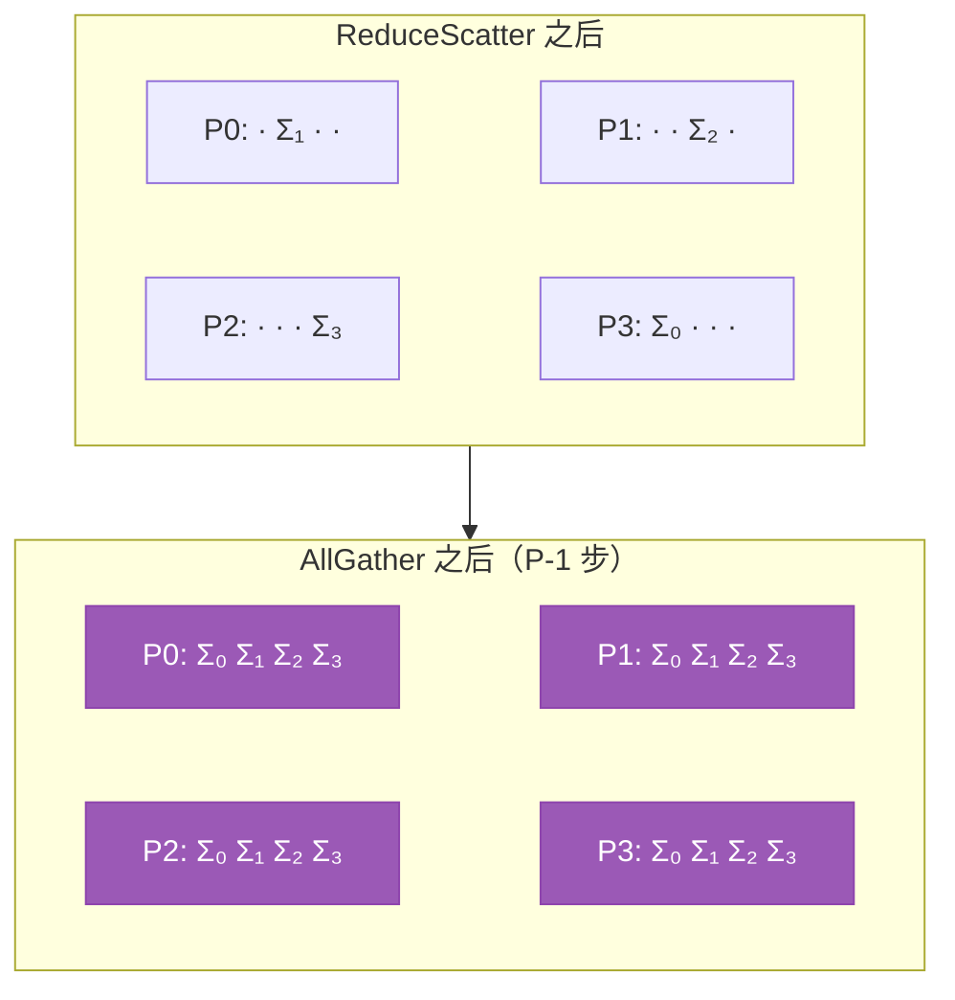
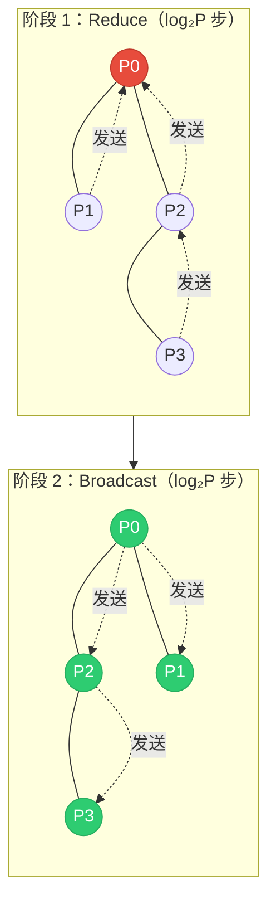

<div class="chapter-opener" markdown>
同一个逻辑操作——AllReduce——可以有多种实现方式。环形算法优化带宽；树形算法优化延迟。正确选择取决于消息大小。
</div>

<div class="investigation-question" markdown>
**问题**：为什么环形 AllReduce 是带宽最优的？我们能证明它达到了理论最小通信量吗？又该在什么时候改用树形算法？
</div>

!!! abstract "本章导览"
    **前置知识**：[第 4 章](../foundations/04-alpha-beta-model.md)（α-β 成本模型）、[第 11 章](11-primitives-properties.md)（集合通信原语）

    **关键洞察**：环形算法对大消息达到带宽最优；树形算法对小消息最小化延迟。α-β 模型给出的交叉点告诉你该用哪种。

## 算法设计空间

AllReduce 接收 $P$ 个输入向量，产生它们之和的 $P$ 份副本。问题是：我们如何移动并合并这些数据？

两种基本方法：

1. **环形**：把进程排成一个逻辑环，让数据绕着传递
2. **树形**：把进程排成一棵逻辑树，先向上归约，再向下广播

它们针对 α-β 模型中的不同区间进行优化。

## 环形 AllReduce

### 两阶段算法

环形 AllReduce 包含两个阶段：

**阶段 1：ReduceScatter**——每个进程最终持有最终结果的 1/P

**阶段 2：AllGather**——每个进程收集所有片段



<div class="algorithm-stepper" markdown>
<div class="stepper-controls">
<button class="stepper-prev">← 上一步</button>
<span class="step-indicator">第 1 步，共 7 步</span>
<button class="stepper-next">下一步 →</button>
<button class="stepper-play">▶ 播放</button>
</div>

<div class="step active" markdown>
**初始状态**——每块 GPU 持有自己的数据，并划分为 4 个块

<div class="tensor-viz">
<div class="partition gpu-0">P0: A₀ A₁ A₂ A₃</div>
<div class="partition gpu-1">P1: B₀ B₁ B₂ B₃</div>
<div class="partition gpu-2">P2: C₀ C₁ C₂ C₃</div>
<div class="partition gpu-3">P3: D₀ D₁ D₂ D₃</div>
</div>

每个进程最终将拥有最终归约结果的一个块。
</div>

<div class="step" markdown>
**ReduceScatter 第 1 步**——每块 GPU r 顺时针发送块 r，从逆时针邻居接收块 (r-1)

<div class="tensor-viz">
<div class="partition gpu-0">P0: A₀ A₁ A₂ <strong>A₃+D₃</strong></div>
<div class="partition gpu-1">P1: <strong>B₀+A₀</strong> B₁ B₂ B₃</div>
<div class="partition gpu-2">P2: C₀ <strong>C₁+B₁</strong> C₂ C₃</div>
<div class="partition gpu-3">P3: D₀ D₁ <strong>D₂+C₂</strong> D₃</div>
</div>

P0→P1（块 0），P1→P2（块 1），P2→P3（块 2），P3→P0（块 3）
</div>

<div class="step" markdown>
**ReduceScatter 第 2 步**——每块 GPU 发送刚刚累积的块

<div class="tensor-viz">
<div class="partition gpu-0">P0: A₀ A₁ <strong>A₂+C₂+D₂</strong> A₃+D₃</div>
<div class="partition gpu-1">P1: B₀+A₀ B₁ B₂ <strong>B₃+A₃+D₃</strong></div>
<div class="partition gpu-2">P2: <strong>C₀+A₀+B₀</strong> C₁+B₁ C₂ C₃</div>
<div class="partition gpu-3">P3: D₀ <strong>D₁+B₁+C₁</strong> D₂+C₂ D₃</div>
</div>

现在每个部分和都包含 3 份贡献。
</div>

<div class="step" markdown>
**ReduceScatter 第 3 步（最终）**——经过 P-1=3 步后，每块 GPU 拥有一个完全归约的块

<div class="tensor-viz">
<div class="partition complete">P0: · <strong>Σ₁</strong> · ·</div>
<div class="partition complete">P1: · · <strong>Σ₂</strong> ·</div>
<div class="partition complete">P2: · · · <strong>Σ₃</strong></div>
<div class="partition complete">P3: <strong>Σ₀</strong> · · ·</div>
</div>

其中 Σᵢ = Aᵢ + Bᵢ + Cᵢ + Dᵢ。注意：由于环形轮转，GPU r 拥有块 (r+1) mod P。
</div>

<div class="step" markdown>
**AllGather 第 1 步**——每块 GPU 顺时针发送自己归约后的块

<div class="tensor-viz">
<div class="partition complete">P0: <strong>Σ₀</strong> Σ₁ · ·</div>
<div class="partition complete">P1: · <strong>Σ₁</strong> Σ₂ ·</div>
<div class="partition complete">P2: · · <strong>Σ₂</strong> Σ₃</div>
<div class="partition complete">P3: Σ₀ · · <strong>Σ₃</strong></div>
</div>

不需要归约——只需存储收到的块。
</div>

<div class="step" markdown>
**AllGather 第 2 步**——继续沿环传播各块

<div class="tensor-viz">
<div class="partition complete">P0: Σ₀ Σ₁ · <strong>Σ₃</strong></div>
<div class="partition complete">P1: <strong>Σ₀</strong> Σ₁ Σ₂ ·</div>
<div class="partition complete">P2: · <strong>Σ₁</strong> Σ₂ Σ₃</div>
<div class="partition complete">P3: Σ₀ · <strong>Σ₂</strong> Σ₃</div>
</div>

每块 GPU 现在拥有 4 个块中的 3 个。
</div>

<div class="step" markdown>
**AllGather 第 3 步（完成）**——所有 GPU 都拥有完整的归约结果

<div class="tensor-viz">
<div class="partition complete">P0: Σ₀ Σ₁ Σ₂ Σ₃</div>
<div class="partition complete">P1: Σ₀ Σ₁ Σ₂ Σ₃</div>
<div class="partition complete">P2: Σ₀ Σ₁ Σ₂ Σ₃</div>
<div class="partition complete">P3: Σ₀ Σ₁ Σ₂ Σ₃</div>
</div>

**总步数**：2(P-1) = 6 步。**每 GPU 数据量**：2·(P-1)/P·n ≈ 2n 字节（带宽最优）。
</div>
</div>

### 阶段 1：通过环形实现 ReduceScatter

把每个进程的数据划分为 $P$ 个块。在第 $k$ 步（从 0 到 $P-2$），每个进程：

1. 顺时针发送块 $(r-k) \mod P$（$r$ 是进程 rank）
2. 从逆时针邻居接收一个块
3. 把收到的块与本地对应位置的数据累加

```
初始状态（P=4，数据划分为 4 块）：
P0: [A0 A1 A2 A3]    P1: [B0 B1 B2 B3]
P2: [C0 C1 C2 C3]    P3: [D0 D1 D2 D3]

第 1 步：GPU r 发送块 r，接收块 (r-1) mod P
P0: 发送 A0→P1，接收 D3     P1: 发送 B1→P2，接收 A0
P2: 发送 C2→P3，接收 B1     P3: 发送 D3→P0，接收 C2

第 1 步后（在收到块的位置累加）：
P0: [A0 A1 A2 A3+D3]         P1: [A0+B0 B1 B2 B3]
P2: [C0 B1+C1 C2 C3]         P3: [D0 D1 C2+D2 D3]
        position 3                 position 0

第 2 步：GPU r 发送块 (r-1) mod P（刚刚累加的那个）
P0: 发送 (A3+D3)→P1         P1: 发送 (A0+B0)→P2
P2: 发送 (B1+C1)→P3         P3: 发送 (C2+D2)→P0

第 2 步后：
P0: [... A2+C2+D2 ...]       P1: [... B3+A3+D3]
P2: [A0+B0+C0 ...]           P3: [... B1+C1+D1 ...]

第 3 步：最终累加，每块 GPU 完成一个块
P0: 接收 B1+C1+D1，累加 → Σ1 = A1+B1+C1+D1
P1: 接收 A2+C2+D2，累加 → Σ2 = A2+B2+C2+D2
P2: 接收 A3+B3+D3，累加 → Σ3 = A3+B3+C3+D3
P3: 接收 A0+B0+C0，累加 → Σ0 = A0+B0+C0+D0

经过 P-1=3 步后（注意轮转后的归属）：
P0: 拥有 Σ1（块 1）    P1: 拥有 Σ2（块 2）
P2: 拥有 Σ3（块 3）    P3: 拥有 Σ0（块 0）
```

每个进程现在持有完全归约结果的 1/P。由于环形轮转，GPU $r$ 最终拥有块 $(r+1) \mod P$。



其中 Σᵢ = Aᵢ + Bᵢ + Cᵢ + Dᵢ（完全归约的块 i）。注意：GPU r 拥有块 (r+1) mod P。

### 阶段 2：通过环形实现 AllGather

在 $P-1$ 步中，每个进程：
1. 顺时针发送自己归约后的块
2. 从逆时针邻居接收一个归约块
3. 存储收到的块（无需归约）

```
ReduceScatter 之后（GPU r 拥有块 (r+1) mod P）：
P0: [. Σ1 . .]    P1: [. . Σ2 .]
P2: [. . . Σ3]    P3: [Σ0 . . .]

第 1 步：每个进程顺时针发送自己的块
P0: 发送 Σ1→P1    P1: 发送 Σ2→P2
P2: 发送 Σ3→P3    P3: 发送 Σ0→P0

第 1 步后：
P0: [Σ0 Σ1 . .]    P1: [. Σ1 Σ2 .]
P2: [. . Σ2 Σ3]    P3: [Σ0 . . Σ3]

第 2 步：发送刚刚收到的块
...

经过 P-1=3 步后：
P0: [Σ0 Σ1 Σ2 Σ3]    P1: [Σ0 Σ1 Σ2 Σ3]
P2: [Σ0 Σ1 Σ2 Σ3]    P3: [Σ0 Σ1 Σ2 Σ3]
```



### 通信分析

**每一步**：

- 每个进程发送：$n/P$ 字节
- 每个进程接收：$n/P$ 字节

**总步数**：$2(P-1)$（ReduceScatter + AllGather）

**每进程总量**：

$$\text{Send} = \text{Recv} = 2(P-1) \cdot \frac{n}{P} = 2 \cdot \frac{P-1}{P} \cdot n$$

**使用 α-β 模型的时间**：

$$T_{\text{ring}} = 2(P-1) \cdot \alpha + 2 \cdot \frac{P-1}{P} \cdot \frac{n}{\beta}$$

对大的 $P$：

$$T_{\text{ring}} \approx 2P\alpha + \frac{2n}{\beta}$$

### 带宽最优性证明

!!! question "直觉检查"
    环形 AllReduce 每进程发送 $2(P-1)/P \cdot n$ 字节。当 $P \to \infty$ 时，带宽项趋近 $2n/\beta$——与 $P$ 无关。这看起来对吗？我们能证明没有算法做得更好吗？

**定理**：环形 AllReduce 是带宽最优的。

**证明**：

考虑必须通信的总数据量。AllReduce 的结果是一个大小为 $n$ 的向量，必须存在于所有 $P$ 个进程上。

**下界论证**：

考虑任意进程 $p$。最终归约向量大小为 $n$，但 $p$ 最初对其他 $P-1$ 个进程的贡献没有任何信息。由割集论证，至少 $(P-1)/P \cdot n$ 字节必须进入 $p$ 以提供缺失的信息，并且至少 $(P-1)/P \cdot n$ 字节必须离开 $p$，以便其他 rank 能纳入 $p$ 的贡献。

每进程总通信量：至少 $2(P-1)/P \cdot n$ 字节。

**环形 AllReduce 恰好达到这个下界**。$\square$

### 双向环

标准环形使用单向通信。双向环同时向两个方向发送不同的块：

```
标准环：
P0 → P1 → P2 → P3 → P0

双向环：
P0 ⟷ P1 ⟷ P2 ⟷ P3 ⟷ P0
```

**收益**：利用全双工链路的两个方向。

**时间**：

$$T_{\text{bidir}} = (P-1) \cdot \alpha + \frac{P-1}{P} \cdot \frac{n}{\beta}$$

在全双工链路上，偶数 $P$ 时步数是单向环的一半；奇数 $P$ 需要多一步。

## 树形 AllReduce

### 两阶段算法

树形 AllReduce 也有两个阶段：

**阶段 1：Reduce**——通过树形归约把数据聚合到根

**阶段 2：Broadcast**——通过树形广播把结果从根分发出去



### 递归减半（Reduce 阶段）

把进程排成一棵二叉树。在 $\log_2 P$ 步中：

```
第 1 步：成对归约（P0↔P1, P2↔P3, ...）
        P0 ←── P1        P2 ←── P3
        P0 持有 (P0,P1)  P2 持有 (P2,P3)
        的和             的和

第 2 步：成对的成对归约
        P0 ←────────── P2
        P0 持有所有进程的和

经过 log₂(P) 步：根拥有完整归约结果
```

每一步：

- 一半活跃进程发送它们的全部数据
- 另一半接收并归约

### 递归倍增（Broadcast 阶段）

反转树结构：

```
第 1 步：根发送给伙伴
        P0 ──────────→ P2
        双方都拥有和

第 2 步：每个进程发送给伙伴
        P0 ──→ P1      P2 ──→ P3
        所有进程都拥有和
```

### 通信分析

**Reduce 阶段**：

- $\log_2 P$ 步
- 每步：发送/接收 $n$ 字节（完整数据）
- 时间：$\log_2 P \cdot (\alpha + n/\beta)$

**Broadcast 阶段**：

- $\log_2 P$ 步
- 每步：发送/接收 $n$ 字节
- 时间：$\log_2 P \cdot (\alpha + n/\beta)$

**总计**：

$$T_{\text{tree}} = 2 \log_2 P \cdot \alpha + 2 \log_2 P \cdot \frac{n}{\beta}$$

### 延迟最优性

**定理**：树形 AllReduce 是延迟最优的。

**证明**：

考虑信息流约束。在每一轮成对通信中，持有某个给定贡献的进程数最多翻倍。要让任意一个进程的贡献到达所有 $P$ 个进程，至少需要 $\log_2 P$ 轮。

树形 AllReduce 在 reduce 阶段恰好用 $\log_2 P$ 步、在 broadcast 阶段恰好用 $\log_2 P$ 步，达到了这个下界。$\square$

## 对比：环形 vs 树形

| 方面 | 环形 | 树形 |
|------|------|------|
| 延迟项 | $2(P-1) \cdot \alpha$ | $2\log_2 P \cdot \alpha$ |
| 带宽项 | $2 \cdot \frac{P-1}{P} \cdot \frac{n}{\beta}$ | $2\log_2 P \cdot \frac{n}{\beta}$ |
| 延迟最优 | 否 | 是 |
| 带宽最优 | 是 | 否 |

**关键观察**：

- 环形：带宽项 ≈ $2n/\beta$（与 $P$ 无关）
- 树形：带宽项 = $2\log_2 P \cdot n/\beta$（随 $P$ 增长）

对大的 $P$，树形使用的带宽多 $\log_2 P$ 倍！

### 交叉点

令 $T_{\text{ring}} = T_{\text{tree}}$：

$$2(P-1)\alpha + \frac{2(P-1)}{P} \cdot \frac{n}{\beta} = 2\log_2 P \cdot \alpha + 2\log_2 P \cdot \frac{n}{\beta}$$

求解 $n$：

$$n^* = \frac{2\alpha\beta(P-1 - \log_2 P)}{2\log_2 P - 2(P-1)/P}$$

对大的 $P$：

$$n^* \approx \frac{\alpha\beta \cdot P}{\log_2 P - 1}$$

**示例**：$P = 64$，$\alpha = 1\mu s$，$\beta = 100$ GB/s

$$n^* \approx \frac{10^{-6} \times 10^{11} \times 64}{6 - 1} = \frac{6.4 \times 10^6}{5} = 1.28 \text{ MB}$$

*注：这个近似公式给出的交叉点比精确解（求解完整方程得到的 1.14 MB）高约 12%。对 P=64，近似误差明显，但用于数量级判断可以接受。*

- 消息 < ~1.2 MB：使用树形
- 消息 > ~1.2 MB：使用环形

!!! tip "拓扑会改变交叉点"
    上面的交叉点假设网络是同质的。在层次化集群上，请使用[第 13a 章](13a-topology-aware-collectives.md)的拓扑感知决策流程。

### 可视化

```
时间
  │
  │     树形：T = 2log(P)·α + 2log(P)·n/β
  │              ╱
  │             ╱
  │            ╱
  │           ╱      环形：T = 2(P-1)·α + 2·(P-1)/P·n/β
  │          ╱       ╱
  │    ─────●──────╱──────────────
  │        ╱     ╱ ↑
  │       ╱    ╱   交叉点
  │      ╱   ╱
  │     ╱  ╱
  │    ╱ ╱
  │   ╱╱
  └──●────────────────────────────→ n（消息大小）
     0
```

小 $n$ 时：环形付出很高的延迟代价（$(P-1)$ 步）
大 $n$ 时：树形付出很高的带宽代价（$\log P$ 倍）

## 递归减半-倍增（Rabenseifner 算法）

结合两种方法的最佳之处：

### 算法

**阶段 1：递归减半 + 归约**

类似树形归约，但每一步只交换 $n/2$ 数据：

```
第 1 步：成对交换相反的一半并归约
        P0: [A B] ↔ P1: [C D]
        P0 发送上半 [B]，接收 [C]，归约到自己的下半
        P1 发送下半 [C]，接收 [B]，归约到自己的上半
```

实际上，Rabenseifner 算法用于 ReduceScatter：

```
第 k 步（共 log₂P 步）：

- 与距离 2^(log₂P - k) 的进程配对
- 发送你负责的一半数据
- 接收另一半
- 本地归约

经过 log₂P 步：每个进程拥有归约结果的 1/P
```

**阶段 2：递归倍增（AllGather）**

反转通信模式，收集所有片段。

### 分析

$$T_{\text{RHD}} = 2\log_2 P \cdot \alpha + \frac{2(P-1)}{P} \cdot \frac{n}{\beta}$$

**两全其美**：

- 树形的延迟：$O(\log P)$ 步
- 环形的带宽：总数据量 $O(n)$

**限制**：要求 $P$ 是 2 的幂。

## 层次化算法

现代集群具有层次结构：节点内的 GPU、机架内的节点、集群内的机架。

### 二维环（环-环）

把进程排成二维网格。AllReduce 分三个阶段：

```
节点内环（G=4）：
Node 0: [G0]-[G1]-[G2]-[G3]
        ^                 |
        |_________________|
Node 1: [G4]-[G5]-[G6]-[G7]
        ^                 |
        |_________________|
Node 2: [G8]-[G9]-[G10]-[G11]
        ^                  |
        |__________________|

节点间环（每个节点一个代表）：
[G3] —— [G7] —— [G11] —— [G3]
```

**阶段 1**（节点内 ReduceScatter）：每个节点在自己的 GPU 之间归约并分散数据
- 使用 NVLink（高带宽、低延迟）
- 每块 GPU 最终拥有本地归约结果的 1/G

**阶段 2**（节点间 AllReduce）：在节点之间对相应块做环形 AllReduce
- 使用网络（较低带宽、较高延迟）
- 只有 $n/G$ 的数据跨网络——这是关键的带宽节省

**阶段 3**（节点内 AllGather）：把全局归约后的块分发回每个节点内的所有 GPU
- 再次使用 NVLink

**分析**：设 $G$ = 每节点 GPU 数，$N$ = 节点数，$P = GN$

$$T_{\text{intra}} = 2(G-1)\alpha_{\text{NV}} + \frac{2(G-1)}{G} \cdot \frac{n}{\beta_{\text{NV}}}$$

$$T_{\text{inter}} = 2(N-1)\alpha_{\text{net}} + \frac{2(N-1)}{N} \cdot \frac{n/G}{\beta_{\text{net}}}$$

**关键洞察**：节点间阶段只传输 $n/G$ 字节，把网络带宽需求降低 $G$ 倍。

### 层次化环-树

- **节点内**：环形（充分利用 NVLink 带宽）
- **节点间**：树形（本地归约后消息较小，追求低延迟）

```
每个节点内部：环形 AllReduce
节点之间：对本地结果做树形 AllReduce
```

### NCCL 的双二叉树

NCCL 使用两棵重叠的二叉树来充分利用双向链路：

```
树 1：          树 2：
    0              7
   / \            / \
  1   2          6   5
 / \   \        /   / \
3   4   5      4   3   0
               ...
```

两棵树同时运行，各处理一半数据。这实现了：

- $\log P$ 延迟（树形性质）
- 充分利用双向带宽

## 实践中的算法选择

### NCCL 的启发式规则

NCCL 根据以下因素选择算法：

1. **消息大小**
2. **GPU 数量**
3. **网络拓扑**

典型阈值：

| 消息大小 | 算法 |
|----------|------|
| < 256 KB | 树形（延迟受限） |
| 256 KB - 4 MB | 混合选择 |
| > 4 MB | 环形（带宽受限） |

### 环境变量

```bash
# 强制指定算法
export NCCL_ALGO=Ring   # 或 Tree、CollnetDirect
export NCCL_ALGO=Tree

# 设置协议
export NCCL_PROTO=Simple  # 或 LL（低延迟）或 LL128

# 拓扑检测
export NCCL_TOPO_FILE=/path/to/topology.xml
```

## 实现：环形 AllReduce

```python
import torch
import torch.distributed as dist

def ring_allreduce(tensor, group):
    """环形 AllReduce 实现。"""
    rank = dist.get_rank(group)
    world_size = dist.get_world_size(group)

    # 把张量划分为 world_size 个块
    chunks = tensor.chunk(world_size)
    chunks = list(chunks)  # 使其可变

    # 阶段 1：ReduceScatter
    for step in range(world_size - 1):
        send_idx = (rank - step) % world_size
        recv_idx = (rank - step - 1) % world_size

        send_to = (rank + 1) % world_size
        recv_from = (rank - 1) % world_size

        # 交换块
        recv_buffer = torch.empty_like(chunks[recv_idx])

        send_op = dist.isend(chunks[send_idx], send_to, group)
        recv_op = dist.irecv(recv_buffer, recv_from, group)

        send_op.wait()
        recv_op.wait()

        # 归约
        chunks[recv_idx] += recv_buffer

    # 阶段 2：AllGather
    for step in range(world_size - 1):
        send_idx = (rank - step + 1) % world_size
        recv_idx = (rank - step) % world_size

        send_to = (rank + 1) % world_size
        recv_from = (rank - 1) % world_size

        recv_buffer = torch.empty_like(chunks[recv_idx])

        send_op = dist.isend(chunks[send_idx], send_to, group)
        recv_op = dist.irecv(recv_buffer, recv_from, group)

        send_op.wait()
        recv_op.wait()

        chunks[recv_idx] = recv_buffer

    # 重建张量
    return torch.cat(chunks)
```

## 桶融合（Bucket Fusion）

对许多小张量（例如梯度），逐个 AllReduce 效率很低。解决方案：桶融合。

```python
class BucketedAllReduce:
    def __init__(self, bucket_size_mb=25):
        self.bucket_size = bucket_size_mb * 1024 * 1024
        self.buckets = []
        self.current_bucket = []
        self.current_size = 0

    def add_tensor(self, tensor):
        tensor_size = tensor.numel() * tensor.element_size()

        if self.current_size + tensor_size > self.bucket_size:
            # 刷出当前桶
            self._flush_bucket()

        self.current_bucket.append(tensor)
        self.current_size += tensor_size

    def _flush_bucket(self):
        if not self.current_bucket:
            return

        # 把所有张量展平到单个缓冲区
        flat = torch.cat([t.view(-1) for t in self.current_bucket])

        # 一次 AllReduce
        dist.all_reduce(flat)

        # 还原回去
        offset = 0
        for t in self.current_bucket:
            numel = t.numel()
            t.copy_(flat[offset:offset+numel].view(t.shape))
            offset += numel

        self.current_bucket = []
        self.current_size = 0
```

PyTorch DDP 默认使用 25MB 的桶。

## 练习题

1. **环形正确性**：对 P=4，数据 `P0=[1,2,3,4], P1=[5,6,7,8], P2=[9,10,11,12], P3=[13,14,15,16]`，追踪环形 ReduceScatter。该阶段结束后每个进程持有什么？

??? success "解答"
    **追踪 P=4 的环形 ReduceScatter：**

    **初始状态：**
    ```
    P0: [1, 2, 3, 4]      → 块：[1] [2] [3] [4]
    P1: [5, 6, 7, 8]      → 块：[5] [6] [7] [8]
    P2: [9, 10, 11, 12]   → 块：[9] [10] [11] [12]
    P3: [13, 14, 15, 16]  → 块：[13] [14] [15] [16]
    ```

    **第 1 步：** GPU r 发送块 r，接收块 (r-1) mod 4：
    - P0 发送块 0（=1）→ P1，从 P3 接收块 3（=16）→ 在位置 3 累加
    - P1 发送块 1（=6）→ P2，从 P0 接收块 0（=1）→ 在位置 0 累加
    - P2 发送块 2（=11）→ P3，从 P1 接收块 1（=6）→ 在位置 1 累加
    - P3 发送块 3（=16）→ P0，从 P2 接收块 2（=11）→ 在位置 2 累加

    ```
    第 1 步后：
    P0: [1, 2, 3, 4+16=20]       位置 3 已累加
    P1: [5+1=6, 6, 7, 8]         位置 0 已累加
    P2: [9, 10+6=16, 11, 12]     位置 1 已累加
    P3: [13, 14, 15+11=26, 16]   位置 2 已累加
    ```

    **第 2 步：** 发送刚刚累加的块（块 (r-1) mod 4）：
    - P0 发送 20（位置 3）→ P1，从 P3 接收 26（位置 2）→ 在位置 2 累加
    - P1 发送 6（位置 0）→ P2，从 P0 接收 20（位置 3）→ 在位置 3 累加
    - P2 发送 16（位置 1）→ P3，从 P1 接收 6（位置 0）→ 在位置 0 累加
    - P3 发送 26（位置 2）→ P0，从 P2 接收 16（位置 1）→ 在位置 1 累加

    第 1 步后，P3 在位置 2 有 26（即 15+11 = C2+D2）。
    P0 接收 26 并累加：位置 2 变为 3 + 26 = 29。

    ```
    第 2 步后：
    P0: [1, 2, 29, 20]          位置 2 = A2+C2+D2
    P1: [6, 6, 7, 8+20=28]      位置 3 = B3+A3+D3
    P2: [9+6=15, 16, 11, 12]    位置 0 = C0+A0+B0
    P3: [13, 14+16=30, 26, 16]  位置 1 = D1+B1+C1
    ```

    **第 3 步：** 最后一轮，发送块 (r-2) mod 4：
    - P0 发送 29 → P1，从 P3 接收 30 → 在位置 1 累加
    - P1 发送 28 → P2，从 P0 接收 29 → 在位置 2 累加
    - P2 发送 15 → P3，从 P1 接收 28 → 在位置 3 累加
    - P3 发送 30 → P0，从 P2 接收 15 → 在位置 0 累加

    ```
    第 3 步后（最终）：
    P0: [1, 2+30=32, 29, 20]    → P0 在位置 1 有 Σ1=32 ✓
    P1: [6, 6, 7+29=36, 28]     → P1 在位置 2 有 Σ2=36 ✓
    P2: [15, 16, 11, 12+28=40]  → P2 在位置 3 有 Σ3=40 ✓
    P3: [13+15=28, 30, 26, 16]  → P3 在位置 0 有 Σ0=28 ✓
    ```

    **最终结果（GPU r 拥有块 (r+1) mod P）：**
    ```
    P0: 拥有 Σ1 = 2+6+10+14 = 32   （所有第二个元素之和）
    P1: 拥有 Σ2 = 3+7+11+15 = 36   （所有第三个元素之和）
    P2: 拥有 Σ3 = 4+8+12+16 = 40   （所有第四个元素之和）
    P3: 拥有 Σ0 = 1+5+9+13 = 28    （所有第一个元素之和）
    ```

2. **交叉点计算**：对 P=256，α=5μs，β=200 GB/s，计算环形与树形之间的交叉点。

??? success "解答"
    **P=256、α=5μs、β=200 GB/s 的交叉点计算：**

    **环形 AllReduce：**
    $$T_{\text{ring}} = 2(P-1)\alpha + 2 \cdot \frac{P-1}{P} \cdot \frac{n}{\beta}$$

    $$= 2(255)(5 \times 10^{-6}) + 2 \cdot \frac{255}{256} \cdot \frac{n}{2 \times 10^{11}}$$

    $$= 2.55 \text{ ms} + 9.96 \times 10^{-12} \cdot n$$

    **树形 AllReduce：**
    $$T_{\text{tree}} = 2\log_2 P \cdot \alpha + 2\log_2 P \cdot \frac{n}{\beta}$$

    $$= 2(8)(5 \times 10^{-6}) + 2(8) \cdot \frac{n}{2 \times 10^{11}}$$

    $$= 80 \mu s + 8 \times 10^{-11} \cdot n$$

    **令两者相等：**
    $$2.55 \times 10^{-3} + 9.96 \times 10^{-12} n = 8 \times 10^{-5} + 8 \times 10^{-11} n$$

    $$2.47 \times 10^{-3} = (8 \times 10^{-11} - 9.96 \times 10^{-12}) n$$

    $$2.47 \times 10^{-3} = 7.004 \times 10^{-11} n$$

    $$n = \frac{2.47 \times 10^{-3}}{7.004 \times 10^{-11}} = \boxed{35.3 \text{ MB}}$$

    **结论：**
    - 消息 < 35.3 MB：使用**树形**
    - 消息 > 35.3 MB：使用**环形**

    注意：$P$ 越大 → 交叉点越高（环形的延迟代价增加）。

3. **层次化分析**：你有 8 个节点、每节点 8 块 GPU（共 64 块）。节点内带宽 600 GB/s（NVLink），节点间 100 GB/s。比较 1GB AllReduce 的扁平环与二维环总时间。

??? success "解答"
    **64 块 GPU、1 GB AllReduce 的层次化二维环 vs 扁平环：**

    **设定：**
    - 8 节点 × 8 GPU = 64
    - 节点内：$\beta_{\text{NV}} = 600$ GB/s，$\alpha_{\text{NV}} = 1\mu s$
    - 节点间：$\beta_{\text{net}} = 100$ GB/s，$\alpha_{\text{net}} = 5\mu s$
    - 数据：$n = 1$ GB $= 10^9$ 字节

    **扁平环（全部 64 块 GPU，受网络瓶颈限制）：**
    $$T_{\text{flat}} = 2(63)\alpha_{\text{net}} + 2 \cdot \frac{63}{64} \cdot \frac{n}{\beta_{\text{net}}}$$

    $$= 126 \times 5\mu s + 1.97 \times \frac{10^9}{10^{11}}$$

    $$= 0.63 \text{ ms} + 19.7 \text{ ms} = \boxed{20.3 \text{ ms}}$$

    **二维环（层次化）：**

    *阶段 1：节点内 ReduceScatter（每节点 8 块 GPU）*
    $$T_1 = (7)\alpha_{\text{NV}} + \frac{7}{8} \cdot \frac{n}{\beta_{\text{NV}}}$$

    $$= 7\mu s + 0.875 \times \frac{10^9}{6 \times 10^{11}} = 7\mu s + 1.46 \text{ ms} = 1.47 \text{ ms}$$

    *阶段 2：节点间 AllReduce（8 个节点，1/8 数据）*
    $$T_2 = 2(7)\alpha_{\text{net}} + 2 \cdot \frac{7}{8} \cdot \frac{n/8}{\beta_{\text{net}}}$$

    $$= 70\mu s + 1.75 \times \frac{1.25 \times 10^8}{10^{11}} = 70\mu s + 2.19 \text{ ms} = 2.26 \text{ ms}$$

    *阶段 3：节点内 AllGather（每节点 8 块 GPU）*
    $$T_3 = (7)\alpha_{\text{NV}} + \frac{7}{8} \cdot \frac{n}{\beta_{\text{NV}}} = 1.47 \text{ ms}$$

    *层次化总计：*
    $$T_{\text{hier}} = 1.47 + 2.26 + 1.47 = \boxed{5.2 \text{ ms}}$$

    **加速比：**
    $$\frac{T_{\text{flat}}}{T_{\text{hier}}} = \frac{20.3}{5.2} = \boxed{3.9\times}$$

    | 方案 | 时间 | 网络数据量 |
    |------|------|------------|
    | 扁平环 | 20.3 ms | 1 GB 跨网络 |
    | 二维环 | 5.2 ms | 125 MB 跨网络 |

4. **桶大小**：你有 1000 个梯度张量，每个 1MB。α=10μs，β=100 GB/s，比较：

   - 1000 次独立 AllReduce 调用
   - 融合成 25MB 的桶

??? success "解答"
    **桶大小对比：**

    **设定：**
    - 1000 个张量 × 每个 1 MB = 总共 1 GB
    - $\alpha = 10\mu s$，$\beta = 100$ GB/s

    **方案 A：1000 次独立 AllReduce 调用：**

    每次调用时间（假设 P=8）：

    $$T_{\text{call}} = 2(7)(10\mu s) + 2 \cdot \frac{7}{8} \cdot \frac{10^6}{10^{11}}$$

    $$= 140\mu s + 17.5\mu s = 157.5\mu s$$

    总时间：

    $$T_A = 1000 \times 157.5\mu s = \boxed{157.5 \text{ ms}}$$

    **方案 B：融合成 25 MB 的桶（40 次调用）：**

    每个桶时间：

    $$T_{\text{bucket}} = 2(7)(10\mu s) + 2 \cdot \frac{7}{8} \cdot \frac{25 \times 10^6}{10^{11}}$$

    $$= 140\mu s + 437.5\mu s = 577.5\mu s$$

    总时间：

    $$T_B = 40 \times 577.5\mu s = \boxed{23.1 \text{ ms}}$$

    **加速比：**
    $$\frac{T_A}{T_B} = \frac{157.5}{23.1} = \boxed{6.8\times}$$

    **分析：**

    | 方案 | 调用次数 | 延迟开销 | 带宽时间 | 总计 |
    |------|----------|----------|----------|------|
    | 独立 | 1000 | 140 ms | 17.5 ms | 157.5 ms |
    | 分桶 | 40 | 5.6 ms | 17.5 ms | 23.1 ms |

    **关键洞察：** 分桶把延迟开销降低 25×，而带宽时间保持不变。6.8× 的加速完全来自对 $\alpha$ 的摊薄。

5. **2 的幂约束**：Rabenseifner 算法要求 $P = 2^k$。描述如何处理 P=6（不是 2 的幂）。

??? success "解答"
    **处理非 2 的幂的进程数（P=6）：**

    **方案 1：补齐到下一个 2 的幂**

    增加 2 个贡献为零的“幽灵”进程：
    - 实际进程：0, 1, 2, 3, 4, 5
    - 幽灵进程：6, 7（贡献零）
    - 用 P=8 运行 Rabenseifner
    - 忽略幽灵结果

    *缺点：* 浪费 25% 的通信（8 个进程中有 2 个是假的）。

    **方案 2：带余数的递归减半**

    分成若干组：
    - 第一轮：P0-P3（4 个进程）使用标准递归减半
    - 余数：P4、P5 参与修改后的交换

    P=6 的算法：
    ```
    第 1 步：配对 (P0,P1)、(P2,P3)、(P4,P5) 交换一半
    第 2 步：配对 (P0,P2)、(P1,P3)，P4↔P5 交换四分之一
    第 3 步：用额外通信处理不对称
    ```

    *实现：*
    ```python
    def rabenseifner_nonpower2(data, rank, P):
        # 找到 ≤ P 的最大 2 的幂
        k = int(np.log2(P))
        P_eff = 2**k
        remainder = P - P_eff

        if rank < 2 * remainder:
            # 这些 rank 先与伙伴交换
            if rank % 2 == 0:
                partner = rank + 1
                # 发送后半，接收前半
                # 该 rank 成为“虚拟”参与者
            else:
                partner = rank - 1
                # 发送前半，接收后半
                # 该 rank 退出主算法

        # 在 P_eff 个“虚拟”参与者之间运行标准 Rabenseifner
        # 把结果解包回原始 rank
    ```

    **方案 3：环形算法（总是可用）**

    直接使用环形 AllReduce——没有 2 的幂约束：

    $$T_{\text{ring}} = 2(P-1)\alpha + 2\frac{P-1}{P}\frac{n}{\beta}$$

    适用于任意 P。对典型大小，只比 Rabenseifner 慢约 10%。

    **实践选择：** 大多数实现（包括 NCCL）在非 2 的幂进程数下退回到环形。

6. **双向环**：证明双向环在保持带宽最优的同时把步数减半。

??? success "解答"
    **证明：双向环把步数减半，同时保持带宽最优**

    **单向环：**
    - 数据沿环的一个方向流动
    - ReduceScatter 用 P-1 步，AllGather 用 P-1 步
    - 总计：$2(P-1)$ 步
    - 每步：每进程发送 $n/P$ 字节

    **双向环：**

    *关键思想：* 把数据分成两半。前半顺时针发送，后半逆时针发送，同时进行。

    **ReduceScatter 阶段：**
    - 第 1 步：每个进程顺时针发送前半，逆时针发送后半
    - 两半同时沿环推进
    - 经过 $(P-1)/2$ 步（向上取整）后，两半都完成归约

    **详细分析：**

    *单向：*
    ```
    第 1 步：P0→P1→P2→P3→P0（块 A）
    第 2 步：P0→P1→P2→P3→P0（块 B）
    ...
    ```
    每个块需要 P-1 步才能完全归约。

    *双向：*
    ```
    第 1 步：顺时针：P0→P1→P2→P3→P0（块 A）
            逆时针：P0←P3←P2←P1←P0（块 B）
    ```
    两个块同时推进。

    **时间分析：**

    *单向：*
    - 步数：$2(P-1)$
    - 每步传输：$n/P$ 字节
    - 总计：$2(P-1) \cdot (\alpha + \frac{n/P}{\beta})$

    *双向：*
    - 步数：$(P-1)$（两个方向同时）
    - 每步传输：每个方向 $n/P$ 字节
    - 总计：$(P-1) \cdot (\alpha + \frac{n/P}{\beta})$

    **带宽计算：**

    每进程数据移动：
    - 发送：$\frac{n}{P} \times (P-1) = \frac{P-1}{P} n$（每个方向）
    - 总发送：$2 \times \frac{P-1}{P} n$（两个方向）

    与单向相同！只是通过利用链路的两个方向，用一半时间完成。

    **全双工利用率：**

    | 指标 | 单向 | 双向 |
    |------|------|------|
    | 步数 | $2(P-1)$ | $(P-1)$ |
    | 链路利用率 | 50%（一个方向） | 100%（两个方向） |
    | 总数据移动 | $2\frac{P-1}{P}n$ | $2\frac{P-1}{P}n$ |
    | 时间 | $2(P-1)\alpha + 2\frac{P-1}{P}\frac{n}{\beta}$ | $(P-1)\alpha + \frac{P-1}{P}\frac{n}{\beta}$ |

    **结论：** 双向环实现了：
    - **一半延迟**（全双工链路上偶数 $P$ 的步数减半）
    - **相同总数据量**（带宽最优）
    - **需要全双工链路**（同时双向）

    $$\boxed{T_{\text{bidir}} = (P-1)\alpha + \frac{P-1}{P}\frac{n}{\beta}}$$ $\square$

## 关键要点

1. **环形是带宽最优的**：每进程总数据量 = $2(P-1)/P \cdot n$。

2. **树形是延迟最优的**：只有 $\log_2 P$ 轮通信。

3. **交叉点存在**：小消息 → 树形；大消息 → 环形。

4. **层次化适配拓扑**：让算法匹配网络结构。

5. **桶融合摊薄延迟**：通信前先合并小张量。

6. **NCCL 负责选择**：基于启发式自动选择算法。