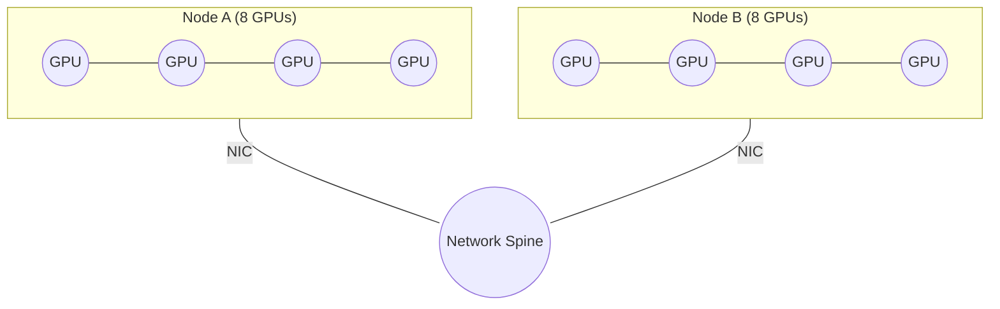

<div class="chapter-opener" markdown>
集合通信（collective communication）是代数的，网络却不是。同一个 AllReduce 在某种拓扑上可能最优，在另一种拓扑上却糟糕透顶。拓扑感知的集合通信通过选择尊重硬件层次的算法，来调和这两重现实。
</div>

<div class="investigation-question" markdown>
**问题**：你有每节点 8 块 GPU、共 512 个节点，以及 10GB 的梯度。你的节点间链路比 NVLink 慢 10 倍。你应该运行哪种 AllReduce？为什么最优算法会随拓扑而变？
</div>

!!! abstract "本章导览"
    **前置知识**：[第 13 章](13-collective-cost-model.md)（集合通信成本公式）

    **核心洞见**：代数性质赋予我们重新组合归约的自由，但拓扑决定哪种重组才是最优的。拓扑感知模型用每一层的成本和拥塞因子，取代单一的 $\alpha, \beta$。

## 非均匀网络

上一章的成本模型假设存在单一、均匀的网络。真实集群是层次化的：

- **节点内（Intra-node）**：GPU 通过 NVLink/NVSwitch 互联（极高带宽、低延迟）
- **节点间（Inter-node）**：网卡与交换机（较低带宽、较高延迟）

这种层次结构把一个逻辑上的集合通信操作，变成多个位于不同物理层级的集合通信操作。



## 代数给予自由，拓扑决定成本

结合律和交换律让你可以重新组合归约：

$$\sum_{i=1}^{P} x_i = \sum_{g=1}^{N} \left(\sum_{i \in g} x_i\right)$$

你可以先在节点内归约、再跨节点归约，或者反过来。两者都正确，但只有一个快。

## 拓扑感知的成本模型

把集群表示为一个图。每条边 $e$ 具有：

- **带宽** $B_e$（字节/秒）
- **延迟** $\alpha_e$（秒）

对任何集合通信调度方案，定义**边负载**（edge load）$L_e$ 为通过边 $e$ 发送的总字节数。

**带宽下界**：

$$T \ge \max_{e \in E} \frac{L_e}{B_e}$$

**延迟项**（调度的步数）：

$$T \approx s \cdot \alpha_{\max} + \max_{e \in E} \frac{L_e}{B_e}$$

这明确表达了关键思想：**最慢、负载最重的那条边**决定运行时间。

### 竞争因子

如果多个集合通信操作共用相同的边，有效带宽就会下降。用一个竞争因子 $C \ge 1$ 来建模：

$$T \approx s \cdot \alpha_{\max} + C \cdot \max_{e \in E} \frac{L_e}{B_e}$$

当 $C$ 增大时，能够降低慢速边负载的拓扑感知算法就变得必不可少。

## 推导层次化 AllReduce

结合律让我们先做局部归约，再做全局归约。设每节点 $G$ 块 GPU、共 $N$ 个节点（$P = GN$）：

1. **节点内 ReduceScatter**
2. **节点间 AllReduce**
3. **节点内 AllGather**

每一层都用环形算法：

$$T_{\text{hier}} \approx 2(G-1)\alpha_{\text{intra}} + 2\frac{G-1}{G}\frac{n}{\beta_{\text{intra}}} + 2(N-1)\alpha_{\text{inter}} + 2\frac{N-1}{N}\frac{n/G}{\beta_{\text{inter}}}$$

节点间项小了 $G$ 倍，因为只有 $n/G$ 字节离开每个节点。

### 推广到 L 层

如果拓扑有多个层级（例如 GPU、插槽、节点、机架），就反复套用同样的逻辑：

$$T \approx \sum_{\ell=1}^{L} \left( 2(p_\ell - 1)\alpha_\ell + 2\frac{p_\ell - 1}{p_\ell}\frac{n / \prod_{j<\ell} p_j}{\beta_\ell} \right)$$

每一层都在进入下一层之前先做归约，从而缩小最慢链路上的流量。

## 拥塞变成设计约束

超售（oversubscribed）网络会造成瓶颈。定义**超售比**（oversubscription ratio）：

$$\sigma = \frac{\text{total injection bandwidth}}{\text{bisection bandwidth}}$$

当 $\sigma > 1$ 时，任何把完整流量送上主干（spine）的算法都会受限于竞争。层次化集合通信通过让数据在触及瓶颈之前先完成归约，从而避免这一点。

## 决策流程：按层级选择算法

1. **识别拓扑层级**（GPU、节点、机架）及其 $(\alpha, \beta)$。
2. **计算每层的消息大小**（先是 $n$，然后 $n/G$，然后 $n/(G \cdot R)$……）。
3. **按层选择算法**：
   - 大消息：环形
   - 小消息：树形
4. **估算边负载**，检查是否超售。
5. **如果竞争占主导**，在数据跨过慢速链路之前先做归约。

这是集合通信层面的设备网格（device mesh）抽象——你将在[第 23 章](../composition/23-device-mesh.md)见到它。

## 案例研究：8 节点 × 8 GPU，10GB 梯度

**假设**：
- $G = 8$，$N = 8$，$n = 10$ GB
- $\alpha_{\text{intra}} = 1$ 微秒，$\beta_{\text{intra}} = 600$ GB/s
- $\alpha_{\text{inter}} = 5$ 微秒，$\beta_{\text{inter}} = 50$ GB/s

**扁平环形（64 块 GPU，受节点间支配）**：

$$T_{\text{flat}} = 2(P-1)\alpha_{\text{inter}} + 2\frac{P-1}{P}\frac{n}{\beta_{\text{inter}}}$$

$$= 0.63 \text{ ms} + 393.8 \text{ ms} \approx 394 \text{ ms}$$

**层次化环形**：

$$T_{\text{intra}} = 2(G-1)\alpha_{\text{intra}} + 2\frac{G-1}{G}\frac{n}{\beta_{\text{intra}}} = 0.014 \text{ ms} + 29.2 \text{ ms} \approx 29.2 \text{ ms}$$

$$T_{\text{inter}} = 2(N-1)\alpha_{\text{inter}} + 2\frac{N-1}{N}\frac{n/G}{\beta_{\text{inter}}} = 0.07 \text{ ms} + 43.8 \text{ ms} \approx 43.9 \text{ ms}$$

$$T_{\text{hier}} \approx 29.2 \text{ ms} + 43.9 \text{ ms} = 73.1 \text{ ms}$$

**结果**：层次化大约快 **5.4 倍**。

**流量核对**：

$$\text{Flat ring bytes per GPU} \approx 2\frac{63}{64} \cdot 10 \approx 19.7 \text{ GB}$$

$$\text{Inter-node bytes per GPU (hier)} \approx 2\frac{7}{8} \cdot \frac{10}{8} \approx 2.19 \text{ GB}$$

节点间流量下降了 **9 倍**，这正是层次化 AllReduce 在真实集群上占主导的原因。如果节点间网络超售，就把节点间项乘以竞争因子 $C$。

### 流量热力图（节点间负载）

相对于扁平环形归一化后的节点间负载：

| 算法 | 每 GPU 节点间字节数 | 相对负载 |
|-----------|--------------------------|---------------|
| 扁平环形 | 19.7 GB | ########## (1.00) |
| 层次化环形 | 2.19 GB | # (0.11) |

### 扁平与层次化路径

在扁平环形中，**每一跳**都可能跨越节点间链路。在层次化环形中，节点间流量**只在节点之间**发生，而且是在节点内归约之后。

```mermaid
flowchart TB
    subgraph flat["Flat ring (all GPUs)"]
        direction LR
        F1((GPU)) --> F2((GPU)) --> F3((GPU)) --> F4((GPU))
        F4 --> F1
    end

    subgraph hier["Hierarchical ring (node-level)"]
        direction TB
        subgraph n1["Node A (intra-node reduce)"]
            A1((GPU)) --- A2((GPU)) --- A3((GPU)) --- A4((GPU))
        end
        subgraph n2["Node B (intra-node reduce)"]
            B1((GPU)) --- B2((GPU)) --- B3((GPU)) --- B4((GPU))
        end
        subgraph n3["Node C (intra-node reduce)"]
            C1((GPU)) --- C2((GPU)) --- C3((GPU)) --- C4((GPU))
        end
        n1 == inter-node == n2
        n2 == inter-node == n3
        n3 == inter-node == n1
    end
```

### 玩具示例：2 节点 × 2 GPU

假设每块 GPU 向一次 AllReduce 贡献 $n = 1$ GB。

**扁平环形（P=4）**：

$$\text{Inter-node bytes per GPU} \approx 2\frac{P-1}{P}n = 1.5 \text{ GB}$$

**层次化环形（G=2，N=2）**：

$$\text{Inter-node bytes per GPU} \approx 2\frac{N-1}{N}\frac{n}{G} = 0.5 \text{ GB}$$

| 指标 | 扁平环形 | 层次化环形 |
|--------|-----------|-----------|
| 每 GPU 节点间字节数 | 1.5 GB | 0.5 GB |
| 相对负载 | 1.00 | 0.33 |

### 边负载表（玩具示例）

假设一个两节点集群，Node A 与 Node B 之间只有一条节点间链路。

| 算法 | 每 GPU 节点间字节数 | 节点间链路总字节数 |
|-----------|--------------------------|--------------------------------|
| 扁平环形（P=4） | 1.5 GB | $4 \times 1.5 = 6$ GB |
| 层次化环形（G=2，N=2） | 0.5 GB | $4 \times 0.5 = 2$ GB |

这张表展示了同样的 3 倍节点间负载下降，只是改用唯一瓶颈链路上的总流量来表达。它忽略了全双工重叠和协议开销，因此这些数字只应作为下界参考。

## 练习题

1. 对 $G=8$、$N=16$，推导每层都用环形算法的层次化 AllReduce 总时间。

??? success "解答"
    **1. 层次化环形（G=8，N=16）：**

    $$T_{\text{hier}} = 2(G-1)\alpha_{\text{intra}} + 2\frac{G-1}{G}\frac{n}{\beta_{\text{intra}}} + 2(N-1)\alpha_{\text{inter}} + 2\frac{N-1}{N}\frac{n/G}{\beta_{\text{inter}}}$$

    代入 $G=8, N=16$：

    $$T_{\text{hier}} = 14\alpha_{\text{intra}} + \frac{7}{4}\frac{n}{\beta_{\text{intra}}} + 30\alpha_{\text{inter}} + \frac{15}{64}\frac{n}{\beta_{\text{inter}}}$$

2. 已知 $\alpha_{\text{inter}} = 5e-6$ 秒、$\beta_{\text{inter}} = 50$ GB/s、$N=8$，求树形优于环形的节点间消息大小 $n'$。

??? success "解答"
    **2. 树形与环形的交叉点（节点间）：**

    环形：
    $$T_{\text{ring}} = 2(N-1)\alpha + 2\frac{N-1}{N}\frac{n'}{\beta}$$

    树形：
    $$T_{\text{tree}} = 2\log_2 N \cdot \alpha + 2\log_2 N \cdot \frac{n'}{\beta}$$

    求解 $T_{\text{tree}} < T_{\text{ring}}$：

    $$n' < \beta \cdot \alpha \cdot \frac{(N-1) - \log_2 N}{\log_2 N - (N-1)/N}$$

    对 $N=8$、$\alpha = 5e-6$ 秒、$\beta = 50$ GB/s：

    $$n' \approx 0.47 \text{ MB}$$

    当节点间这一步中每 GPU 的消息小于约 $0.47$ MB 时，树形更快。

3. 如果超售比 $\sigma = 3$，这会如何改变你的算法选择？

??? success "解答"
    **3. 超售的影响：**

    有效节点间带宽变为：

    $$\beta_{\text{inter,eff}} = \frac{\beta_{\text{inter}}}{\sigma}$$

    因此节点间项被乘以 $\sigma$。这更加凸显了在数据跨越慢速链路之前先做归约的重要性，从而更倾向于选择层次化集合通信和更小的节点间分组。

4. 使用案例研究中的数字，计算 $\sigma = 3$ 时新的 $T_{\text{hier}}$。

??? success "解答"
    **4. 带 $\sigma = 3$ 的案例研究：**

    只有节点间项被放大：

    $$T_{\text{inter,new}} = \sigma \cdot T_{\text{inter}} = 3 \times 43.9 \text{ ms} = 131.7 \text{ ms}$$

    $$T_{\text{hier,new}} \approx T_{\text{intra}} + T_{\text{inter,new}} = 29.2 \text{ ms} + 131.7 \text{ ms} = 160.9 \text{ ms}$$

    依然远快于扁平环形基线（约 394 毫秒）。