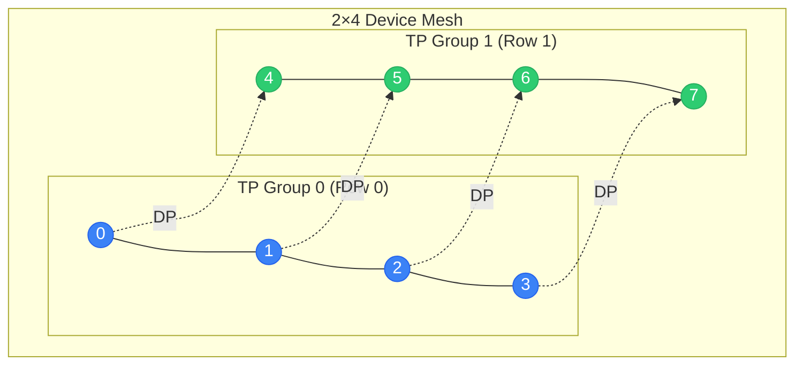

<div class="chapter-opener" markdown>
一个 GPU 集群并不是一个扁平的集合——它是一个有结构的拓扑，每一层的带宽各不相同。设备网格（device mesh）抽象捕捉了这种结构，使得并行策略可以系统化地组合。
</div>

<div class="investigation-question" markdown>
**问题**：你有 4096 块 GPU，组织为 512 个节点 × 每节点 8 块 GPU。你如何表达「节点内张量并行（Tensor Parallelism）、跨节点数据并行」？什么样的抽象能让这类组合既自然又正确？
</div>

<div class="notation-banner" markdown>
**本章符号：** $P$ = GPU 总数，$d_i$ = 网格各维度的大小。参见[符号表](../appendices/notation.md)。
</div>

!!! abstract "承上启下：第三至第五部分"
    你现在已经拥有了所有单独的部件：**集合通信**（[第三部分](../collectives/11-primitives-properties.md)）、**并行策略**——DP、TP、PP、SP、EP（[第四部分](../parallelism/14-data-parallelism-associativity.md)），以及像 ZeRO 这样的**内存优化**（[第五部分](../memory/19-memory-equation.md)）。本部分教你如何把它们组合起来。我们将使用设备网格抽象，在同一集群上组合多种策略，并把每种策略匹配到硬件层次的恰当层级。

## 从扁平到结构化

早期的分布式训练把 GPU 当作一个扁平列表：

```python
# Flat view: just a list of ranks
world = [0, 1, 2, 3, 4, 5, 6, 7]
```

这忽略了关键结构：

- GPU 0–7 位于同一节点（由 NVLink 连接）
- GPU 0 和 8 位于不同节点（由更慢的网络连接）

**设备网格**抽象捕捉了拓扑：

```python
# Structured view: 2D mesh matching hardware
mesh = DeviceMesh(
    devices=[[0, 1, 2, 3, 4, 5, 6, 7],    # Node 0
             [8, 9, 10, 11, 12, 13, 14, 15]],  # Node 1
    axis_names=["dp", "tp"]  # Rows = data parallel, Cols = tensor parallel
)
```

## 数学基础

### 把设备网格看作 N 维数组

设备网格 $\mathcal{M}$ 是一个由设备标识符构成的 $n$ 维数组：

$$\mathcal{M}: \mathbb{Z}_{d_1} \times \mathbb{Z}_{d_2} \times \ldots \times \mathbb{Z}_{d_n} \to \text{DeviceID}$$

其中 $d_i$ 是第 $i$ 维的大小。

**示例**：维度为 $(D, T)$ 的二维网格：

$$\mathcal{M}[i, j] = \text{device at data-parallel rank } i, \text{ tensor-parallel rank } j$$

### 由网格切片得到进程组

网格的每个轴都定义了一族进程组：

**定义（网格切片，mesh slice）**：对于维度为 $(d_1, d_2, \ldots, d_n)$ 的网格 $\mathcal{M}$，沿轴 $k$ 在索引 $(i_1, \ldots, i_{k-1}, :, i_{k+1}, \ldots, i_n)$ 处的切片是集合：

$$S_k(i_1, \ldots, i_{k-1}, i_{k+1}, \ldots, i_n) = \{\mathcal{M}[i_1, \ldots, i_{k-1}, j, i_{k+1}, \ldots, i_n] : j \in \mathbb{Z}_{d_k}\}$$

**示例**：在 2×4 网格中：

```
        TP axis (axis 1)
         0   1   2   3
DP    0 [0] [1] [2] [3]    ← TP group 0: {0,1,2,3}
axis  1 [4] [5] [6] [7]    ← TP group 1: {4,5,6,7}
         ↑   ↑   ↑   ↑
        DP groups: {0,4}, {1,5}, {2,6}, {3,7}
```



**图例**：实线 = TP 组（快速 NVLink），虚线 = DP 组（网络）。

### 网格与进程组的对应关系

**定理（网格-进程组双射）**：对于维度为 $(d_1, \ldots, d_n)$ 的 $n$ 维网格：

1. 每个轴 $k$ 定义 $\prod_{i \neq k} d_i$ 个互不相交的进程组
2. 每个进程组的大小为 $d_k$
3. 每个设备在每个轴上恰好属于一个进程组
4. 同一轴上的各组是设备集合的一个划分

**证明**：

对于轴 $k$，固定其他所有轴的索引：$(i_1, \ldots, i_{k-1}, i_{k+1}, \ldots, i_n)$。这样的组合共有 $\prod_{i \neq k} d_i$ 个，每一个定义一个组。

每个组的大小为 $d_k$（该维度在 $\mathbb{Z}_{d_k}$ 上变化）。

设备 $\mathcal{M}[j_1, \ldots, j_n]$ 属于轴 $k$ 上固定索引为 $(j_1, \ldots, j_{k-1}, j_{k+1}, \ldots, j_n)$ 的那个组。

它们构成划分，因为固定其他索引、让索引 $j_k$ 变化会遍历该组内全部 $d_k$ 个设备，而不同的固定索引会得到互不相交的组。$\square$

## 实现

### 核心 DeviceMesh 类

```python
import torch
import torch.distributed as dist
from typing import List, Dict, Tuple, Optional, Union
from dataclasses import dataclass
import numpy as np
from functools import cached_property

@dataclass(frozen=True)
class MeshCoordinate:
    """Immutable coordinate in a device mesh."""
    coords: Tuple[int, ...]

    def __getitem__(self, idx: int) -> int:
        return self.coords[idx]

    def replace(self, axis: int, value: int) -> 'MeshCoordinate':
        """Return new coordinate with one axis changed."""
        coords = list(self.coords)
        coords[axis] = value
        return MeshCoordinate(tuple(coords))

class DeviceMesh:
    """
    Multi-dimensional mesh of devices for organizing parallelism.

    A DeviceMesh maps logical coordinates to physical device IDs
    and provides process groups for collective operations along
    each axis.
    """

    def __init__(
        self,
        devices: Union[List, np.ndarray, torch.Tensor],
        axis_names: Optional[List[str]] = None,
        mesh_dim_names: Optional[List[str]] = None  # Alias for axis_names
    ):
        """
        Initialize a device mesh.

        Args:
            devices: N-dimensional array of device IDs
            axis_names: Names for each axis (e.g., ["dp", "tp"])
        """
        if isinstance(devices, torch.Tensor):
            devices = devices.numpy()
        elif isinstance(devices, list):
            devices = np.array(devices)

        self._devices = devices
        self._shape = devices.shape
        self._ndim = len(self._shape)

        # Handle axis names
        names = axis_names or mesh_dim_names
        if names is not None:
            if len(names) != self._ndim:
                raise ValueError(
                    f"axis_names length {len(names)} != mesh dimensions {self._ndim}"
                )
            self._axis_names = tuple(names)
        else:
            self._axis_names = tuple(f"dim{i}" for i in range(self._ndim))

        # Map device ID to coordinate
        self._device_to_coord: Dict[int, MeshCoordinate] = {}
        for idx in np.ndindex(self._shape):
            device_id = int(devices[idx])
            self._device_to_coord[device_id] = MeshCoordinate(idx)

        # Process groups for each axis (created lazily)
        self._process_groups: Dict[Tuple[str, Tuple[int, ...]], dist.ProcessGroup] = {}

    @property
    def shape(self) -> Tuple[int, ...]:
        """Shape of the mesh."""
        return self._shape

    @property
    def ndim(self) -> int:
        """Number of dimensions."""
        return self._ndim

    @property
    def size(self) -> int:
        """Total number of devices."""
        return int(np.prod(self._shape))

    @property
    def axis_names(self) -> Tuple[str, ...]:
        """Names of each axis."""
        return self._axis_names

    def get_axis_size(self, axis: Union[int, str]) -> int:
        """Get size of a specific axis."""
        if isinstance(axis, str):
            axis = self._axis_names.index(axis)
        return self._shape[axis]

    def get_coordinate(self, device_id: int) -> MeshCoordinate:
        """Get mesh coordinate for a device."""
        return self._device_to_coord[device_id]

    def get_device(self, *coords) -> int:
        """Get device ID at coordinate."""
        if len(coords) == 1 and isinstance(coords[0], (tuple, list, MeshCoordinate)):
            coords = tuple(coords[0]) if isinstance(coords[0], MeshCoordinate) else tuple(coords[0])
        return int(self._devices[coords])

    def get_local_rank(self, axis: Union[int, str], device_id: Optional[int] = None) -> int:
        """Get rank along a specific axis."""
        if device_id is None:
            device_id = dist.get_rank()
        coord = self.get_coordinate(device_id)
        axis_idx = self._axis_names.index(axis) if isinstance(axis, str) else axis
        return coord[axis_idx]

    def get_group(
        self,
        axis: Union[int, str],
        device_id: Optional[int] = None
    ) -> dist.ProcessGroup:
        """
        Get the process group for communication along an axis.

        All devices with the same coordinates on OTHER axes
        form a group along this axis.
        """
        if device_id is None:
            device_id = dist.get_rank()

        coord = self.get_coordinate(device_id)
        axis_idx = self._axis_names.index(axis) if isinstance(axis, str) else axis

        # Key: axis + coordinates on all other axes
        other_coords = tuple(coord[i] for i in range(self._ndim) if i != axis_idx)
        key = (self._axis_names[axis_idx], other_coords)

        if key not in self._process_groups:
            # Find all devices in this group
            group_devices = []
            for rank in range(self._shape[axis_idx]):
                new_coord = coord.replace(axis_idx, rank)
                group_devices.append(self.get_device(*new_coord.coords))

            # Create process group
            group = dist.new_group(ranks=sorted(group_devices))
            self._process_groups[key] = group

        return self._process_groups[key]

    def get_group_ranks(
        self,
        axis: Union[int, str],
        device_id: Optional[int] = None
    ) -> List[int]:
        """Get all device IDs in the process group along an axis."""
        if device_id is None:
            device_id = dist.get_rank()

        coord = self.get_coordinate(device_id)
        axis_idx = self._axis_names.index(axis) if isinstance(axis, str) else axis

        group_devices = []
        for rank in range(self._shape[axis_idx]):
            new_coord = coord.replace(axis_idx, rank)
            group_devices.append(self.get_device(*new_coord.coords))

        return group_devices

    def __repr__(self) -> str:
        return f"DeviceMesh(shape={self._shape}, axes={self._axis_names})"

def create_device_mesh(
    shape: Tuple[int, ...],
    axis_names: List[str],
    device_ids: Optional[List[int]] = None
) -> DeviceMesh:
    """
    Create a device mesh with given shape.

    Args:
        shape: Dimensions of the mesh (e.g., (2, 4) for 2×4)
        axis_names: Names for each dimension
        device_ids: Optional list of device IDs (defaults to range(product(shape)))

    Returns:
        DeviceMesh with specified configuration
    """
    total_devices = int(np.prod(shape))

    if device_ids is None:
        device_ids = list(range(total_devices))
    elif len(device_ids) != total_devices:
        raise ValueError(
            f"device_ids length {len(device_ids)} != mesh size {total_devices}"
        )

    devices = np.array(device_ids).reshape(shape)
    return DeviceMesh(devices, axis_names=axis_names)
```

### 网格感知的集合通信

```python
class MeshCollectives:
    """
    Collective operations organized by mesh axes.

    Instead of specifying process groups directly, operations
    are named by the mesh axis they operate along.
    """

    def __init__(self, mesh: DeviceMesh):
        self.mesh = mesh
        self._my_rank = dist.get_rank()

    def all_reduce(
        self,
        tensor: torch.Tensor,
        axis: Union[int, str],
        op: dist.ReduceOp = dist.ReduceOp.SUM
    ) -> torch.Tensor:
        """AllReduce along a mesh axis."""
        group = self.mesh.get_group(axis)
        dist.all_reduce(tensor, op=op, group=group)
        return tensor

    def all_gather(
        self,
        tensor: torch.Tensor,
        axis: Union[int, str]
    ) -> torch.Tensor:
        """AllGather along a mesh axis, concatenating results."""
        group = self.mesh.get_group(axis)
        axis_size = self.mesh.get_axis_size(axis)

        # Prepare output buffer
        gather_list = [torch.empty_like(tensor) for _ in range(axis_size)]
        dist.all_gather(gather_list, tensor, group=group)

        return torch.cat(gather_list, dim=0)

    def reduce_scatter(
        self,
        tensor: torch.Tensor,
        axis: Union[int, str],
        op: dist.ReduceOp = dist.ReduceOp.SUM
    ) -> torch.Tensor:
        """ReduceScatter along a mesh axis."""
        group = self.mesh.get_group(axis)
        axis_size = self.mesh.get_axis_size(axis)

        # Split input
        chunks = tensor.chunk(axis_size, dim=0)
        output = torch.empty_like(chunks[0])

        dist.reduce_scatter(output, list(chunks), op=op, group=group)
        return output

    def broadcast(
        self,
        tensor: torch.Tensor,
        axis: Union[int, str],
        src_rank: int = 0
    ) -> torch.Tensor:
        """Broadcast along a mesh axis from local rank src_rank."""
        group = self.mesh.get_group(axis)
        ranks = self.mesh.get_group_ranks(axis)
        src_global = ranks[src_rank]

        dist.broadcast(tensor, src=src_global, group=group)
        return tensor
```

## 网格拓扑

不同的集群配置适合不同的网格形状。

### 单节点网格

一个节点上的 8 块 GPU，由 NVLink 连接：

```
DeviceMesh shape: (8,)
Axis: ["tp"]

  [0]-[1]-[2]-[3]-[4]-[5]-[6]-[7]
         All connected via NVLink
```

所有 GPU 都能以约 900 GB/s（NVLink 4.0）通信。

### 多节点二维网格

跨 4 个节点的 32 块 GPU：

```
DeviceMesh shape: (4, 8)
Axes: ["dp", "tp"]

Node 0: [0  1  2  3  4  5  6  7]   ← TP group (NVLink)
Node 1: [8  9  10 11 12 13 14 15]
Node 2: [16 17 18 19 20 21 22 23]
Node 3: [24 25 26 27 28 29 30 31]
         ↓        ↓
        DP groups (Network)
```

节点内做 TP（快），跨节点做 DP（较慢但流量更小）。

### 面向大集群的三维网格

512 块 GPU 的三维并行：

```
DeviceMesh shape: (8, 8, 8)
Axes: ["dp", "pp", "tp"]

         PP (pipeline)
         ↗
      /─────────────\
     /               \
DP ←  8×8×8 = 512    → TP
     \               /
      \─────────────/
```

### 层次化网格

对于有多个层次级别的集群：

```python
def create_hierarchical_mesh(
    num_nodes: int,
    gpus_per_node: int,
    axis_names: List[str]
) -> DeviceMesh:
    """
    Create mesh respecting node boundaries.

    Places consecutive ranks on same node for optimal NVLink usage.
    """
    if len(axis_names) != 2:
        raise ValueError("Hierarchical mesh requires exactly 2 axes")

    devices = np.arange(num_nodes * gpus_per_node).reshape(num_nodes, gpus_per_node)
    return DeviceMesh(devices, axis_names=axis_names)

# Example: 64 nodes × 8 GPUs
mesh = create_hierarchical_mesh(
    num_nodes=64,
    gpus_per_node=8,
    axis_names=["dp", "tp"]
)
# DP across nodes, TP within nodes
```

## 网格变换

网格可以被重塑和转置，以表达不同的并行模式。

### 重塑

```python
def reshape_mesh(
    mesh: DeviceMesh,
    new_shape: Tuple[int, ...],
    new_axis_names: List[str]
) -> DeviceMesh:
    """
    Reshape mesh while preserving device ordering.

    The product of dimensions must remain constant.
    """
    if np.prod(mesh.shape) != np.prod(new_shape):
        raise ValueError(
            f"Cannot reshape {mesh.shape} to {new_shape}: "
            f"sizes {np.prod(mesh.shape)} != {np.prod(new_shape)}"
        )

    devices = mesh._devices.reshape(new_shape)
    return DeviceMesh(devices, axis_names=new_axis_names)

# Example: Convert 2D to 3D
mesh_2d = create_device_mesh((4, 8), ["a", "b"])  # 32 devices
mesh_3d = reshape_mesh(mesh_2d, (2, 4, 4), ["dp", "pp", "tp"])
```

### 转置

```python
def transpose_mesh(
    mesh: DeviceMesh,
    axes: Tuple[int, ...]
) -> DeviceMesh:
    """
    Transpose mesh axes.

    This reorders which dimension corresponds to which parallelism type.
    """
    if sorted(axes) != list(range(mesh.ndim)):
        raise ValueError(f"Invalid axis permutation: {axes}")

    devices = np.transpose(mesh._devices, axes)
    new_names = [mesh.axis_names[i] for i in axes]
    return DeviceMesh(devices, axis_names=new_names)

# Example: Swap DP and TP axes
mesh = create_device_mesh((4, 8), ["dp", "tp"])
mesh_t = transpose_mesh(mesh, (1, 0))  # Now shape (8, 4) with ["tp", "dp"]
```

### 提取子网格

```python
def get_submesh(
    mesh: DeviceMesh,
    axis: Union[int, str],
    index: int
) -> DeviceMesh:
    """
    Extract a submesh by fixing one axis at a specific index.

    Returns a mesh with one fewer dimension.
    """
    axis_idx = mesh.axis_names.index(axis) if isinstance(axis, str) else axis

    # Slice along the specified axis
    slices = [slice(None)] * mesh.ndim
    slices[axis_idx] = index
    devices = mesh._devices[tuple(slices)]

    # Remove the fixed axis name
    new_names = [n for i, n in enumerate(mesh.axis_names) if i != axis_idx]

    # Handle 0-d result
    if devices.ndim == 0:
        devices = devices.reshape(1)
        new_names = ["single"]

    return DeviceMesh(devices, axis_names=new_names)

# Example: Get the TP mesh for a specific DP rank
mesh = create_device_mesh((4, 8), ["dp", "tp"])
tp_mesh_dp0 = get_submesh(mesh, "dp", 0)  # Shape (8,), devices [0..7]
```

## 用设备网格做分片

网格抽象使声明式的分片规格成为可能。

### DTensor 风格的分片

```python
from enum import Enum
from typing import Dict, List, Sequence

class PlacementType(Enum):
    SHARD = "shard"      # Tensor is sharded along this axis
    REPLICATE = "replicate"  # Tensor is replicated along this axis

@dataclass
class Placement:
    """How a tensor dimension maps to a mesh dimension."""
    type: PlacementType
    mesh_dim: str
    tensor_dim: Optional[int] = None  # For SHARD: which tensor dim to shard

class ShardingSpec:
    """
    Specification for how a tensor is distributed across a mesh.

    Each mesh dimension has a placement: either SHARD (tensor split)
    or REPLICATE (tensor copied).
    """

    def __init__(
        self,
        mesh: DeviceMesh,
        placements: List[Placement]
    ):
        if len(placements) != mesh.ndim:
            raise ValueError(
                f"Need {mesh.ndim} placements, got {len(placements)}"
            )
        self.mesh = mesh
        self.placements = placements

    def get_local_shape(self, global_shape: Tuple[int, ...]) -> Tuple[int, ...]:
        """Compute local tensor shape given global shape."""
        local_shape = list(global_shape)

        for placement in self.placements:
            if placement.type == PlacementType.SHARD:
                dim = placement.tensor_dim
                mesh_size = self.mesh.get_axis_size(placement.mesh_dim)
                if local_shape[dim] % mesh_size != 0:
                    raise ValueError(
                        f"Dimension {dim} (size {local_shape[dim]}) "
                        f"not divisible by mesh dim {placement.mesh_dim} (size {mesh_size})"
                    )
                local_shape[dim] //= mesh_size

        return tuple(local_shape)

    def get_local_tensor(
        self,
        global_tensor: torch.Tensor,
        device_id: Optional[int] = None
    ) -> torch.Tensor:
        """Extract local shard from global tensor."""
        if device_id is None:
            device_id = dist.get_rank()

        coord = self.mesh.get_coordinate(device_id)
        local_tensor = global_tensor

        for i, placement in enumerate(self.placements):
            if placement.type == PlacementType.SHARD:
                dim = placement.tensor_dim
                mesh_size = self.mesh.get_axis_size(placement.mesh_dim)
                axis_idx = self.mesh.axis_names.index(placement.mesh_dim)
                rank = coord[axis_idx]

                # Chunk and take local piece
                chunks = local_tensor.chunk(mesh_size, dim=dim)
                local_tensor = chunks[rank]

        return local_tensor.contiguous()

# Example usage
mesh = create_device_mesh((4, 2), ["dp", "tp"])
spec = ShardingSpec(mesh, [
    Placement(PlacementType.REPLICATE, "dp"),  # Replicated across DP
    Placement(PlacementType.SHARD, "tp", tensor_dim=1)  # Sharded on dim 1 across TP
])

# Global weight: (1024, 4096)
# Local on each TP rank: (1024, 2048)
local_shape = spec.get_local_shape((1024, 4096))  # (1024, 2048)
```

### 在不同分片规格之间重分布

```python
def redistribute(
    tensor: torch.Tensor,
    current_spec: ShardingSpec,
    target_spec: ShardingSpec,
) -> torch.Tensor:
    """
    Redistribute tensor from one sharding to another.

    This may involve:

    - AllGather (shard → replicate)
    - Scatter or chunk (replicate → shard)
    - AlltoAll (reshard to different dimension)
    """
    if current_spec.mesh is not target_spec.mesh:
        raise ValueError("Redistribution requires same mesh")

    mesh = current_spec.mesh
    result = tensor

    for i, (curr, tgt) in enumerate(zip(current_spec.placements, target_spec.placements)):
        mesh_dim = curr.mesh_dim
        group = mesh.get_group(mesh_dim)
        mesh_size = mesh.get_axis_size(mesh_dim)

        if curr.type == tgt.type:
            # Same placement, no communication needed
            if curr.type == PlacementType.SHARD and curr.tensor_dim != tgt.tensor_dim:
                # Reshard to different dimension - requires AlltoAll
                result = _reshard_alltoall(result, curr.tensor_dim, tgt.tensor_dim, group, mesh_size)
        elif curr.type == PlacementType.SHARD and tgt.type == PlacementType.REPLICATE:
            # Shard → Replicate: AllGather
            result = _allgather_tensor(result, curr.tensor_dim, group, mesh_size)
        elif curr.type == PlacementType.REPLICATE and tgt.type == PlacementType.SHARD:
            # Replicate → Shard: Local chunk
            coord = mesh.get_coordinate(dist.get_rank())
            axis_idx = mesh.axis_names.index(mesh_dim)
            rank = coord[axis_idx]
            chunks = result.chunk(mesh_size, dim=tgt.tensor_dim)
            result = chunks[rank].contiguous()

    return result

def _allgather_tensor(
    tensor: torch.Tensor,
    dim: int,
    group: dist.ProcessGroup,
    world_size: int
) -> torch.Tensor:
    """AllGather and concatenate along dimension."""
    gather_list = [torch.empty_like(tensor) for _ in range(world_size)]
    dist.all_gather(gather_list, tensor, group=group)
    return torch.cat(gather_list, dim=dim)

def _reshard_alltoall(
    tensor: torch.Tensor,
    src_dim: int,
    dst_dim: int,
    group: dist.ProcessGroup,
    world_size: int
) -> torch.Tensor:
    """Reshard from one dimension to another using AlltoAll."""
    # Implementation depends on specific requirements
    # This is a simplified placeholder
    raise NotImplementedError("AlltoAll resharding")
```

## 把并行策略映射到网格

每种并行策略都自然地映射到网格维度。

### 数据并行

```python
def setup_data_parallel(mesh: DeviceMesh, dp_axis: str = "dp"):
    """
    Configure data parallelism along a mesh axis.

    All parameters are replicated along dp_axis.
    Gradients are AllReduced along dp_axis.
    """
    class DPWrapper(nn.Module):
        def __init__(self, module: nn.Module, mesh: DeviceMesh, axis: str):
            super().__init__()
            self.module = module
            self.mesh = mesh
            self.axis = axis
            self.collectives = MeshCollectives(mesh)

        def forward(self, *args, **kwargs):
            return self.module(*args, **kwargs)

        def allreduce_gradients(self):
            """AllReduce gradients along DP axis."""
            for param in self.module.parameters():
                if param.grad is not None:
                    self.collectives.all_reduce(param.grad, self.axis)
                    # Average the gradients
                    param.grad /= self.mesh.get_axis_size(self.axis)

    return DPWrapper
```

### 张量并行

```python
def setup_tensor_parallel(mesh: DeviceMesh, tp_axis: str = "tp"):
    """
    Configure tensor parallelism along a mesh axis.

    Parameters are sharded along tp_axis.
    Activations require collective operations for consistency.
    """
    class TPColumnLinear(nn.Module):
        """Linear layer with column-parallel sharding."""

        def __init__(
            self,
            in_features: int,
            out_features: int,
            mesh: DeviceMesh,
            axis: str,
            bias: bool = True
        ):
            super().__init__()
            self.mesh = mesh
            self.axis = axis
            self.tp_size = mesh.get_axis_size(axis)
            self.tp_rank = mesh.get_local_rank(axis)

            # Shard output dimension
            assert out_features % self.tp_size == 0
            self.local_out = out_features // self.tp_size

            self.weight = nn.Parameter(
                torch.empty(self.local_out, in_features)
            )
            if bias:
                self.bias = nn.Parameter(torch.empty(self.local_out))
            else:
                self.register_parameter('bias', None)

            self._init_weights()

        def _init_weights(self):
            nn.init.kaiming_uniform_(self.weight)
            if self.bias is not None:
                nn.init.zeros_(self.bias)

        def forward(self, x: torch.Tensor) -> torch.Tensor:
            # Local matmul: (B, S, in) @ (in, local_out)^T → (B, S, local_out)
            return F.linear(x, self.weight, self.bias)

    return TPColumnLinear
```

### 流水线并行

```python
def setup_pipeline_parallel(mesh: DeviceMesh, pp_axis: str = "pp"):
    """
    Configure pipeline parallelism along a mesh axis.

    Model layers are partitioned across pp_axis.
    Activations are sent point-to-point between adjacent stages.
    """
    class PPStage:
        def __init__(
            self,
            layers: nn.ModuleList,
            mesh: DeviceMesh,
            axis: str
        ):
            self.layers = layers
            self.mesh = mesh
            self.axis = axis
            self.pp_rank = mesh.get_local_rank(axis)
            self.pp_size = mesh.get_axis_size(axis)
            self.is_first = self.pp_rank == 0
            self.is_last = self.pp_rank == self.pp_size - 1

        def get_prev_rank(self) -> Optional[int]:
            """Get global rank of previous pipeline stage."""
            if self.is_first:
                return None
            group_ranks = self.mesh.get_group_ranks(self.axis)
            return group_ranks[self.pp_rank - 1]

        def get_next_rank(self) -> Optional[int]:
            """Get global rank of next pipeline stage."""
            if self.is_last:
                return None
            group_ranks = self.mesh.get_group_ranks(self.axis)
            return group_ranks[self.pp_rank + 1]

    return PPStage
```

## 自动构建网格

给定硬件拓扑，自动构建最优网格。

```python
from dataclasses import dataclass
from typing import Optional

@dataclass
class HardwareTopology:
    """Description of cluster hardware."""
    num_nodes: int
    gpus_per_node: int
    intra_node_bandwidth: float  # GB/s (NVLink)
    inter_node_bandwidth: float  # GB/s (Network)

def auto_mesh(
    topology: HardwareTopology,
    dp_degree: Optional[int] = None,
    tp_degree: Optional[int] = None,
    pp_degree: Optional[int] = None
) -> DeviceMesh:
    """
    Automatically construct mesh given parallelism degrees.

    Prioritizes:
    1. TP within nodes (needs high bandwidth)
    2. PP across close nodes (moderate bandwidth)
    3. DP anywhere (low bandwidth due to ZeRO)
    """
    total_gpus = topology.num_nodes * topology.gpus_per_node

    # Infer missing degrees
    specified_product = 1
    unspecified = []

    for name, degree in [("dp", dp_degree), ("tp", tp_degree), ("pp", pp_degree)]:
        if degree is not None:
            specified_product *= degree
        else:
            unspecified.append(name)

    if total_gpus % specified_product != 0:
        raise ValueError(
            f"Total GPUs {total_gpus} not divisible by specified degrees {specified_product}"
        )

    remaining = total_gpus // specified_product

    # Assign remaining to unspecified dimensions
    if len(unspecified) == 1:
        if "dp" in unspecified:
            dp_degree = remaining
        elif "tp" in unspecified:
            tp_degree = remaining
        else:
            pp_degree = remaining
    elif len(unspecified) > 1:
        # Default: remaining goes to DP
        dp_degree = dp_degree or remaining
        tp_degree = tp_degree or 1
        pp_degree = pp_degree or 1

    # Validate TP fits within node
    if tp_degree > topology.gpus_per_node:
        raise ValueError(
            f"TP degree {tp_degree} exceeds GPUs per node {topology.gpus_per_node}"
        )

    # Construct mesh: (DP, PP, TP)
    # Arrange so TP is innermost (consecutive ranks on same node)
    shape = (dp_degree, pp_degree, tp_degree)
    devices = np.arange(total_gpus).reshape(shape)

    return DeviceMesh(devices, axis_names=["dp", "pp", "tp"])

# Example
topology = HardwareTopology(
    num_nodes=64,
    gpus_per_node=8,
    intra_node_bandwidth=600.0,
    inter_node_bandwidth=50.0
)

mesh = auto_mesh(topology, dp_degree=64, tp_degree=8, pp_degree=1)
# Shape: (64, 1, 8) - 64 DP groups, each with 8 TP ranks
```

## 练习题

1. **网格构建**：为 256 块 GPU 创建一个三维网格，DP=8、PP=4、TP=8。画出其结构，标出每个进程组包含哪些 rank。

??? success "解答"
    **验证维度：**

    $$8 \times 4 \times 8 = 256 \checkmark$$

    **网格构建：**

    ```python
    import numpy as np

    # Create 3D mesh: shape (DP=8, PP=4, TP=8)
    mesh = np.arange(256).reshape(8, 4, 8)
    axes = ["dp", "pp", "tp"]
    ```

    **Rank 分配可视化：**

    ```
    DP Slice 0 (ranks 0-31):
    ┌─────────────────────────────────────────────────┐
    │ PP Stage 0: [ 0,  1,  2,  3,  4,  5,  6,  7] TP │
    │ PP Stage 1: [ 8,  9, 10, 11, 12, 13, 14, 15] TP │
    │ PP Stage 2: [16, 17, 18, 19, 20, 21, 22, 23] TP │
    │ PP Stage 3: [24, 25, 26, 27, 28, 29, 30, 31] TP │
    └─────────────────────────────────────────────────┘

    DP Slice 1 (ranks 32-63):
    ┌─────────────────────────────────────────────────┐
    │ PP Stage 0: [32, 33, 34, 35, 36, 37, 38, 39] TP │
    │ PP Stage 1: [40, 41, 42, 43, 44, 45, 46, 47] TP │
    │ PP Stage 2: [48, 49, 50, 51, 52, 53, 54, 55] TP │
    │ PP Stage 3: [56, 57, 58, 59, 60, 61, 62, 63] TP │
    └─────────────────────────────────────────────────┘
    ... (continues for DP slices 2-7)
    ```

    **进程组：**

    | 轴 | 组大小 | 组数 | 示例组 |
    |------|------------|------------------|----------------|
    | TP | 8 | 32 | {0,1,2,3,4,5,6,7}, {8,9,10,11,12,13,14,15}, ... |
    | PP | 4 | 64 | {0,8,16,24}, {1,9,17,25}, ... |
    | DP | 8 | 32 | {0,32,64,96,128,160,192,224}, ... |

    **提取各组的代码：**

    ```python
    # TP groups (vary last axis, fix first two)
    tp_groups = [mesh[d, p, :].tolist() for d in range(8) for p in range(4)]
    # PP groups (vary middle axis, fix first and last)
    pp_groups = [mesh[d, :, t].tolist() for d in range(8) for t in range(8)]
    # DP groups (vary first axis, fix last two)
    dp_groups = [mesh[:, p, t].tolist() for p in range(4) for t in range(8)]
    ```

2. **进程组计数**：对于维度为 $(d_1, d_2, \ldots, d_n)$ 的 $n$ 维网格，所有轴上总共有多少个进程组？

??? success "解答"
    **每个轴上的进程组数：**

    对于维度为 $d_i$ 的轴 $i$：

    - 组大小为 $d_i$
    - 组数 = （GPU 总数）/ $d_i$

    $$G_i = \frac{\prod_{j=1}^{n} d_j}{d_i} = \prod_{j \neq i} d_j$$

    **进程组总数：**

    $$G_{total} = \sum_{i=1}^{n} G_i = \sum_{i=1}^{n} \frac{P}{d_i}$$

    其中 $P = \prod_{j=1}^{n} d_j$ 是设备总数。

    $$\boxed{G_{total} = P \sum_{i=1}^{n} \frac{1}{d_i}}$$

    **示例：(8, 4, 8) 网格**

    $$P = 8 \times 4 \times 8 = 256$$

    | 轴 | $d_i$ | $G_i = P/d_i$ |
    |------|-------|---------------|
    | DP | 8 | 32 |
    | PP | 4 | 64 |
    | TP | 8 | 32 |

    $$G_{total} = 32 + 64 + 32 = \boxed{128 \text{ process groups}}$$

    **通式验证：**

    $$G_{total} = 256 \times \left(\frac{1}{8} + \frac{1}{4} + \frac{1}{8}\right) = 256 \times 0.5 = 128 \checkmark$$

    **特例：**

    | 网格形状 | 组总数 |
    |------------|--------------|
    | 一维：$(P,)$ | 1 |
    | 二维：$(a, b)$ | $b + a = P(\frac{1}{a} + \frac{1}{b})$ |
    | 均匀：$(d, d, ..., d)$ | $n \times d^{n-1}$ |

3. **提取子网格**：给定轴为 ["dp", "pp", "tp"] 的 (4, 4, 8) 网格，提取 DP rank 2 的子网格。它的形状是什么，包含哪些 rank？

??? success "解答"
    **原始网格：**

    ```python
    import numpy as np
    mesh = np.arange(128).reshape(4, 4, 8)  # (DP=4, PP=4, TP=8)
    ```

    设备总数：$4 \times 4 \times 8 = 128$

    **提取子网格（固定 DP=2）：**

    ```python
    submesh = mesh[2, :, :]  # Select DP rank 2
    print(submesh.shape)  # (4, 8)
    print(submesh)
    ```

    **形状：** $\boxed{(4, 8)}$，轴为 ["pp", "tp"]

    **包含的 rank：**

    每个 DP 切片包含 $4 \times 8 = 32$ 个 rank。

    DP rank 2 起始于：$2 \times 32 = 64$

    ```
    Submesh for DP=2:
    ┌──────────────────────────────────────────────────────────┐
    │ PP=0: [64, 65, 66, 67, 68, 69, 70, 71]  (TP ranks 0-7)  │
    │ PP=1: [72, 73, 74, 75, 76, 77, 78, 79]  (TP ranks 0-7)  │
    │ PP=2: [80, 81, 82, 83, 84, 85, 86, 87]  (TP ranks 0-7)  │
    │ PP=3: [88, 89, 90, 91, 92, 93, 94, 95]  (TP ranks 0-7)  │
    └──────────────────────────────────────────────────────────┘
    ```

    $$\boxed{\text{Ranks 64-95}}$$

    **子网格中的进程组：**

    | 轴 | 组 |
    |------|--------|
    | PP | {64,72,80,88}, {65,73,81,89}, ..., {71,79,87,95}（8 个组） |
    | TP | {64-71}, {72-79}, {80-87}, {88-95}（4 个组） |

4. **分片规格**：为一个权重矩阵编写 ShardingSpec，要求：

   - 在 DP 轴上复制
   - 在 TP 轴上沿输出维度分片
   - 在 PP 轴上复制

??? success "解答"
    **权重矩阵形状：** $(H_{out}, H_{in})$ —— 输出维度在前

    **网格轴：** ["dp", "pp", "tp"]，形状例如 (8, 4, 8)

    **分片规格：**

    ```python
    from dataclasses import dataclass
    from enum import Enum
    from typing import List, Optional

    class ShardType(Enum):
        REPLICATE = "R"       # Full copy on all devices
        SHARD = "S"           # Split across devices

    @dataclass
    class ShardingSpec:
        """Specifies how each tensor dimension maps to mesh axes."""
        mesh_axes: List[str]  # ["dp", "pp", "tp"]
        dim_specs: List[ShardType]  # Per tensor dimension

    # For weight matrix W[H_out, H_in]:
    weight_sharding = ShardingSpec(
        mesh_axes=["dp", "pp", "tp"],
        dim_specs={
            "dp": ShardType.REPLICATE,    # Same weights for all DP replicas
            "pp": ShardType.REPLICATE,    # Each PP stage has this layer's weights
            "tp": ShardType.SHARD,        # Split output dim across TP
        },
        tensor_dims={
            0: "tp",      # Output dimension (H_out) sharded across TP
            1: None,      # Input dimension (H_in) replicated
        }
    )
    ```

    **另一种记法（JAX 风格）：**

    ```python
    # P = PartitionSpec
    # None = replicated, axis_name = sharded along that axis
    weight_spec = P(None, "tp", None)  # Batch/DP, Output/TP, Input/replicated

    # Or for 2D weight matrix on 3D mesh:
    weight_spec = P("tp", None)  # Output sharded on TP, input replicated
    # DP and PP are implicitly replicated (not in tensor dims)
    ```

    **每块 GPU 的内存：**

    对于形状为 $(H_{out}, H_{in})$ 的权重：

    $$M_{per\_GPU} = \frac{H_{out}}{TP} \times H_{in} \times \text{bytes}$$

    | 分片方式 | 内存公式 |
    |----------|----------------|
    | 完全复制 | $H_{out} \times H_{in}$ |
    | TP 分片（输出） | $\frac{H_{out}}{TP} \times H_{in}$ |
    | TP 分片（两者） | $\frac{H_{out}}{TP} \times \frac{H_{in}}{TP}$ |

5. **最优网格映射**：给定 32 节点 × 每节点 8 GPU 的集群，以及 DP=32、TP=8 的要求，应如何分配 rank 以最小化跨节点通信？

??? success "解答"
    **集群拓扑：**

    - 32 节点 × 8 GPU/节点 = 256 块 GPU
    - 节点内：NVLink（约 900 GB/s 双向）
    - 节点间：InfiniBand（约 400 Gb/s = 50 GB/s）

    **所需并行度：**

    $$DP \times TP = 32 \times 8 = 256 \checkmark$$

    **关键原则：** 把 TP 组放在节点内（高带宽），把 DP 跨节点。

    **最优分配：**

    ```
    Node 0:  Ranks [0-7]   → TP group 0, DP ranks 0
    Node 1:  Ranks [8-15]  → TP group 1, DP ranks 1
    ...
    Node 31: Ranks [248-255] → TP group 31, DP ranks 31
    ```

    **网格构建：**

    ```python
    import numpy as np

    # Create mesh with TP as inner dimension (within nodes)
    mesh = np.arange(256).reshape(32, 8)  # (DP=32, TP=8)

    # Rank to (node, local_gpu) mapping:
    def rank_to_location(rank):
        node = rank // 8      # DP dimension
        local_gpu = rank % 8  # TP dimension
        return node, local_gpu
    ```

    **通信分析：**

    | 操作 | 并行度 | 节点内？ | 带宽 |
    |-----------|-------------|--------------|-----------|
    | TP AllReduce | TP=8 | 是 ✓ | 900 GB/s |
    | DP AllReduce | DP=32 | 否（跨节点） | 50 GB/s |

    **为什么这是最优的：**

    TP 通信在每次前向/反向传播中都会发生（高频）：
    - 每层 2× AllReduce × 很多层

    DP 通信每步只发生一次（频率较低）：
    - 梯度的 1× AllReduce

    $$\boxed{\text{TP within nodes, DP across nodes}}$$

    **另一种（次优）分配：**

    ```
    # DON'T DO THIS: DP within nodes
    Node 0: Ranks [0, 8, 16, ..., 248]  → DP group, different TP
    ```

    这会迫使高频的 TP AllReduce 经过缓慢的节点间链路。

    **带宽比较：**

    | 配置 | TP 带宽 | DP 带宽 | 效果 |
    |---------------|--------------|--------------|-----------|
    | TP 在内（最优） | 900 GB/s | 50 GB/s | 最佳 |
    | DP 在内 | 50 GB/s | 900 GB/s | TP 慢 18 倍 |

6. **重分布代价**：如果沿 TP（大小为 8）的 AllGather 耗时 10ms，而 chunk（复制→分片）是免费的，从 (REPLICATE, SHARD) 到 (SHARD, REPLICATE) 的重分布代价是多少？

??? success "解答"
    **初始状态：** (REPLICATE, SHARD)

    - 维度 0：沿网格复制
    - 维度 1：沿 TP 轴分片（大小为 8）

    **目标状态：** (SHARD, REPLICATE)

    - 维度 0：沿 TP 轴分片
    - 维度 1：复制（每块设备持有完整副本）

    **重分布操作：**

    | 步骤 | 操作 | 维度 | 代价 |
    |------|-----------|-----------|------|
    | 1 | AllGather | 维度 1：SHARD → REPLICATE | 10ms |
    | 2 | Chunk/Slice | 维度 0：REPLICATE → SHARD | 免费 |

    **总重分布代价：**

    $$T_{redistribution} = T_{AllGather} + T_{chunk} = 10 + 0 = \boxed{10 \text{ ms}}$$

    **详细分解：**

    ```
    Before: Tensor [M, N/8] on each of 8 GPUs
            (full M rows, 1/8 of columns)

    After AllGather on dim 1:
            Tensor [M, N] on each GPU
            (full tensor temporarily)

    After chunking dim 0:
            Tensor [M/8, N] on each GPU
            (1/8 of rows, full columns)
    ```

    **重分布期间的内存：**

    峰值内存 = 完整张量（AllGather 之后、chunk 之前）

    | 阶段 | 每 GPU 内存 |
    |-------|----------------|
    | 初始 | $M \times \frac{N}{8}$ |
    | AllGather 之后 | $M \times N$（增加 8 倍） |
    | Chunk 之后 | $\frac{M}{8} \times N$ |

    **替代方案：AlltoAll（融合操作）**

    AlltoAll 可以直接完成这种重分布：

    $$T_{AlltoAll} \approx T_{AllGather} = 10 \text{ ms}$$

    代价相同，但峰值内存更低（没有中间阶段的完整副本）。

    **通用的重分布代价表：**

    | 从 → 到 | 所需操作 | 代价 |
    |-----------|-------------------|------|
    | SHARD → REPLICATE | AllGather | $O(n-1)/n \cdot M / B$ |
    | REPLICATE → SHARD | 本地 chunk | 免费 |
    | (R,S) → (S,R) | AllGather + chunk | $\boxed{10 \text{ ms}}$ |
    | (S,R) → (R,S) | AllGather + chunk | 10 ms |

## 关键要点

1. **设备网格使并行结构化**：多维数组可以清晰地映射到并行组合。

2. **每个轴都定义进程组**：沿某个轴切分网格即可创建通信组。

3. **网格尊重拓扑**：内层维度应匹配高带宽连接（NVLink）。

4. **分片规格是声明式的**：描述你*想要*什么分布，而不是*如何*实现。

5. **重分布是系统化的**：改变分片规格可映射到已知的集合通信（collective communication）操作。

6. **自动构建是可行的**：给定拓扑与并行度，网格可以自动构建。