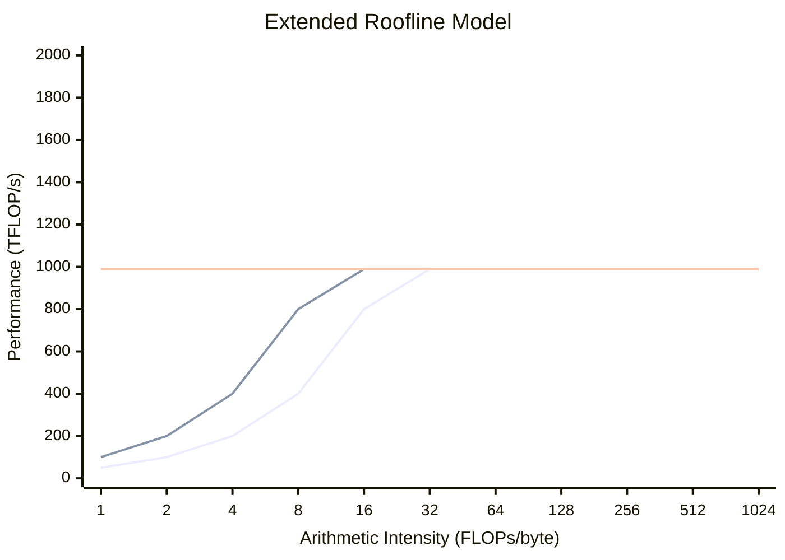

屋顶线（roofline）模型改变了我们推理单设备性能的方式。对分布式系统，我们要再给它加上第三重上限——而且这重上限往往起决定性作用：网络带宽。

**问题**：你在 256 块 GPU 上训练。每一步，每块 GPU 计算梯度，然后你们对梯度做 AllReduce。单卡计算耗时 100ms，AllReduce 耗时 200ms。你把 2/3 的时间花在了通信上。你该如何分析这个问题？又该如何改进？

## 原始屋顶线

!!! info "与《The Algebra of Speed》的联系"
    单设备屋顶线模型在姊妹书 [*The Algebra of Speed*](https://ttsugriy.github.io/performance-book/) 中有深入讲解。那本书聚焦于单个 kernel 的内存带宽与计算上限。这里我们再加上**第三重上限——网络带宽**，它在分布式规模下常常占据主导。

屋顶线模型由 Williams、Waterman 和 Patterson（2009）提出，用两重上限界定性能：

$$\text{Performance} \leq \min\left(\text{Peak FLOP/s}, \quad \text{Memory BW} \times \text{Arithmetic Intensity}\right)$$

其中**算术强度（arithmetic intensity）**为：

$$I = \frac{\text{FLOPs}}{\text{Bytes accessed from memory}}$$

算术强度高的运算（矩阵乘法：$O(n^3)$ FLOPs、$O(n^2)$ 内存）是计算受限的；强度低的运算（向量加法：$O(n)$ FLOPs、$O(n)$ 内存）是内存受限的。

## 第三重上限：网络

对分布式训练，我们补充第三项：

$$\text{Performance} \leq \min\left(\text{Peak FLOP/s}, \quad \text{Mem BW} \times I_{\text{mem}}, \quad \text{Net BW} \times I_{\text{net}}\right)$$

其中**通信强度（communication intensity）**为：

$$I_{\text{net}} = \frac{\text{FLOPs}}{\text{Bytes communicated}}$$

画图时，强度要相对于你正在比较的资源来解读：$I_{\text{mem}}$ 对应内存上限，$I_{\text{net}}$ 对应网络上限。

这第三重上限往往占据主导。考虑对一个 10GB 的梯度张量做 AllReduce：

- 通信量：每 GPU 约 20GB（ReduceScatter + AllGather）；网络总流量随 $P$ 增长
- 在 400 Gbps InfiniBand 上：$\frac{20 \times 8}{400} = 0.4$ 秒
- 同一步的计算可能只要 0.1 秒

我们受通信限制的程度达到 4 倍。

## 可视化扩展屋顶线

扩展屋顶线模型用三重上限界定性能。下图在示意坐标轴上展示性能与算术强度的关系：

**如何读这张图：**

- **斜坡区域**：性能随强度线性增长（带宽受限）
- **平坦区域**：性能达到峰值 FLOP/s（计算受限）
- **屋脊点（ridge point）**：斜坡与上限相交处（不同区制之间的转折）

| 区域 | 上限 | 强度 | 性能受限于 |
|------|------|------|------------|
| 左侧斜坡 | 网络 | 低 $I_{net}$ | 网络带宽 |
| 中间斜坡 | 内存 | 低 $I_{mem}$ | HBM 带宽 |
| 平顶 | 计算 | 高 | 峰值 FLOP/s |

**屋脊点**标记区制之间的转折。对 H100（约 989 TFLOP/s 稠密 FP16/BF16）配 400 Gbps InfiniBand：

$$I_{ridge}^{net} = \frac{989 \times 10^{12} \text{ FLOP/s}}{50 \times 10^9 \text{ B/s}} \approx 19,780 \text{ FLOPs/byte}$$

## 三种区制

### 计算受限

当 $I_{\text{net}}$ 与 $I_{\text{mem}}$ 都高时：

- GPU 利用率接近峰值
- 只要通信与内存开销保持次要，增加 GPU 就能线性加速
- 例子：大批量矩阵乘法

### 内存受限

当 $I_{\text{mem}}$ 低、$I_{\text{net}}$ 高时：

- 受限于 HBM 带宽
- 技术手段：kernel 融合、重算
- 例子：逐元素运算、小批量注意力

### 通信受限

当 $I_{\text{net}}$ 低时：

- 受限于网络带宽或延迟
- 技术手段：梯度压缩、重叠、低精度通信
- 例子：梯度同步、参数服务器

!!! note "实践"
    如果 NCCL/通信占步时超过 30%，就估算 $I_{\text{net}}$ 并与屋脊点比较。对 H100 + 400 Gbps InfiniBand，$I_{\text{ridge}} \approx 20k$ FLOPs/byte。低于此值时，应增大批大小/累积步数，或把低强度的集合通信迁移到更快的链路上。

## 计算通信强度

对不同并行策略：

### 数据并行

设 $B$ 为全局批大小（序列数），$S$ 为序列长度，$P$ 为 GPU 数，$s$ 为每参数字节数（如 FP16/BF16 时 $s=2$）。
每步每 GPU：$6\Psi B S / P$ FLOPs（对 $B/P$ 个样本做前向＋反向），AllReduce 约 $2\Psi s$ 字节（$P$ 较大时）

$$I_{\text{net}}^{\text{DP}} = \frac{6\Psi B S / P}{2\Psi s} = \frac{3BS}{Ps}$$

随着每 GPU 的 token 批 $B \cdot S / P$ 增大，通信强度增大 → 通信受限程度减轻。

### 张量并行

对隐层维 $H$、批 $B$、序列 $S$ 的每一层：

- FLOPs：$O(BSH^2)$
- 通信：$O(BSH)$（在张量并行 rank 间对激活值做 AllGather/ReduceScatter）

$$I_{\text{net}}^{\text{TP}} = O(H)$$

隐层维越大 → 强度越高 → 张量并行越高效。

### 流水线并行

只在阶段边界通信：

- FLOPs：整个模型的计算
- 通信：阶段之间的激活张量

$$I_{\text{net}}^{\text{PP}} = \frac{\text{Total FLOPs}}{\text{Activation size} \times \text{num stages}}$$

一般而言这是通信效率最高的策略。

## 屋脊点

**屋脊点**是两重上限的交点。对分布式训练：

$$I_{\text{ridge}} = \frac{\text{Peak FLOP/s}}{\text{Network BW}}$$

对 H100（989 TFLOP/s）配 400 Gbps（50 GB/s）InfiniBand：

$$I_{\text{ridge}} = \frac{989 \times 10^{12}}{50 \times 10^9} = 19,780 \text{ FLOPs/byte}$$

通信强度低于此值的运算，就是网络受限的。

## 对系统设计的启示

1. **最大化通信强度**：增大批大小，使用梯度累积
2. **让通信与计算重叠**：用有用的工作隐藏延迟
3. **压缩通信**：减少传输字节数
4. **明智地选择拓扑**：张量并行放在节点内（高带宽），流水线并行跨节点（容忍延迟）

扩展屋顶线是我们分析分布式训练瓶颈的首要工具。

## 练习题

1. 用数据并行在 64 块 GPU 上训练一个 70 亿参数模型，批大小为 100 万 token，计算其通信强度。

??? success "解答"
    **已知：**

    - 参数：$\Psi = 7 \times 10^9$
    - 每步 token 数：$B_{\text{tok}} = 1 \times 10^6$
    - GPU 数：$P = 64$（数据并行）

    **每 GPU 每步 FLOPs：**

    $$\text{FLOPs}_{\text{per-GPU}} = \frac{6 \times \Psi \times B_{\text{tok}}}{P} = \frac{6 \times 7 \times 10^9 \times 10^6}{64} = 6.56 \times 10^{14}$$

    **每 GPU 通信字节数（以 FP16 AllReduce 梯度）：**

    $$\text{Bytes} = 2 \times \frac{P-1}{P} \times \Psi \times 2 \approx 2 \times 7 \times 10^9 \times 2 = 2.8 \times 10^{10}$$

    **通信强度：**

    $$I_{\text{net}} = \frac{6.56 \times 10^{14}}{2.8 \times 10^{10}} \approx 23{,}400 \text{ FLOPs/byte}$$

    这高于 InfiniBand 的屋脊点（约 19,780 FLOPs/byte），因此该工作负载是**计算受限**的——但只是勉强如此。若把批大小减半到 50 万 token，强度会降到约 11,700 FLOPs/byte，工作负载在 InfiniBand 上就变成通信受限了。

2. 一套 H100 DGX 系统节点内 NVLink 带宽为 900 GB/s，跨节点 InfiniBand 为 400 Gbps。节点内与跨节点通信的屋脊点之比是多少？

??? success "解答"
    **屋脊点公式：**

    $$I_{ridge} = \frac{\text{Peak FLOPs}}{\text{Bandwidth}}$$

    **对 H100（峰值 989 TFLOP/s）：**

    NVLink（900 GB/s）：

    $$I_{ridge}^{NVLink} = \frac{989 \times 10^{12}}{900 \times 10^9} = 1,099 \text{ FLOPs/byte}$$

    InfiniBand（400 Gbps = 50 GB/s）：

    $$I_{ridge}^{IB} = \frac{989 \times 10^{12}}{50 \times 10^9} = 19,780 \text{ FLOPs/byte}$$

    **比值：**
    $$\frac{I_{ridge}^{IB}}{I_{ridge}^{NVLink}} = \frac{19,780}{1,099} \approx 18\times$$

    **含义：** 要让运算在 InfiniBand 上而非 NVLink 上成为计算受限，其算术强度需要高出 18 倍。这就是为什么张量并行（低强度）使用 NVLink，而数据并行（高强度）可以使用 InfiniBand。

3. 你在一次训练中观察到 35% 的 MFU（模型 FLOP 利用率）。用扩展屋顶线分析，可能的瓶颈有哪些？你如何诊断哪一个占主导？

??? success "解答"
    **可能的瓶颈（损失了 65% 的潜力）：**

    1. **网络受限**：通信未与计算重叠
    2. **内存受限**：低算术强度的运算（注意力、LayerNorm）
    3. **流水线气泡**：阶段边界的空闲时间
    4. **负载不均衡**：部分 GPU 先完成
    5. **kernel 低效**：次优的 GPU kernel

    **诊断方法：**

    | 症状 | 可能原因 | 如何检查 |
    |------|----------|----------|
    | profile 中 NCCL 时间高 | 网络受限 | profile 显示未隐藏的 AllReduce |
    | SM 占用率低 | 内存受限 | NSight 显示内存停顿 |
    | 周期性空闲间隙 | 流水线气泡 | 时间线显示阶段间隙 |
    | GPU 利用率不均 | 负载不均衡 | 逐 GPU profiling |

    **步骤：**

    1. 运行 profiler（PyTorch Profiler、NSight）
    2. 检查时间线中通信/计算的重叠情况
    3. 对比实测带宽与理论带宽
    4. 检查主导运算的算术强度
    5. 若使用流水线并行，计算气泡比例：$\frac{p-1}{m+p-1}$

## 关键要点

1. **分布式性能有三重上限**：计算、内存带宽和网络带宽。
2. **通信强度是诊断的抓手**：$I_{\text{net}}$ 低意味着你受网络限制。
3. **拓扑选择跟随屋脊点**：张量并行偏好高带宽链路；批很大时数据并行能容忍较慢的网络。