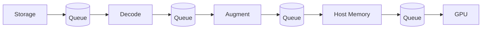
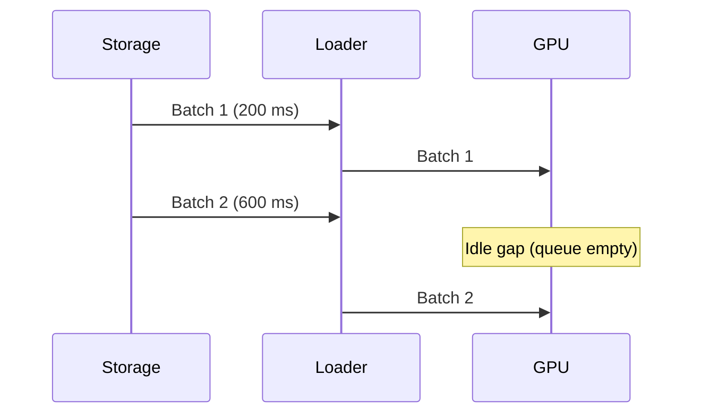
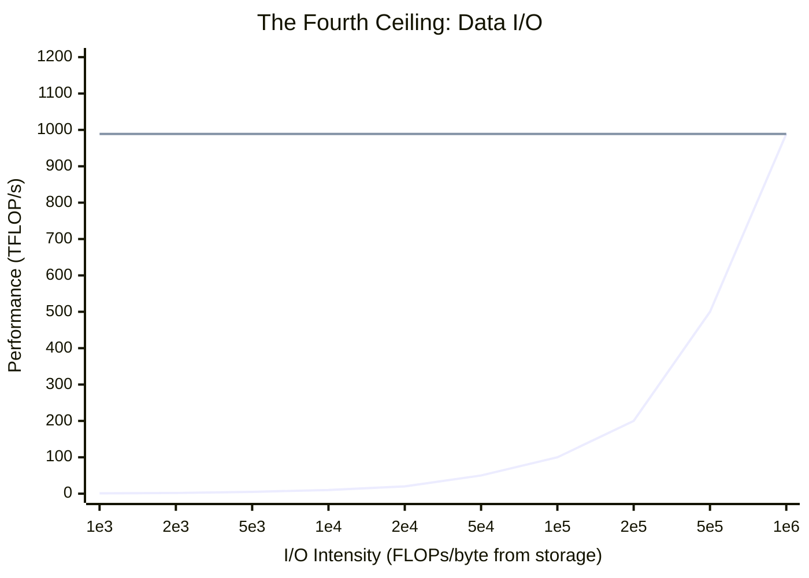

<div class="chapter-opener" markdown>
我们优化了 FLOPs、内存和通信，却只能看着 GPU 因为数据迟到而空转。数据流水线是无声的第四重上限。它一旦拖后腿，其他所有优化都白费。
</div>

<div class="investigation-question" markdown>
**问题**：你的 256 GPU 训练达到 40% MFU，却只有 241k tokens/s。GPU trace 显示每一步之前都有空闲间隙。这是数据问题还是计算问题？要持续喂饱流水线，你*真正*需要多少存储带宽？
</div>

<div class="notation-banner" markdown>
**本章符号：** $\Psi$ = 参数数量，$B$ = 全局批大小（序列数），$B_{\text{tok}} = B \cdot S$ = 批 token 数，$S$ = 序列长度，$P$ = GPU 数量，$F$ = 每 GPU 峰值 FLOP/s，MFU = 模型 FLOP 利用率。参见[符号说明](../appendices/notation.md)。
</div>

## 第四重上限

扩展屋顶线（roofline）已经给了我们三重上限：

$$\text{Perf} \le \min(\text{Compute}, \text{HBM}, \text{Network})$$

训练还要加上**第四重**：数据从存储与预处理中到达的速率。如果输入流水线无法以所需速率供应 token，那么无论计算或通信怎么优化，GPU 都会空转。

我们为此定义一个新的强度：

$$I_{\text{io}} = \frac{\text{FLOPs}}{\text{Bytes pulled from storage}}$$

于是上界变为：

$$\text{Perf} \le \min(\text{Compute}, \text{HBM}, \text{Network}, \text{Storage} \times I_{\text{io}})$$

这里的“存储”一项包括：

- 网络文件系统（S3/GCS/HDFS）
- 共享文件系统（Lustre、Ceph、NFS）
- 本地 NVMe 缓存
- CPU 解码／数据增强吞吐

## 第一步：我们每秒需要多少 token？

我们完全可以仅从训练的 FLOP 预算推出吞吐。对稠密 transformer，每 token 的 FLOPs 约为 $6\Psi$。

每 GPU 实际达到的 FLOP/s 为 $F \cdot \text{MFU}$。在 $P$ 块 GPU 上，训练吞吐（tokens/s）为：

$$\text{tokens/s} = \frac{P \cdot F \cdot \text{MFU}}{6\Psi}$$

### 例子：70B 模型跑在 256 块 H100 上

- $\Psi = 70 \times 10^9$
- $P = 256$
- $F = 989$ TFLOP/s（H100 稠密 BF16）
- MFU = 0.40

$$\text{tokens/s} = \frac{256 \cdot 989 \times 10^{12} \cdot 0.4}{6 \cdot 70 \times 10^9} \approx 2.41 \times 10^5 \;\text{tokens/s}$$

因此，仅为了避免计算停摆，流水线就必须供应**约 241k tokens/s**。

!!! note "实践"
    在扩大训练规模之前，先用上面的公式算出所需的 tokens/s。如果你的数据加载器在单节点上都无法维持该速率，增加 GPU 只会放大空闲时间。

## 第二步：把 tokens/s 换算成存储带宽

设：

- $b_{\text{tok}}$ = 每 token 字节数（压缩后或原始）
- $\rho$ = 读放大（由混洗、缓存未命中或格式开销导致的额外读取）

则所需存储带宽为：

$$B_{\text{req}} = \text{tokens/s} \cdot b_{\text{tok}} \cdot \rho$$

### 带宽示例

假设每个 token 平均 2 KB（文本＋元数据），读放大为 1.2。这是针对重元数据或多模态数据集的悲观上界；纯文本语料在压缩和混洗开销之后，通常更接近每 token 2–8 字节。

$$B_{\text{req}} = 2.41 \times 10^5 \cdot 2048 \cdot 1.2 \approx 0.59 \;\text{GB/s}$$

若读放大为 1.5 倍，需求升至约 0.74 GB/s。如果你的共享文件系统每节点只能提供 400 MB/s，那么无论 GPU 有多少，你都会因数据不足而挨饿。

## 数据屋脊点

存储的屋脊点告诉我们 I/O 何时不再是瓶颈：

$$I_{\text{ridge}}^{\text{io}} = \frac{\text{Peak FLOP/s}}{B_{\text{storage}}}$$

取 $F = 989$ TFLOP/s、$B_{\text{storage}} = 1$ GB/s：

$$I_{\text{ridge}}^{\text{io}} = \frac{989 \times 10^{12}}{10^9} = 9.89 \times 10^5 \;\text{FLOPs/byte}$$

若你的工作负载的 $I_{\text{io}}$ 低于此值，存储带宽就占主导。除非提高数据吞吐，否则提升 MFU 或增加 GPU 都无济于事。

## 把流水线看作排队系统

把输入栈想象成一条各阶段之间有队列的流水线：

```
Storage → Decode → Augment → Host Memory → GPU
```



每个阶段都有一个服务速率。最慢的阶段决定吞吐；只要某个阶段不稳定（服务速率 < 到达速率），队列就会积压，步时随之增长。

### 用利特尔法则确定预取深度

利特尔法则（Little's Law）：$L = \lambda W$

- $L$ = 队列中的批数
- $\lambda$ = 到达速率（批/秒）
- $W$ = 在系统中的时间（秒）

若步时为 0.5s，而你想隐藏 2s 的存储延迟，需要：

$$L = \lambda W = (2 \;\text{batches/s}) \cdot (2 \;\text{s}) = 4 \;\text{batches}$$

因此，预取深度**至少 4 批**，才能在存储停顿时让 GPU 保持忙碌。

!!! note "实践"
    当你看到间歇性的 GPU 空闲时，测量队列深度。如果预取队列经常见底，就加大预取或降低每批的解码成本。

### 图示：一次停顿长什么样



## 混洗、分片与读放大

混洗对优化至关重要，但它会增加 I/O 成本。

### 确定性分片

设数据集大小为 $D$ 个 token，分片到 $P$ 个 worker。每个 worker 每轮读取 $D/P$ 个 token。这很省 I/O，但如果分片是静态的，混合效果会很差。

### 全局混洗

完美混洗意味着跨整个数据集随机访问。读放大随之增长，因为：

1. 文件系统读取以页／块为单位（4KB–1MB）
2. 多个 worker 访问同一文件中的不相交样本
3. 压缩格式偏好顺序扫描

我们可以把读放大建模为：

$$\rho \approx \frac{\text{bytes read}}{\text{bytes used}}$$

典型取值：

| 流水线 | $\rho$ |
|---|---|
| 顺序分片 | 1.0–1.1 |
| 分片内混洗 | 1.1–1.3 |
| 全局混洗 | 1.3–2.0 |

**规则**：如果数据集很大，优先用*分片内混洗*，把 $\rho$ 保持在 1.2 附近，同时维持随机性。

## 压缩作为一种计算权衡

压缩能减少每 token 字节数，代价是 CPU/GPU 的工作量。

设：

- $b_{\text{raw}}$ = 原始字节/token
- $c$ = 压缩比（$b_{\text{raw}}/b_{\text{compressed}}$）
- $R_{\text{decode}}$ = 解码吞吐（字节/秒）

来自存储的有效字节/token：

$$b_{\text{tok}} = \frac{b_{\text{raw}}}{c}$$

但解码会带来计算时间。若解码吞吐低于存储带宽，瓶颈就会从存储转移到 CPU。

**例子**：如果存储能提供 2 GB/s，而解码只有 0.6 GB/s，压缩不会带来收益——它只是把瓶颈挪了个位置。

## 图示：数据屋顶线



在低 $I_{\text{io}}$ 区间，性能随存储带宽线性增长；在高 $I_{\text{io}}$ 区间，计算占主导。屋脊点位于两线相交处。

## 数据质量、混合与课程

以上各节讨论的是数据投递的*机制*。但数据的*内容*对训练结果同样重要，而数据质量决策也有系统层面的影响。

### 数据质量作为扩展乘子

回想第 7 章，损失取决于有效数据量：

$$L(\Psi, D, q) = \frac{A}{\Psi^\alpha} + \frac{B}{(qD)^\beta} + L_\infty$$

其中 $q \in (0, 1]$ 是数据质量乘子。高质量、已去重、过滤良好的数据，能用更少的 token 达到相同的损失——实际上等于放大了你的数据预算。

**系统含义**：投资数据质量（去重、过滤、领域分类）能减少所需的总 token 数 $D$，从而直接缩短训练时间、降低 I/O 带宽需求。

### 数据混合比例

前沿模型在多个领域的混合数据上训练（网页、代码、书籍、数学、多语言）。混合比例同时影响损失和能力：

| 领域 | 典型占比 | 增加后的效果 |
|------|----------|--------------|
| 网页抓取（已过滤） | 60–80% | 通用语言能力 |
| 代码 | 5–15% | 推理、结构化输出 |
| 书籍／学术 | 5–10% | 长程连贯性 |
| 数学／科学 | 2–5% | 定量推理 |
| 多语言 | 5–15% | 跨语言迁移 |

**对分布式训练的系统含义**：不同领域可能来自读取特性不同的存储系统。混合领域的流水线必须在所有 worker 上维持目标比例——这需要以下之一：

1. **预混洗分片**：在分片前交错各领域（简单，但不灵活）
2. **按领域采样器**：每个 worker 按规定比例从特定领域流中采样（灵活，但需要协调）
3. **全局混合服务**：由集中式或分层调度器按正确比例分配批次（最灵活，复杂度最高）

### 课程学习与退火

有些训练会在过程中改变数据混合：

- **预热阶段**：用更简单、更高质量的数据保证初期稳定
- **主阶段**：按目标比例使用完整混合
- **退火阶段**：提高高质量领域的权重（降低基准上的损失）

LLaMA 3 使用了后期退火阶段，提高代码和数学数据的权重。这要求数据流水线支持**动态混合比例**——在不停训练的情况下中途切换数据源。

### 大规模去重

在重复数据上训练收益递减（第 8 章：重复比 $r$ 时 $L \propto \gamma \cdot \log(r)$）。去重必不可少，但有 I/O 成本：

- **精确去重**：基于哈希，每文档 O(1)，但会漏掉近重复
- **模糊去重**（MinHash/SimHash）：能捕捉改写，但为 $O(n \log n)$ 且 I/O 密集
- **布隆过滤器**：内存高效的近似成员测试，用于流式去重

**系统含义**：去重是一项预处理成本，它减少 $D_{\text{unique}}$ 但提升 $q$。对数万亿 token 的数据集，模糊去重在数百个 CPU 上可能要跑数天——请把这段时间计入整个训练时间线。

### 实践指引

| 决策 | 何时重要 | 系统影响 |
|------|----------|----------|
| 数据质量过滤 | 始终 | 减少所需 $D$ → 缩短训练 |
| 领域混合比例 | 多领域训练 | 需要跨 worker 协调采样 |
| 课程／退火 | 大规模训练（>1T token） | 混合比例中途变化 |
| 去重 | 网页抓取数据 | 预处理成本；减少训练期 I/O |

## 实践诊断

1. **测量 tokens/s**，与理论需求比较。
2. **profile 数据加载器时间**：若超过步时的约 10%，你就是 I/O 受限。
3. **检查队列占用**：队列为空说明预取不足。
4. **估算读放大**：比较从存储读取的字节与实际消费的字节。
5. **用 NVMe 做暂存**：若共享存储慢，使用本地缓存并异步预取。

!!! note "实践"
    如果 GPU 利用率低，但 NCCL 和计算 kernel 都正常，数据流水线就是最可能的元凶。要跟踪从存储到 GPU 的端到端 tokens/s，而不只是 GPU 时间。

## 关键要点

1. **数据 I/O 是第四重上限**：再多 GPU 也跑不赢慢存储。
2. **tokens/s 决定带宽**：$\text{tokens/s} = \frac{P F \cdot \text{MFU}}{6\Psi}$ 是核心的规模估算公式。
3. **读放大很重要**：混洗策略和文件格式可能让所需带宽翻倍。
4. **队列隐藏延迟**：预取深度应按利特尔法则确定。
5. **压缩会转移瓶颈**：只有解码跟得上时，省下的字节才有意义。

## 练习题

1. 一个 13B 模型在 128 块 GPU 上以 45% MFU 训练。估算 tokens/s。若每个 token 压缩后为 1.5 KB、读放大为 1.3，需要多少存储带宽？

??? success "解答"
    **Tokens/s**：

    $$\text{tokens/s} = \frac{128 \cdot 989 \times 10^{12} \cdot 0.45}{6 \cdot 13 \times 10^9} \approx 73,000 \;\text{tokens/s}$$

    **带宽**：

    $$B_{\text{req}} = 73,000 \cdot 1.5 \times 10^3 \cdot 1.3 \approx 142 \;\text{MB/s}$$

2. 你的数据加载器花 0.25s 解码、0.05s 传输到 GPU。步时为 0.6s。数据受限占步时的多大比例？预取能隐藏多少？

??? success "解答"
    **数据时间**：0.25 + 0.05 = 0.30s

    **比例**：$0.30 / 0.60 = 50\%$

    在完美的预取重叠下，你可以隐藏**最多 0.30s**（全部）。若队列耗尽，你就要承受完整的 50% 惩罚。

3. 共享文件系统每节点提供 300 MB/s，而你的流水线需要 900 MB/s。你可以加一块 2 TB 的 NVMe 缓存，以 300 MB/s 从存储预取。填满 1 TB 数据需要多少启动时间？对持续数周的训练值得吗？

??? success "解答"
    **预取时间**：

    $$T = \frac{1 \text{ TB}}{300 \text{ MB/s}} = \frac{10^{12}}{3 \times 10^8} \approx 3333 \text{ s} \approx 55 \text{ min}$$

    **结论**：相比持续数周的训练，55 分钟的暂存可以忽略，因此本地缓存是值得的。