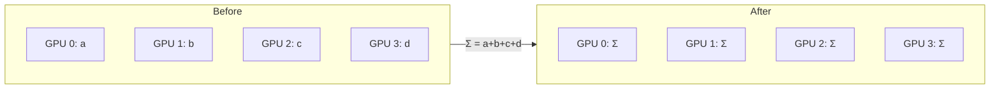
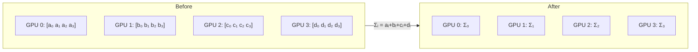
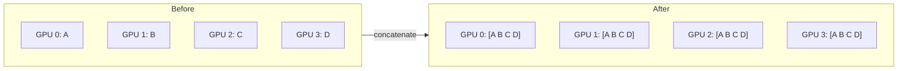
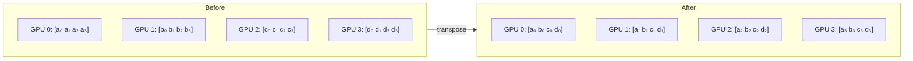

<div class="chapter-opener" markdown>
每一种通信操作都有代价。α-β 模型给了我们一个简单而强大的框架来推理这一代价：一个固定的启动延迟，加上与传输数据量成正比的时间。
</div>

<div class="investigation-question" markdown>
**问题**：你需要跨 64 块 GPU 对一个 1GB 的张量做 AllReduce。是发一条大消息更快，还是拆成 1000 条小消息更快？答案取决于你是延迟受限还是带宽受限。
</div>

## 模型

传输 $n$ 字节点对点消息的通信时间：

$$T(n) = \alpha + \frac{n}{\beta}$$

其中：

- $\alpha$（alpha）：**延迟**——发送零字节消息所需的时间
- $\beta$（beta）：**带宽**——传输开始后每秒的字节数
- $n$：消息大小（字节）

这个简单的模型抓住了网络通信中最本质的权衡。

## 理解延迟（α）

延迟包括：

- 软件开销（kernel 调用、缓冲区管理）
- 网卡处理时间
- 交换机转发时间
- 传播延迟（光在光纤中的传播）

延迟是**按消息固定**的，与大小无关。这让小消息相对于其有效载荷而言非常昂贵。

| 网络 | 典型 α |
|------|--------|
| NVLink | ~1 μs |
| InfiniBand（同机架） | ~1-2 μs |
| InfiniBand（跨机架） | ~3-5 μs |
| 以太网 | ~10-50 μs |

## 理解带宽（β）

带宽是大消息下的持续传输速率：

| 网络 | β（每链路） |
|------|--------------|
| NVLink 4.0 | 900 GB/s |
| InfiniBand NDR 400 | 50 GB/s |
| 100GbE | 12.5 GB/s |

注意：以上为单方向数值；全双工链路可以同时收发。

## 交叉点

延迟与带宽贡献相等的那个消息大小：

$$n^* = \alpha \cdot \beta$$

低于此大小，延迟占主导；高于此大小，带宽占主导。

**例子**（InfiniBand，α=2μs，β=50 GB/s）：

$$n^* = 2 \times 10^{-6} \times 50 \times 10^{9} = 100 \times 10^{3} \text{ B} = 100 \text{ KB}$$

小于 100KB 的消息在 InfiniBand 上主要是延迟受限的。

## 集合通信操作

对集合通信，我们要给模型加上额外的项。

!!! note "预览：集合通信一览"
    我们将在第三部分深入讨论集合通信。现在先建立直觉：

    - **AllReduce**：每块 GPU 贡献一个值 → 每块 GPU 都收到总和
    - **ReduceScatter**：每块 GPU 贡献一个值 → 每块 GPU 收到归约结果的 1/P
    - **AllGather**：每块 GPU 有一片 → 每块 GPU 都收到完整的拼接结果
    - **All-to-All**：每块 GPU 向其他每块 GPU 发送*不同*的数据（跨进程的“转置”）

    下面的公式展示了 α-β 模型如何应用于这些操作。先不必纠结细节——关注结构：*延迟项随 P 增长，而带宽项往往不增长*。

#### 可视化模式

这些图展示的是每种集合通信做什么，而非如何实现。环形与树形算法将在[第 12 章](../collectives/12-ring-tree-algorithms.md)探讨。

<div class="collective-patterns" markdown>

**AllReduce**——合并后广播：



**ReduceScatter**——合并后分发各片：



**AllGather**——把各片收集成整体：



**All-to-All**——跨进程转置：



</div>

### AllReduce

对大消息、$P$ 个进程、每个 $n$ 字节的情形，带宽最优的（环形）算法：

$$T_{\text{AllReduce}}(n, P) = 2(P-1)\alpha + \frac{2(P-1)}{P} \cdot \frac{n}{\beta}$$

当 $P \to \infty$：

$$T_{\text{AllReduce}} \approx 2P\alpha + \frac{2n}{\beta}$$

延迟项随 $P$ 增长，但带宽项与 $P$ 无关（对环形算法而言）。
对小消息，树形／递归倍增算法能把延迟项降到 $O(\log P)$。

### AllReduce 成本的分解

| 组成 | 延迟成本 | 带宽成本 |
|------|----------|----------|
| ReduceScatter | $(P-1)\alpha$ | $\frac{P-1}{P} \cdot \frac{n}{\beta}$ |
| AllGather | $(P-1)\alpha$ | $\frac{P-1}{P} \cdot \frac{n}{\beta}$ |
| **合计** | $2(P-1)\alpha$ | $\frac{2(P-1)}{P} \cdot \frac{n}{\beta}$ |

### ReduceScatter

$$T_{\text{ReduceScatter}}(n, P) = (P-1)\alpha + \frac{P-1}{P} \cdot \frac{n}{\beta}$$

每块 GPU 初始持有一个大小为 $n$ 的张量。ReduceScatter 之后，每块 GPU 持有*归约后*结果的 $1/P$——GPU $i$ 上的第 $i$ 个分块包含所有 GPU 第 $i$ 块之和。这是环形 AllReduce 的前半程。

### AllGather

$$T_{\text{AllGather}}(n, P) = (P-1)\alpha + \frac{P-1}{P} \cdot \frac{n}{\beta}$$

每块 GPU 初始持有一个大小为 $n/P$ 的片段，最终持有大小为 $n$ 的完整张量。环形算法把每个片段沿环传递，需要 $P-1$ 步。AllGather 是环形 AllReduce 互补的后半程。

### All-to-All

$$T_{\text{AlltoAll}}(n, P) = (P-1)\alpha + \frac{P-1}{P} \cdot \frac{n}{\beta}$$

All-to-All 执行跨进程的*转置*。每块 GPU 有 $P$ 个数据块，分别发往每块 GPU（包括自己）。All-to-All 之后，每块 GPU 收到了来自其他所有 GPU、地址指向自己的那些块。

可以把它想象成一个矩阵转置，行是源 GPU、列是目标 GPU：

| | → GPU 0 | → GPU 1 | → GPU 2 | → GPU 3 |
|---------|---------|---------|---------|---------|
| **GPU 0 持有** | a₀ | a₁ | a₂ | a₃ |
| **GPU 1 持有** | b₀ | b₁ | b₂ | b₃ |
| **GPU 2 持有** | c₀ | c₁ | c₂ | c₃ |
| **GPU 3 持有** | d₀ | d₁ | d₂ | d₃ |

All-to-All 之后，GPU $j$ 持有第 $j$ 列：即每块 GPU 上处于位置 $j$ 的那些块。

**为什么成本与 AllGather 相同？** 对直接交换的实现，每块 GPU 发送其数据的 $(P-1)/P$（除自己保留的那块之外的全部），并从其他 GPU 接收 $(P-1)/P$。总数据移动量完全相同；其他算法的常数项不同。

**用例：**

- **专家并行**（Mixtral、Switch Transformer 等 MoE 模型）：把 token 路由到分布在 GPU 上相应专家，再用 All-to-All 送回结果
- **序列并行 ↔ 张量并行转换**：在切换并行策略时变换数据布局
- **FFT 及其他重转置算法**：为下一个计算阶段重新分配数据

## 对算法设计的启示

### 批量合并小消息

发送 $k$ 条大小为 $m$ 的小消息：

$$T_{\text{small}} = k\alpha + \frac{km}{\beta}$$

发送一条大小为 $km$ 的大消息：

$$T_{\text{large}} = \alpha + \frac{km}{\beta}$$

节省：$(k-1)\alpha$

**准则**：批量合并小通信，以摊薄延迟。

### 梯度分桶

现代框架（PyTorch DDP、Horovod）会对小的梯度张量分桶：

```python
# Instead of AllReduce per tensor:
for tensor in gradients:
    allreduce(tensor)  # Each incurs α latency

# Bucket and AllReduce together:
bucket = concatenate([t for t in gradients if t.size < threshold])
allreduce(bucket)  # Single α latency
```

### 与计算重叠

如果能让通信与计算重叠：

$$T_{\text{total}} = \max(T_{\text{compute}}, T_{\text{comm}})$$

而不是：

$$T_{\text{total}} = T_{\text{compute}} + T_{\text{comm}}$$

这就是把 AllReduce 与反向传播流水化如此有效的原因。

## LogP 与 LogGP 模型

要做更细致的分析，扩展模型还加入了：

- **L**：网络延迟
- **o**：每条消息的 CPU 开销
- **g**：间隙（两次消息发送之间的最短时间）
- **G**：每字节的间隙（带宽的倒数）

大多数分析我们用 α-β 就够了；这些扩展在非常细粒度的优化中才有意义。

## 实际测量

要实测 α 与 β：

1. 发送不同大小的消息
2. 测量往返时间
3. 拟合：$T = 2\alpha + \frac{2n}{\beta}$

```python
import torch.distributed as dist
import time

def measure_bandwidth(size_bytes, dtype=torch.bfloat16, warmup=10, trials=100):
    elem_size = torch.tensor([], dtype=dtype).element_size()
    tensor = torch.zeros(size_bytes // elem_size, dtype=dtype, device='cuda')

    # Warmup
    for _ in range(warmup):
        dist.all_reduce(tensor)
    torch.cuda.synchronize()

    # Use CUDA events for accurate GPU-side timing
    start_event = torch.cuda.Event(enable_timing=True)
    end_event = torch.cuda.Event(enable_timing=True)

    start_event.record()
    for _ in range(trials):
        dist.all_reduce(tensor)
    end_event.record()
    torch.cuda.synchronize()

    elapsed_ms = start_event.elapsed_time(end_event)
    return elapsed_ms / (trials * 1000)  # return seconds per op
```

## 练习题

1. 用环形算法计算在 InfiniBand（α=2μs，β=50GB/s 每链路）上跨 256 块 GPU 对 10GB 张量做 AllReduce 的时间。

??? success "解答"
    **使用环形 AllReduce 公式：**

    $$T_{\text{AllReduce}}(n, P) = 2(P-1)\alpha + \frac{2(P-1)}{P} \cdot \frac{n}{\beta}$$

    **已知：**

    - $n = 10$ GB $= 10 \times 10^9$ bytes
    - $P = 256$ GPUs
    - $\alpha = 2$ μs $= 2 \times 10^{-6}$ s
    - $\beta = 50$ GB/s $= 50 \times 10^9$ B/s

    **延迟项：**

    $$2(P-1)\alpha = 2 \times 255 \times 2 \times 10^{-6} = 1.02 \times 10^{-3} \text{ s} \approx 1.02 \text{ ms}$$

    **带宽项：**

    $$\frac{2(P-1)}{P} \cdot \frac{n}{\beta} = \frac{2 \times 255}{256} \times \frac{10 \times 10^9}{50 \times 10^9} = 1.992 \times 0.2 \approx 398 \text{ ms}$$

    **总时间：**

    $$T = 1.02 \text{ ms} + 398 \text{ ms} \approx \boxed{399 \text{ ms}}$$

    **观察：** 带宽项占主导（总时间的 99.7%）。对大张量，AllReduce 是带宽受限的。

2. 你在为 AllReduce 对梯度分桶。每个小张量 1MB，共 1000 个。比较以下情形的总 AllReduce 时间：(a) 每个张量单独 AllReduce，(b) 对拼接后的 1GB 张量做一次 AllReduce。假设 α=2μs，β=50GB/s，P=64。

??? success "解答"
    **已知：**

    - 1000 个张量，每个 1 MB
    - $\alpha = 2$ μs, $\beta = 50$ GB/s, $P = 64$

    **(a) 每个张量单独 AllReduce（各 1 MB）：**

    每个张量：

    $$T = 2(P-1)\alpha + \frac{2(P-1)}{P} \cdot \frac{n}{\beta}$$

    $$= 2 \times 63 \times 2 \times 10^{-6} + \frac{126}{64} \times \frac{10^6}{50 \times 10^9}$$

    $$= 252 \text{ μs} + 1.97 \times 20 \text{ μs} = 252 \text{ μs} + 39.4 \text{ μs} = 291.4 \text{ μs}$$

    1000 个张量合计：

    $$T_{total}^{(a)} = 1000 \times 291.4 \text{ μs} = \boxed{291.4 \text{ ms}}$$

    **(b) 对拼接后的 1 GB 张量做一次 AllReduce：**

    $$T = 2 \times 63 \times 2 \times 10^{-6} + \frac{126}{64} \times \frac{10^9}{50 \times 10^9}$$

    $$= 252 \text{ μs} + 1.97 \times 20 \text{ ms} = 252 \text{ μs} + 39.4 \text{ ms} \approx \boxed{39.7 \text{ ms}}$$

    **分桶带来的加速：**

    $$\frac{291.4 \text{ ms}}{39.7 \text{ ms}} \approx 7.3\times$$

    **分解：** 逐个 AllReduce 光延迟开销就花了 $252 \text{ ms}$（1000 × 252 μs），而分桶版本只付 252 μs。分桶节省了 $(k-1)\alpha = 999 \times 252 \text{ μs} \approx 252 \text{ ms}$ 的延迟。

3. 推导 NVLink（α=1μs，β=900GB/s）的交叉点。它与 InfiniBand 相比如何？这对张量并行与数据并行的最优消息大小意味着什么？

??? success "解答"
    **交叉点公式：**

    $$n^* = \alpha \cdot \beta$$

    **NVLink 交叉点：**

    $$n^*_{NVLink} = 1 \times 10^{-6} \times 900 \times 10^9 = 900 \times 10^{3} \text{ B} = 900 \text{ KB}$$

    **InfiniBand 交叉点：**

    $$n^*_{IB} = 2 \times 10^{-6} \times 50 \times 10^9 = 100 \times 10^{3} \text{ B} = 100 \text{ KB}$$

    **比较：**

    $$\frac{n^*_{NVLink}}{n^*_{IB}} = \frac{900 \text{ KB}}{100 \text{ KB}} = 9\times$$

    NVLink 的交叉点比 InfiniBand 高 9 倍。

    **对并行策略的启示：**

    | 方面 | NVLink（TP） | InfiniBand（DP） |
    |------|-------------|-----------------|
    | 交叉点 | 900 KB | 100 KB |
    | 消息大小 | 常常几十 MB（激活值） | 常常几十 GB（梯度） |
    | 区制 | 带宽受限 | 带宽受限 |

    - **张量并行**（NVLink）：激活张量通常为 10–100 MB，远高于 900 KB 的交叉点。通信是带宽受限的。

    - **数据并行**（InfiniBand）：梯度 AllReduce 通常是 GB 量级，远超 100 KB。同样是带宽受限的。

    - **关键洞察**：对典型工作负载，两种策略都运行在带宽受限区制。但 NVLink 高出 18 倍的带宽（900 vs 50 GB/s），使其对张量并行那种每层都频繁通信的场景不可或缺。数据并行通信频率低（每步一次），因此能容忍 InfiniBand 较低的带宽。

## 关键要点

1. **通信有两种成本**：延迟（$\alpha$）主导小消息，带宽（$\beta$）主导大消息。
2. **交叉点大小决定算法选择**：低于 $n^* = \alpha\beta$ 时优化延迟，高于时优化带宽。
3. **分桶通过摊薄 $\alpha$ 取胜**：聚合小消息可带来 5–10 倍加速。