<div class="chapter-opener" markdown>
第 19 章的内存方程揭示了一种巨大的冗余：每块 GPU 都存储着优化器状态、梯度和参数的完全相同副本。ZeRO 通过分片（sharding）消除这种冗余——把这些张量划分到各设备上。其结果是内存随 GPU 数量近乎线性地扩展。
</div>

<div class="investigation-question" markdown>
**问题**：有 8 块 GPU，你就有 8 倍的聚合内存。但标准数据并行仍然把你限制在单块 GPU 的内存上。如何在不从根本上改变训练算法的前提下，拿到完整的 8 倍？
</div>

!!! abstract "本章导览"
    **前置知识**：[第 11 章](../collectives/11-primitives-properties.md)（AllGather、ReduceScatter）、[第 19 章](19-memory-equation.md)（内存方程）

    **核心洞见**：数据并行存储了 P 份冗余的模型状态。ZeRO 把优化器状态（ZeRO-1）、梯度（ZeRO-2）和参数（ZeRO-3）分片到各 GPU 上，用额外的 AllGather/ReduceScatter 通信换取近乎线性的内存扩展。

## 冗余问题

在数据并行训练中，每块 GPU 都维护：

| 组成部分 | 每 GPU 大小 | 冗余因子 |
|-----------|--------------|-------------------|
| 参数（FP16） | $2\Psi$ 字节 | $P$× |
| 梯度（FP16） | $2\Psi$ 字节 | $P$× |
| 主权重（FP32） | $4\Psi$ 字节 | $P$× |
| 动量（FP32） | $4\Psi$ 字节 | $P$× |
| 方差（FP32） | $4\Psi$ 字节 | $P$× |

有 $P$ 块 GPU 时，我们总共存储 $16\Psi P$ 字节，但其中只有 $16\Psi$ 字节是唯一的。

**数据并行的内存效率**：

$$\eta_{DP} = \frac{\text{Unique data}}{\text{Total storage}} = \frac{16\Psi}{16\Psi P} = \frac{1}{P}$$

在 1024 块 GPU 上，我们把 99.9% 的聚合内存浪费在冗余副本上。

## ZeRO：核心洞见

**零冗余优化器（Zero Redundancy Optimizer）**（Rajbhandari et al., 2019）观察到：

1. 计算时每块 GPU 需要全部数据
2. 但存储可以分散
3. 需要时可以通过通信取回数据

权衡是：**用内存削减换通信开销**。

### 三个阶段

ZeRO 逐步划分训练状态：

| 阶段 | 分片的组件 | 每 GPU 内存 | 通信 |
|-------|-------------------|----------------|---------------|
| ZeRO-1 | 优化器状态 | $4\Psi + \frac{12\Psi}{P}$ | +0% |
| ZeRO-2 | + 梯度 | $2\Psi + \frac{14\Psi}{P}$ | +0% |
| ZeRO-3 | + 参数 | $\frac{16\Psi}{P}$ | +50% |

```mermaid
flowchart LR
    subgraph baseline["Data Parallel (No ZeRO)"]
        direction TB
        B_P["Params (2\Psi)"]
        B_G["Gradients (2\Psi)"]
        B_O["Optimizer (12\Psi)"]
    end

    subgraph zero1["ZeRO Stage 1"]
        direction TB
        Z1_P["Params (2\Psi)"]
        Z1_G["Gradients (2\Psi)"]
        Z1_O["Optimizer (12\Psi/P)"]
    end

    subgraph zero2["ZeRO Stage 2"]
        direction TB
        Z2_P["Params (2\Psi)"]
        Z2_G["Gradients (2\Psi/P)"]
        Z2_O["Optimizer (12\Psi/P)"]
    end

    subgraph zero3["ZeRO Stage 3"]
        direction TB
        Z3_P["Params (2\Psi/P)"]
        Z3_G["Gradients (2\Psi/P)"]
        Z3_O["Optimizer (12\Psi/P)"]
    end

    baseline --> zero1 --> zero2 --> zero3

    style B_O fill:#e74c3c,stroke:#c0392b,color:white
    style Z1_O fill:#2ecc71,stroke:#27ae60,color:white
    style B_G fill:#e74c3c,stroke:#c0392b,color:white
    style Z2_O fill:#2ecc71,stroke:#27ae60,color:white
    style Z2_G fill:#2ecc71,stroke:#27ae60,color:white
    style Z3_P fill:#2ecc71,stroke:#27ae60,color:white
    style Z3_G fill:#2ecc71,stroke:#27ae60,color:white
    style Z3_O fill:#2ecc71,stroke:#27ae60,color:white
```



**图例**：红色 = 复制（内存浪费），绿色 = 分片（内存高效）。

下面我们严格推导每个阶段。

## ZeRO 第 1 阶段：优化器状态分片

### 算法

每块 GPU $r$ 拥有参数范围 $[r\Psi/P, (r+1)\Psi/P)$ 内的优化器状态。

**前向传播**：不变——所有 GPU 都有完整参数。

**反向传播**：照常计算梯度。

**AllReduce 梯度**：与数据并行相同。

**优化器步**：每块 GPU 只更新自己拥有的参数。

**AllGather 参数**：从各分片重建完整参数。

```
GPU 0                 GPU 1                 GPU 2                 GPU 3
┌─────────────────┐  ┌─────────────────┐  ┌─────────────────┐  ┌─────────────────┐
│ Params (full)   │  │ Params (full)   │  │ Params (full)   │  │ Params (full)   │
│ Grads (full)    │  │ Grads (full)    │  │ Grads (full)    │  │ Grads (full)    │
│ Opt State 0     │  │ Opt State 1     │  │ Opt State 2     │  │ Opt State 3     │
│ (shard 0 only)  │  │ (shard 1 only)  │  │ (shard 2 only)  │  │ (shard 3 only)  │
└─────────────────┘  └─────────────────┘  └─────────────────┘  └─────────────────┘
```

### 内存分析

ZeRO-1 之前（每 GPU）：

- 参数：$2\Psi$ 字节（FP16）
- 梯度：$2\Psi$ 字节（FP16）
- 优化器状态：$12\Psi$ 字节（主权重 + 动量 + 方差）

合计：$16\Psi$ 字节

ZeRO-1 之后（每 GPU）：

- 参数：$2\Psi$ 字节（FP16）
- 梯度：$2\Psi$ 字节（FP16）
- 优化器状态：$12\Psi/P$ 字节（已分片）

合计：$4\Psi + 12\Psi/P$ 字节

**内存削减倍数**：

$$\rho_1 = \frac{16\Psi}{4\Psi + 12\Psi/P} = \frac{16P}{4P + 12} = \frac{4P}{P + 3}$$

| GPU 数（$P$） | 内存削减 |
|------------|-----------------|
| 4 | 2.3× |
| 8 | 2.9× |
| 64 | 3.8× |
| ∞ | 4× |

**渐近极限**：ZeRO-1 最多节省 4 倍（消除 12\Psi 的优化器开销）。

### 通信分析

ZeRO-1 在优化器步之后需要一次 AllGather 来重建参数。

**每步通信**：

- AllReduce 梯度：$2 \cdot \frac{P-1}{P} \cdot 2\Psi = \frac{4(P-1)\Psi}{P}$ 字节
- AllGather 参数：$\frac{P-1}{P} \cdot 2\Psi = \frac{2(P-1)\Psi}{P}$ 字节

**合计**：$\frac{6(P-1)\Psi}{P}$ 字节

标准数据并行：$\frac{4(P-1)\Psi}{P}$ 字节（仅 AllReduce）

**通信开销**：增加 50%。

但等等——我们可以做得更聪明。

### 融合 ReduceScatter + AllGather

不要用 AllReduce → AllGather，而是用：
1. ReduceScatter 梯度（每块 GPU 得到梯度分片）
2. 在分片上做优化器步
3. AllGather 更新后的参数

**通信**：

- ReduceScatter：$\frac{(P-1)\Psi \cdot 2}{P}$ 字节
- AllGather：$\frac{(P-1)\Psi \cdot 2}{P}$ 字节

**合计**：$\frac{4(P-1)\Psi}{P}$ 字节——与 AllReduce 相同！

**关键洞见**：如果把 AllReduce 换成 ReduceScatter + AllGather，ZeRO-1 可以相对标准 DP **没有任何额外带宽开销**。

## ZeRO 第 2 阶段：梯度分片

### 算法

每块 GPU $r$ 只存储自己拥有参数的梯度。

**前向传播**：不变。

**反向传播**：
1. 计算所有参数的梯度
2. 立即 ReduceScatter——每块 GPU 只保留自己的梯度分片
3. 丢弃非自己拥有的梯度

```python
def backward_with_gradient_sharding(loss, model, rank, world_size):
    """ZeRO-2 backward pass with gradient sharding."""
    # Standard backward to compute all gradients
    loss.backward()

    # For each parameter, ReduceScatter the gradient
    for name, param in model.named_parameters():
        if param.grad is None:
            continue

        # Flatten gradient
        grad_flat = param.grad.view(-1)

        # Compute shard boundaries
        shard_size = (grad_flat.numel() + world_size - 1) // world_size

        # ReduceScatter: each GPU gets sum of its shard
        output_shard = torch.zeros(shard_size, device=grad_flat.device)
        dist.reduce_scatter_tensor(output_shard, grad_flat)

        # Store only our shard
        param.grad_shard = output_shard

        # Free full gradient (memory savings!)
        param.grad = None
```

### 内存分析

ZeRO-2 之后（每 GPU）：

- 参数：$2\Psi$ 字节（FP16）
- 梯度：$2\Psi/P$ 字节（已分片）
- 优化器状态：$12\Psi/P$ 字节（已分片）

合计：$2\Psi + 14\Psi/P$ 字节

**内存削减倍数**：

$$\rho_2 = \frac{16\Psi}{2\Psi + 14\Psi/P} = \frac{16P}{2P + 14} = \frac{8P}{P + 7}$$

| GPU 数（$P$） | 内存削减 |
|------------|-----------------|
| 4 | 2.9× |
| 8 | 4.3× |
| 64 | 7.2× |
| ∞ | 8× |

**渐近极限**：ZeRO-2 最多节省 8 倍（消除优化器 + 梯度开销）。

### 通信分析

**反向传播**：

- ReduceScatter 梯度：$\frac{(P-1) \cdot 2\Psi}{P}$ 字节

**优化器步**：

- 在梯度分片上做本地计算
- AllGather 更新后的参数：$\frac{(P-1) \cdot 2\Psi}{P}$ 字节

**合计**：$\frac{4(P-1)\Psi}{P}$ 字节——与标准 DP 的 AllReduce **相同**（标准 DP 的 ReduceScatter 和 AllGather 两个阶段也各自传输 $\frac{2(P-1)\Psi}{P}$）。ZeRO-2 在**没有额外通信开销**的情况下实现了内存节省。

### 用分桶提高效率

逐个参数做 ReduceScatter 效率低下。使用分桶：

```python
class GradientBucket:
    """Accumulate gradients into buckets for efficient ReduceScatter."""

    def __init__(self, bucket_size_mb: float = 25.0):
        self.bucket_size = int(bucket_size_mb * 1024 * 1024)
        self.buckets: List[torch.Tensor] = []
        self.bucket_params: List[List[nn.Parameter]] = []
        self.current_bucket = []
        self.current_size = 0

    def add_gradient(self, param: nn.Parameter):
        """Add a parameter's gradient to the current bucket."""
        grad_size = param.grad.numel() * param.grad.element_size()

        if self.current_size + grad_size > self.bucket_size:
            self._flush_bucket()

        self.current_bucket.append(param)
        self.current_size += grad_size

    def _flush_bucket(self):
        """Concatenate and ReduceScatter the current bucket."""
        if not self.current_bucket:
            return

        # Flatten all gradients in bucket
        flat_grads = torch.cat([p.grad.view(-1) for p in self.current_bucket])

        # ReduceScatter
        shard_size = (flat_grads.numel() + world_size - 1) // world_size
        output = torch.zeros(shard_size, device=flat_grads.device)
        dist.reduce_scatter_tensor(output, flat_grads)

        # Store bucket and its params
        self.buckets.append(output)
        self.bucket_params.append(self.current_bucket)

        # Clear bucket
        self.current_bucket = []
        self.current_size = 0
```

## ZeRO 第 3 阶段：参数分片

### 算法

最后一步：分片参数本身。

每块 GPU $r$ 只存储参数范围 $[r\Psi/P, (r+1)\Psi/P)$ 内的参数。

**前向传播**：
1. 在每层之前 AllGather 参数
2. 计算该层前向
3. 丢弃收集到的参数（只保留自己拥有的分片）

**反向传播**：
1. 在每层之前（再次）AllGather 参数
2. 计算该层反向
3. ReduceScatter 梯度
4. 丢弃收集到的参数和非自己拥有的梯度

```
Forward: AllGather → Compute → Discard
                ↓
           [Next Layer]
                ↓
Backward: AllGather → Compute → ReduceScatter → Discard
```

### 内存分析

ZeRO-3 之后（每 GPU）：

- 参数：$2\Psi/P$ 字节（已分片）
- 梯度：$2\Psi/P$ 字节（已分片）
- 优化器状态：$12\Psi/P$ 字节（已分片）

合计：$16\Psi/P$ 字节

**内存削减倍数**：

$$\rho_3 = \frac{16\Psi}{16\Psi/P} = P$$

**线性扩展！** 有 $P$ 块 GPU 时，每块 GPU 只持有 $1/P$ 的训练状态。

| GPU 数（$P$） | 内存削减 |
|------------|-----------------|
| 4 | 4× |
| 8 | 8× |
| 64 | 64× |
| 1024 | 1024× |

### 通信分析

现在我们要为参数收集付出代价：

**前向传播**（每层 $l$）：

- AllGather 第 $l$ 层参数：$\frac{(P-1) \cdot 2\Psi_l}{P}$ 字节

**反向传播**（每层 $l$）：

- AllGather 第 $l$ 层参数：$\frac{(P-1) \cdot 2\Psi_l}{P}$ 字节（计算梯度需要参数）
- ReduceScatter 梯度：$\frac{(P-1) \cdot 2\Psi_l}{P}$ 字节

**每步合计**：

$$V_{ZeRO-3} = 3 \cdot \frac{(P-1)}{P} \cdot 2\Psi = \frac{6(P-1)\Psi}{P}$$

标准数据并行：$\frac{4(P-1)\Psi}{P}$ 字节

**通信开销**：增加 50%。

这就是 ZeRO-3 的根本权衡：**用多 50% 的通信换取线性内存扩展**。

### 实现：参数划分

```python
class ZeROParameter:
    """Wrapper for ZeRO-3 partitioned parameters."""

    def __init__(
        self,
        param: nn.Parameter,
        rank: int,
        world_size: int,
        process_group: dist.ProcessGroup
    ):
        self.rank = rank
        self.world_size = world_size
        self.process_group = process_group

        # Store original shape for reconstruction
        self.original_shape = param.shape
        self.original_numel = param.numel()

        # Compute shard boundaries
        self.shard_size = (self.original_numel + world_size - 1) // world_size
        self.start_idx = rank * self.shard_size
        self.end_idx = min((rank + 1) * self.shard_size, self.original_numel)

        # Extract and store only our shard
        param_flat = param.data.view(-1)
        self.shard = nn.Parameter(
            param_flat[self.start_idx:self.end_idx].clone()
        )

        # Buffer for gathered parameter (allocated on demand)
        self._gathered = None

    def gather(self) -> torch.Tensor:
        """AllGather to reconstruct full parameter."""
        if self._gathered is not None:
            return self._gathered

        # Allocate buffer for all shards
        gathered_flat = torch.zeros(
            self.shard_size * self.world_size,
            dtype=self.shard.dtype,
            device=self.shard.device
        )

        # AllGather from all ranks
        dist.all_gather_into_tensor(
            gathered_flat,
            self.shard,
            group=self.process_group
        )

        # Reshape to original shape (truncate padding)
        self._gathered = gathered_flat[:self.original_numel].view(self.original_shape)
        return self._gathered

    def release(self):
        """Release gathered parameter to save memory."""
        self._gathered = None

    @property
    def grad_shard(self) -> Optional[torch.Tensor]:
        """Get gradient shard after ReduceScatter."""
        return self.shard.grad

class ZeROLinear(nn.Module):
    """Linear layer with ZeRO-3 parameter sharding."""

    def __init__(
        self,
        in_features: int,
        out_features: int,
        rank: int,
        world_size: int,
        process_group: dist.ProcessGroup,
        bias: bool = True
    ):
        super().__init__()
        self.in_features = in_features
        self.out_features = out_features

        # Create full parameters temporarily
        weight = nn.Parameter(torch.randn(out_features, in_features))
        self.weight_zero = ZeROParameter(weight, rank, world_size, process_group)

        if bias:
            bias_param = nn.Parameter(torch.zeros(out_features))
            self.bias_zero = ZeROParameter(bias_param, rank, world_size, process_group)
        else:
            self.bias_zero = None

    def forward(self, x: torch.Tensor) -> torch.Tensor:
        # Gather full parameters
        weight = self.weight_zero.gather()
        bias = self.bias_zero.gather() if self.bias_zero else None

        # Standard linear computation
        output = F.linear(x, weight, bias)

        # Release in backward hook (not here—needed for gradient computation)
        return output
```

### 预取以隐藏延迟

每层之前的 AllGather 会增加延迟。解决方案：**在计算当前层时预取下一层**。

```python
class ZeROPrefetchManager:
    """Prefetch parameters for upcoming layers."""

    def __init__(self, layers: List[nn.Module], lookahead: int = 1):
        self.layers = layers
        self.lookahead = lookahead
        self.prefetch_handles: Dict[int, dist.Work] = {}
        self.prefetch_buffers: Dict[int, torch.Tensor] = {}

    def start_prefetch(self, layer_idx: int):
        """Start async AllGather for layer parameters."""
        target_idx = layer_idx + self.lookahead
        if target_idx >= len(self.layers):
            return

        layer = self.layers[target_idx]
        for name, param in layer.named_parameters():
            if hasattr(param, 'shard'):
                # Allocate buffer
                buffer = torch.zeros(
                    param.shard_size * param.world_size,
                    dtype=param.shard.dtype,
                    device=param.shard.device
                )

                # Start async AllGather
                handle = dist.all_gather_into_tensor(
                    buffer,
                    param.shard,
                    async_op=True
                )

                self.prefetch_handles[(target_idx, name)] = handle
                self.prefetch_buffers[(target_idx, name)] = buffer

    def wait_and_get(self, layer_idx: int, param_name: str) -> torch.Tensor:
        """Wait for prefetched parameter and return it."""
        key = (layer_idx, param_name)

        if key in self.prefetch_handles:
            self.prefetch_handles[key].wait()
            buffer = self.prefetch_buffers[key]

            # Clean up
            del self.prefetch_handles[key]
            del self.prefetch_buffers[key]

            return buffer
        else:
            # Not prefetched—do synchronous gather
            raise RuntimeError(f"Layer {layer_idx} param {param_name} not prefetched")
```

## 完整的 ZeRO 系统

### 统一实现

```python
class ZeROOptimizer:
    """
    Complete ZeRO optimizer implementation.

    Supports stages 1, 2, and 3 with seamless switching.
    """

    def __init__(
        self,
        model: nn.Module,
        base_optimizer: type,
        optimizer_kwargs: dict,
        stage: int = 2,
        bucket_size_mb: float = 25.0,
        prefetch_count: int = 2,
        process_group: Optional[dist.ProcessGroup] = None
    ):
        assert stage in [1, 2, 3], f"Invalid ZeRO stage: {stage}"

        self.model = model
        self.stage = stage
        self.bucket_size_mb = bucket_size_mb
        self.prefetch_count = prefetch_count

        self.rank = dist.get_rank(process_group)
        self.world_size = dist.get_world_size(process_group)
        self.process_group = process_group

        # Partition parameters
        self._partition_parameters()

        # Create optimizer for owned parameters only
        self.optimizer = base_optimizer(
            self.owned_params,
            **optimizer_kwargs
        )

        # Setup gradient hooks
        self._setup_gradient_hooks()

        # Prefetch manager for ZeRO-3
        if stage == 3:
            self.prefetch_manager = ZeROPrefetchManager(
                list(model.modules()),
                lookahead=prefetch_count
            )

    def _partition_parameters(self):
        """Assign parameter ownership across ranks."""
        all_params = list(self.model.parameters())
        total_numel = sum(p.numel() for p in all_params)

        # Simple round-robin partitioning
        self.param_to_rank = {}
        self.owned_params = []
        self.param_info = {}

        cumsum = 0
        for param in all_params:
            # Determine owning rank based on parameter index in flat space
            param_start = cumsum
            param_end = cumsum + param.numel()

            # Owner is determined by majority overlap
            shard_size = total_numel // self.world_size
            owner = param_start // shard_size
            owner = min(owner, self.world_size - 1)

            self.param_to_rank[id(param)] = owner

            if owner == self.rank:
                self.owned_params.append(param)

            self.param_info[id(param)] = {
                'start': param_start,
                'end': param_end,
                'shape': param.shape,
                'owner': owner
            }

            cumsum = param_end

        if self.stage == 3:
            self._shard_parameters()

    def _shard_parameters(self):
        """For ZeRO-3: replace parameters with shards."""
        for name, param in self.model.named_parameters():
            zero_param = ZeROParameter(
                param, self.rank, self.world_size, self.process_group
            )
            # Replace the parameter with a placeholder
            # Actual implementation would modify the module
            param._zero_wrapper = zero_param

    def _setup_gradient_hooks(self):
        """Register hooks for gradient reduction."""
        self.gradient_bucket = []
        self.bucket_size = 0
        self.max_bucket_size = int(self.bucket_size_mb * 1024 * 1024)

        for param in self.model.parameters():
            param.register_hook(self._gradient_hook)

    def _gradient_hook(self, grad: torch.Tensor) -> Optional[torch.Tensor]:
        """Hook called when gradient is computed."""
        if self.stage == 1:
            # Stage 1: accumulate for AllReduce
            return grad
        else:
            # Stage 2/3: accumulate for ReduceScatter
            self.gradient_bucket.append(grad)
            self.bucket_size += grad.numel() * grad.element_size()

            if self.bucket_size >= self.max_bucket_size:
                self._reduce_scatter_bucket()

            return None  # Gradient handled by hook

    def _reduce_scatter_bucket(self):
        """ReduceScatter accumulated gradients."""
        if not self.gradient_bucket:
            return

        # Flatten bucket
        flat = torch.cat([g.view(-1) for g in self.gradient_bucket])

        # ReduceScatter
        shard_size = (flat.numel() + self.world_size - 1) // self.world_size
        output = torch.zeros(shard_size, device=flat.device, dtype=flat.dtype)
        dist.reduce_scatter_tensor(output, flat, group=self.process_group)

        # Store shard for optimizer
        self._store_gradient_shard(output)

        # Clear bucket
        self.gradient_bucket = []
        self.bucket_size = 0

    def step(self):
        """Perform optimization step."""
        # Flush any remaining gradients
        if self.stage >= 2:
            self._reduce_scatter_bucket()

        # Local optimizer step on owned parameters
        self.optimizer.step()

        # AllGather updated parameters
        if self.stage == 1:
            self._allgather_parameters()
        elif self.stage == 3:
            # ZeRO-3: parameters are already sharded
            # AllGather happens on-demand in forward pass
            pass

    def _allgather_parameters(self):
        """Reconstruct full parameters from shards."""
        for param in self.model.parameters():
            owner = self.param_to_rank[id(param)]

            # Broadcast updated parameter from owner
            if owner == self.rank:
                dist.broadcast(param.data, src=owner, group=self.process_group)
            else:
                dist.broadcast(param.data, src=owner, group=self.process_group)

    def zero_grad(self):
        """Clear gradients."""
        self.optimizer.zero_grad()
        self.gradient_bucket = []
        self.bucket_size = 0
```

## 内存节省汇总

### 理论极限

对于混合精度 AdamW 训练：

| 阶段 | 每 GPU 内存 | $P \to \infty$ 时的极限 |
|-------|----------------|-------------------------|
| 无 | $16\Psi$ | $16\Psi$ |
| ZeRO-1 | $4\Psi + 12\Psi/P$ | $4\Psi$ |
| ZeRO-2 | $2\Psi + 14\Psi/P$ | $2\Psi$ |
| ZeRO-3 | $16\Psi/P$ | $0$ |

### 实践示例

考虑一个 7B 参数模型：

- $\Psi = 7 \times 10^9$ 个参数
- 基础内存：$16\Psi = 112$ GB

| 阶段 | 4 GPU | 8 GPU | 64 GPU | 256 GPU |
|-------|--------|--------|---------|----------|
| 无 | 112 GB | 112 GB | 112 GB | 112 GB |
| ZeRO-1 | 49 GB | 39 GB | 30.6 GB | 28.2 GB |
| ZeRO-2 | 38.5 GB | 26.3 GB | 17.1 GB | 14.4 GB |
| ZeRO-3 | 28 GB | 14 GB | 1.75 GB | 437 MB |

256 块 GPU 上的 ZeRO-3：每块 GPU 训练 7B 模型只需 **437 MB**！

## 激活内存与 ZeRO

ZeRO 分片模型状态，但**激活在数据并行各 rank 之间仍然是复制的**（每块 GPU 处理不同的数据）。

对于一个批大小 4、序列 2048 的 7B 模型：

- 模型状态：约 1.75 GB（ZeRO-3，64 GPU）
- 激活：约 30 GB

**激活占了主导！**

解决方案：
1. **激活检查点**（第 21 章）
2. **ZeRO-R**：跨 DP rank 划分激活
3. **卸载**：把激活移到 CPU（第 22 章）

### ZeRO-R：激活划分

跨数据并行副本划分激活内存：

```python
class PartitionedActivation(torch.autograd.Function):
    """Partition activations across DP ranks."""

    @staticmethod
    def forward(ctx, input: torch.Tensor, partition_dim: int = 0):
        ctx.partition_dim = partition_dim
        rank = dist.get_rank()
        world_size = dist.get_world_size()

        # Keep only local partition
        chunks = input.chunk(world_size, dim=partition_dim)
        ctx.original_shape = input.shape

        return chunks[rank].contiguous()

    @staticmethod
    def backward(ctx, grad_output: torch.Tensor):
        # AllGather gradients from all ranks
        gathered = [torch.zeros_like(grad_output) for _ in range(dist.get_world_size())]
        dist.all_gather(gathered, grad_output)

        # Concatenate along partition dimension
        full_grad = torch.cat(gathered, dim=ctx.partition_dim)

        return full_grad, None
```

## 通信-内存权衡曲线

根本权衡：

```
Memory per GPU
     │
     │●  No ZeRO (16\Psi)
     │
     │    ●  ZeRO-1 (4\Psi + 12\Psi/P)
     │
     │        ●  ZeRO-2 (2\Psi + 14\Psi/P)
     │
     │            ●  ZeRO-3 (16\Psi/P)
     │                    ●
     │                        ●  ──→ 0
     └────────────────────────────────→
                         Communication Volume

            ← More Memory | Less Communication →
            ← Less Memory | More Communication →
```

### 何时使用各阶段

| 场景 | 推荐阶段 |
|----------|-------------------|
| 内存宽裕 | ZeRO-1（免费的优化） |
| 内存紧张、网络快 | ZeRO-2 |
| 内存吃紧、任意网络 | ZeRO-3 |
| 超大型模型 | ZeRO-3 + 卸载 |

### 通信-计算重叠

ZeRO-3 的 50% 通信开销可以被隐藏：

```python
def overlapped_forward(model, input, prefetch_manager):
    """Forward pass with communication-compute overlap."""
    hidden = input

    for i, layer in enumerate(model.layers):
        # Start prefetch for layer i+2
        prefetch_manager.start_prefetch(i)

        # Wait for layer i parameters (prefetched earlier)
        layer.wait_for_params()

        # Compute layer i (while layer i+2 is prefetching)
        hidden = layer(hidden)

        # Release layer i parameters
        layer.release_params()

    return hidden
```

有足够的预取深度和计算强度，通信可以被完全隐藏。

## 与其他并行策略的集成

### ZeRO + 张量并行

ZeRO 在数据并行维度上分片；TP 在张量维度上分片。

```
           TP Dimension
         ──────────────→
        ┌───────┬───────┐
     D  │GPU 0  │GPU 1  │  ZeRO shards across DP ranks
     P  ├───────┼───────┤  TP shards within DP rank
        │GPU 2  │GPU 3  │
     │  ├───────┼───────┤
     ↓  │GPU 4  │GPU 5  │
        ├───────┼───────┤
        │GPU 6  │GPU 7  │
        └───────┴───────┘
```

DP=4、TP=2：每个 DP rank 有 2 块 GPU 做 TP。ZeRO 跨 4 个 DP rank 分片。

### ZeRO + 流水线并行

ZeRO 可以在每个流水线阶段内部运行：

```
Pipeline Stages: [Stage 0] → [Stage 1] → [Stage 2] → [Stage 3]
                    ↓           ↓           ↓           ↓
                 ZeRO-DP     ZeRO-DP     ZeRO-DP     ZeRO-DP
                   (4)         (4)         (4)         (4)
```

每个阶段有自己用于分片的 ZeRO 组。

## 练习题

1. **内存计算**：一个 13B 参数模型使用 AdamW、FP16 参数和 FP32 优化器状态。计算 (a) 无 ZeRO、(b) 8 块 GPU 的 ZeRO-2、(c) 32 块 GPU 的 ZeRO-3 下的每 GPU 内存。

??? success "解答"
    **模型状态组成部分：**

    | 组成部分 | 精度 | 字节/参数 |
    |-----------|-----------|-------------|
    | 参数 | FP16 | 2 |
    | 梯度 | FP16 | 2 |
    | 主权重 | FP32 | 4 |
    | Adam 动量 | FP32 | 4 |
    | Adam 方差 | FP32 | 4 |
    | **合计** | | **16** |

    **对 13B 参数（$\Psi = 13 \times 10^9$）：**

    **(a) 无 ZeRO（单 GPU）：**

    $$M = 16\Psi = 16 \times 13 \times 10^9 = \boxed{208\text{ GB}}$$

    任何单块 GPU 都放不下！

    **(b) 8 块 GPU 的 ZeRO-2：**

    ZeRO-2 分片梯度和优化器状态，参数保持复制：

    | 组成部分 | 分片 | 每 GPU 内存 |
    |-----------|----------|----------------|
    | 参数 | 复制 | $2\Psi = 26$ GB |
    | 梯度 | 分片 /8 | $2\Psi/8 = 3.25$ GB |
    | 优化器 | 分片 /8 | $12\Psi/8 = 19.5$ GB |
    | **合计** | | **48.75 GB** |

    $$M_{\text{ZeRO-2}} = 2\Psi + \frac{2\Psi + 12\Psi}{8} = 2\Psi + \frac{14\Psi}{8} = 2\Psi + 1.75\Psi = \boxed{48.75\text{ GB}}$$

    **(c) 32 块 GPU 的 ZeRO-3：**

    ZeRO-3 分片一切：

    | 组成部分 | 分片 | 每 GPU 内存 |
    |-----------|----------|----------------|
    | 参数 | 分片 /32 | $2\Psi/32 = 0.81$ GB |
    | 梯度 | 分片 /32 | $2\Psi/32 = 0.81$ GB |
    | 优化器 | 分片 /32 | $12\Psi/32 = 4.875$ GB |
    | **合计** | | **6.5 GB** |

    $$M_{\text{ZeRO-3}} = \frac{16\Psi}{32} = 0.5\Psi = \boxed{6.5\text{ GB}}$$

    **小结：**

    | 配置 | 每 GPU 内存 | 能否放进 80GB？ |
    |---------------|------------|---------------|
    | 无 ZeRO | 208 GB | 否 |
    | ZeRO-2（8 GPU） | 48.75 GB | 是 |
    | ZeRO-3（32 GPU） | 6.5 GB | 是（还有余量给激活） |

2. **通信量**：推导 ZeRO-2 一个训练步的精确通信量，并与标准 AllReduce 比较。

??? success "解答"
    **标准数据并行（AllReduce）：**

    AllReduce 使用环形算法，通信量为：

    $$V_{\text{AllReduce}} = 2\Psi \times \frac{P-1}{P} \approx 2\Psi \text{ (for large } P \text{)}$$

    这是 fp16 下的梯度同步。

    **ZeRO-2 通信：**

    ZeRO-2 用 ReduceScatter + AllGather 模式替代 AllReduce：

    1. **ReduceScatter 梯度：**
       - 每块 GPU 收到 $\Psi/P$ 个规约后的梯度
       - 每块 GPU 发送 $\Psi \times \frac{P-1}{P}$ 的梯度数据
       - 通信量：$\Psi \times \frac{P-1}{P} \times 2$ 字节（fp16）

    2. **AllGather 参数**（优化器步之后）：
       - 每块 GPU 广播自己那 $\Psi/P$ 个更新后的参数
       - 每块 GPU 接收 $\Psi \times \frac{P-1}{P}$ 个参数
       - 通信量：$\Psi \times \frac{P-1}{P} \times 2$ 字节

    **ZeRO-2 总量：**
    $$V_{\text{ZeRO-2}} = 2\Psi \times \frac{P-1}{P} + 2\Psi \times \frac{P-1}{P} = 4\Psi \times \frac{P-1}{P}$$

    **比较：**

    - 标准环形 AllReduce：$2\Psi \times \frac{P-1}{P}$（ReduceScatter 阶段）+ $2\Psi \times \frac{P-1}{P}$（AllGather 阶段）= $4\Psi \times \frac{P-1}{P}$
    - ZeRO-2（ReduceScatter 梯度 + AllGather 参数）：$4\Psi \times \frac{P-1}{P}$

    **结论：** ZeRO-2 的总通信量与标准 DP 的 AllReduce **相同**。环形 AllReduce 内部本来就是先 ReduceScatter 再 AllGather——ZeRO-2 只是把这个分解显式化，并在两个阶段之间插入优化器步。内存节省**没有额外的通信代价**。

3. **盈亏平衡分析**：在什么批大小下，ZeRO-3 的通信开销相对于计算时间变得可忽略？假设 $\alpha = 10\mu s$、$\beta = 100$ GB/s，计算吞吐为 150 TFLOPs。

??? success "解答"
    **ZeRO-3 每层通信：**

    对每个有 $\Psi_L$ 个参数的层：
    - 前向前 AllGather：$2\Psi_L$ 字节
    - 反向前 AllGather：$2\Psi_L$ 字节
    - 反向后 ReduceScatter：$2\Psi_L$ 字节

    合计：每层 $6\Psi_L$ 字节

    **通信时间：**
    $$T_{\text{comm}} = L \times \left(3\alpha + \frac{6\Psi_L}{\beta}\right)$$

    对于有 $L$ 层、$\Psi = L \times \Psi_L$ 的模型：

    $$T_{\text{comm}} = 3L\alpha + \frac{6\Psi}{\beta}$$

    **计算时间：**

    每步 FLOPs：$F = 6\Psi \times B \times S$（$B \cdot S$ 个 token）

    $$T_{\text{compute}} = \frac{F}{\text{throughput}} = \frac{6\Psi \times B \times S}{150 \times 10^{12}}$$

    **开销比：**
    $$\text{Overhead} = \frac{T_{\text{comm}}}{T_{\text{compute}}}$$

    要使开销可忽略（< 5%）：

    $$\frac{3L\alpha + \frac{6\Psi}{\beta}}{\frac{6\Psi \cdot B \cdot S}{150 \times 10^{12}}} < 0.05$$

    **示例计算（7B 模型，L=32，S=2048）：**

    - $\Psi = 7 \times 10^9$
    - 延迟项：$3 \times 32 \times 10^{-5} = 0.96$ ms
    - 带宽项：$\frac{6 \times 7 \times 10^9}{100 \times 10^9} = 420$ ms
    - 通信总计：约 421 ms

    批大小为 $B$ 时的计算时间：

    $$T_{\text{compute}} = \frac{6 \times 7 \times 10^9 \times B \times 2048}{150 \times 10^{12}} = 0.574B \text{ seconds}$$

    要 5% 开销：

    $$\frac{0.421}{0.574B} < 0.05$$

    $$B > \frac{0.421}{0.05 \times 0.574} = 14.7$$

    **开销可忽略的最小批大小：** $\boxed{B \geq 15}$

    **通用公式：**
    $$B_{\text{min}} = \frac{T_{\text{comm}} \times \text{throughput}}{0.05 \times 6\Psi \times S}$$

    | 模型规模 | 最小批（S=2048） | 最小批（S=8192） |
    |------------|-------------------|-------------------|
    | 7B | 15 | 4 |
    | 13B | 8 | 2 |
    | 70B | 2 | 1 |

    更大的模型和更长的序列使 ZeRO-3 的开销在较小批量下就可忽略。

4. **混合策略**：设计一种混合 ZeRO 策略，对大层（>1 亿参数）使用 ZeRO-3、对小层使用 ZeRO-2。内存-通信权衡是什么？

??? success "解答"
    **混合 ZeRO 设计：**

    ```python
    from enum import Enum
    from typing import Dict, List
    import torch.nn as nn

    class ShardingLevel(Enum):
        ZERO2 = 2  # Shard gradients + optimizer
        ZERO3 = 3  # Shard everything

    class HybridZeROConfig:
        def __init__(self,
                     param_threshold: int = 100_000_000,  # 100M params
                     world_size: int = 8):
            self.param_threshold = param_threshold
            self.world_size = world_size

        def get_sharding_level(self, module: nn.Module) -> ShardingLevel:
            """Determine sharding level based on module size."""
            num_params = sum(p.numel() for p in module.parameters())
            if num_params > self.param_threshold:
                return ShardingLevel.ZERO3
            return ShardingLevel.ZERO2

        def analyze_model(self, model: nn.Module) -> Dict[str, ShardingLevel]:
            """Assign sharding levels to all modules."""
            assignments = {}
            for name, module in model.named_modules():
                if len(list(module.children())) == 0:  # Leaf module
                    assignments[name] = self.get_sharding_level(module)
            return assignments
    ```

    **7B 模型的内存分析：**

    典型层分解：
    - Embedding：约 1 亿参数（ZeRO-3）
    - 每个 transformer 层：约 2 亿参数（ZeRO-3）
    - LayerNorm：每个约 1 万参数（ZeRO-2）
    - 最终线性层：约 1 亿参数（ZeRO-3）

    | 组成部分 | 参数 | 分片 | 每 GPU 内存（8 GPU） |
    |-----------|--------|----------|---------------------|
    | Embeddings | 100M | ZeRO-3 | 25 MB |
    | 32 个注意力 | 3.2B | ZeRO-3 | 400 MB |
    | 32 个 FFN | 3.5B | ZeRO-3 | 437 MB |
    | 64 个 LayerNorm | 6.4M | ZeRO-2 | 12.8 MB（复制） |
    | LM Head | 100M | ZeRO-3 | 25 MB |

    **通信权衡：**

    | 层类型 | ZeRO-3 通信 | ZeRO-2 通信 | 混合带来的节省 |
    |------------|-------------|-------------|----------------|
    | 大（>100M） | 6× 参数 | 2× 参数 | 无（改用 ZeRO-3） |
    | 小（<100M） | 6× 参数 | 2× 参数 | 减少 3× |

    对于小层，ZeRO-2 避免了 AllGather 操作：
    - ZeRO-3：AllGather（前向）+ AllGather（反向）+ ReduceScatter = 6×
    - ZeRO-2：仅 ReduceScatter = 2×

    **权衡小结：**

    | 策略 | 每 GPU 内存 | 通信量 |
    |----------|------------|-------------|
    | 纯 ZeRO-2 | $2\Psi + \frac{14\Psi}{P}$ | $2\Psi$ |
    | 纯 ZeRO-3 | $\frac{16\Psi}{P}$ | $6\Psi$ |
    | 混合 | $\frac{16\Psi_L}{P} + 2\Psi_S + \frac{14\Psi_S}{P}$ | $6\Psi_L + 2\Psi_S$ |

    其中 $\Psi_L$ = 大层参数，$\Psi_S$ = 小层参数。

    **何时使用混合：**
    - 当小层占模型 >10% 时
    - 当通信带宽受限时
    - 不推荐用于超大模型（小层可忽略）

5. **激活划分**：为注意力层实现 ZeRO-R 激活划分。它与序列并行如何相互作用？

??? success "解答"
    **ZeRO-R 激活划分：**

    ZeRO-R 在数据并行维度上划分激活以降低内存：

    ```python
    import torch
    import torch.distributed as dist
    from torch import Tensor
    from typing import Tuple

    class ZeROR_AttentionActivations:
        """
        Partitions attention activations across DP ranks.
        Each rank stores 1/P of the activations.
        """

        def __init__(self, dp_group: dist.ProcessGroup):
            self.dp_group = dp_group
            self.world_size = dist.get_world_size(dp_group)
            self.rank = dist.get_rank(dp_group)

        def partition_activations(self, activations: Tensor) -> Tensor:
            """
            Partition activations across DP ranks.
            Input: [B, S, H] - full batch activations
            Output: [B/P, S, H] - local partition
            """
            B = activations.shape[0]
            local_B = B // self.world_size
            start = self.rank * local_B
            end = start + local_B
            return activations[start:end].contiguous()

        def gather_activations(self, local_acts: Tensor) -> Tensor:
            """
            Gather partitioned activations for backward pass.
            Input: [B/P, S, H] - local partition
            Output: [B, S, H] - full batch
            """
            gathered = [torch.empty_like(local_acts)
                       for _ in range(self.world_size)]
            dist.all_gather(gathered, local_acts, group=self.dp_group)
            return torch.cat(gathered, dim=0)

        def partition_qkv(self, q: Tensor, k: Tensor, v: Tensor
                        ) -> Tuple[Tensor, Tensor, Tensor]:
            """Partition Q, K, V for memory efficiency."""
            return (
                self.partition_activations(q),
                self.partition_activations(k),
                self.partition_activations(v)
            )

    class ZeROR_Attention(torch.nn.Module):
        """
        Attention layer with ZeRO-R activation partitioning.
        """

        def __init__(self, hidden_dim: int, num_heads: int,
                     dp_group: dist.ProcessGroup):
            super().__init__()
            self.hidden_dim = hidden_dim
            self.num_heads = num_heads
            self.head_dim = hidden_dim // num_heads

            self.qkv_proj = torch.nn.Linear(hidden_dim, 3 * hidden_dim)
            self.out_proj = torch.nn.Linear(hidden_dim, hidden_dim)

            self.zero_r = ZeROR_AttentionActivations(dp_group)

        def forward(self, x: Tensor) -> Tensor:
            B, S, H = x.shape

            # Project to Q, K, V
            qkv = self.qkv_proj(x)
            q, k, v = qkv.chunk(3, dim=-1)

            # Partition activations across DP ranks
            # Each rank stores 1/P of the batch
            q_local = self.zero_r.partition_activations(q)
            k_local = self.zero_r.partition_activations(k)
            v_local = self.zero_r.partition_activations(v)

            # Compute attention on local partition
            # Note: Need full K, V for attention computation
            k_full = self.zero_r.gather_activations(k_local)
            v_full = self.zero_r.gather_activations(v_local)

            # Reshape for multi-head attention
            q_local = q_local.view(-1, S, self.num_heads, self.head_dim)
            k_full = k_full.view(-1, S, self.num_heads, self.head_dim)
            v_full = v_full.view(-1, S, self.num_heads, self.head_dim)

            # Attention computation (local queries, full keys/values)
            attn_out = self._attention(q_local, k_full, v_full)

            # Output projection
            out = self.out_proj(attn_out.view(-1, S, H))

            # Gather for next layer
            return self.zero_r.gather_activations(out)

        def _attention(self, q, k, v):
            # Scaled dot-product attention
            scale = self.head_dim ** -0.5
            scores = torch.einsum('bshd,bThd->bshT', q, k) * scale
            probs = torch.softmax(scores, dim=-1)
            return torch.einsum('bshT,bThd->bshd', probs, v)
    ```

    **与序列并行的相互作用：**

    | 维度 | ZeRO-R | 序列并行 | 组合 |
    |-----------|--------|-------------------|----------|
    | 划分维度 | 批（B） | 序列（S） | B × S |
    | 内存节省 | $P_{\text{DP}}\times$ | $P_{\text{SP}}\times$ | $P_{\text{DP}} \times P_{\text{SP}}\times$ |
    | 通信 | AllGather K,V | Ring/Ulysses | 两种模式 |

    **组合方式：**

    ```
    Activations: [B, S, H]
                    ↓
    ZeRO-R partition (batch): [B/P_dp, S, H]
                    ↓
    SP partition (sequence): [B/P_dp, S/P_sp, H]
                    ↓
    Per-GPU memory: [B/(P_dp × P_sp), S, H] or [B/P_dp, S/P_sp, H]
    ```

    **内存削减：**
    - 不划分：每 GPU $BSH$
    - ZeRO-R + SP：每 GPU $\frac{BSH}{P_{\text{DP}} \times P_{\text{SP}}}$

    8 DP × 4 SP = 32 倍激活内存削减！

6. **预取优化**：给定各层计算时间和 AllGather 延迟，推导能完全隐藏通信的最优预取深度。

??? success "解答"
    **问题设定：**

    - 第 $i$ 层计算时间：$T_c^{(i)}$
    - 第 $i$ 层 AllGather 延迟：$T_g^{(i)}$（取第 $i$ 层参数）
    - 预取深度：$k$ 层

    **完全重叠的约束：**

    要隐藏第 $i+k$ 层的通信，必须在第 $i$ 层开始计算之前启动它的 AllGather。AllGather 必须在第 $i+k$ 层开始之前完成：

    $$T_g^{(i+k)} \leq \sum_{j=i}^{i+k-1} T_c^{(j)}$$

    **最优预取深度的推导：**

    对于均匀层（$T_c^{(i)} = T_c$，$T_g^{(i)} = T_g$）：

    $$T_g \leq k \cdot T_c$$

    $$k \geq \frac{T_g}{T_c}$$

    **最优预取深度：** $k^* = \left\lceil \frac{T_g}{T_c} \right\rceil$

    **示例计算：**

    对于 8 块 GPU 上的 7B 模型：
    - 每层参数：$\Psi_L \approx 200M$
    - AllGather 通信量：$2\Psi_L = 400$ MB
    - 带宽：100 GB/s（NVLink）
    - $T_g = \frac{400 \times 10^6}{100 \times 10^9} = 4$ ms

    - 每层计算：约 10 ms（随批大小变化）
    - $k^* = \lceil 4/10 \rceil = 1$

    **只需 1 层预取！**

    **实现：**

    ```python
    import torch
    from collections import deque
    from concurrent.futures import ThreadPoolExecutor

    class PrefetchScheduler:
        def __init__(self, num_layers: int, lookahead: int,
                     allgather_fn, compute_fn):
            self.num_layers = num_layers
            self.lookahead = lookahead
            self.allgather_fn = allgather_fn
            self.compute_fn = compute_fn

            # Buffer for prefetched parameters
            self.param_buffer = deque(maxlen=lookahead + 1)

            # Async executor for AllGather
            self.executor = ThreadPoolExecutor(max_workers=1)
            self.pending_futures = deque()

        def forward(self, x):
            # Prefetch first k layers
            for i in range(min(self.lookahead, self.num_layers)):
                future = self.executor.submit(self.allgather_fn, i)
                self.pending_futures.append((i, future))

            # Process layers
            for i in range(self.num_layers):
                # Wait for current layer's params
                if self.pending_futures:
                    layer_id, future = self.pending_futures[0]
                    if layer_id == i:
                        params = future.result()
                        self.pending_futures.popleft()

                # Start prefetch for layer i + lookahead
                next_layer = i + self.lookahead
                if next_layer < self.num_layers:
                    future = self.executor.submit(
                        self.allgather_fn, next_layer
                    )
                    self.pending_futures.append((next_layer, future))

                # Compute current layer
                x = self.compute_fn(i, x, params)

            return x
    ```

    **预取无济于事的情形：**

    | 条件 | 问题 | 解决方案 |
    |-----------|-------|----------|
    | $T_g > L \cdot T_c$ | 无法隐藏全部通信 | 降低 $T_g$（更大带宽） |
    | $k > L$ | 需要的层数超过实际层数 | 流水线或梯度累积 |
    | 内存受限 | 无法缓冲 $k$ 层 | 减小预取深度，接受开销 |

    **最优预取深度表：**

    | 带宽 | $T_g$（2 亿参数） | $T_c$（典型） | 最优 $k$ |
    |-----------|---------------------|-----------------|-------------|
    | 50 GB/s | 8 ms | 10 ms | 1 |
    | 100 GB/s | 4 ms | 10 ms | 1 |
    | 200 GB/s | 2 ms | 10 ms | 1 |
    | 25 GB/s（PCIe） | 16 ms | 10 ms | 2 |

## 关键要点

1. **ZeRO 消除冗余**：通过在 GPU 之间分片优化器状态、梯度和参数。

2. **三个阶段，权衡各异**：

   - ZeRO-1：4 倍内存节省，若用 RS+AG 则没有*额外*带宽开销
   - ZeRO-2：8 倍节省，通信量与标准 DP 相同
   - ZeRO-3：线性扩展，50% 开销

3. **ZeRO-3 使任意模型规模成为可能**：只要有足够的 GPU，任何模型都放得下。

4. **通信可以被隐藏**：预取和计算-通信重叠能把 ZeRO-3 的开销降到最低。

5. **激活仍是瓶颈**：ZeRO 解决的是模型状态；激活内存需要独立的解决方案。

6. **可与 TP 和 PP 组合**：ZeRO 运行在数据并行维度上，与张量并行和流水线并行正交。