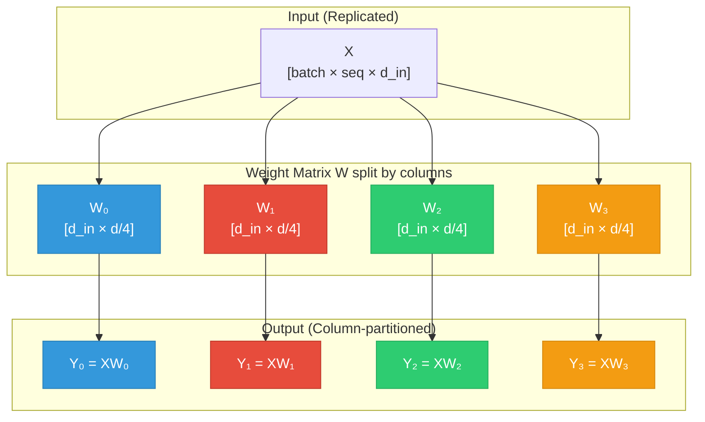
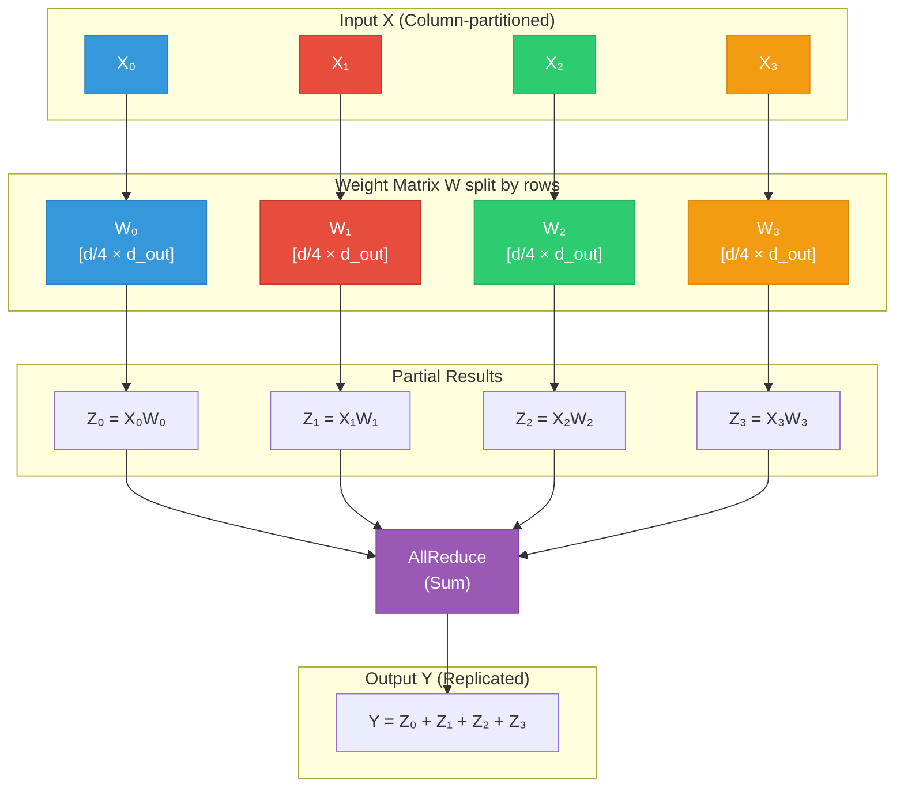
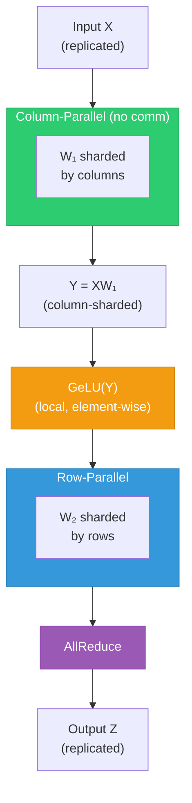
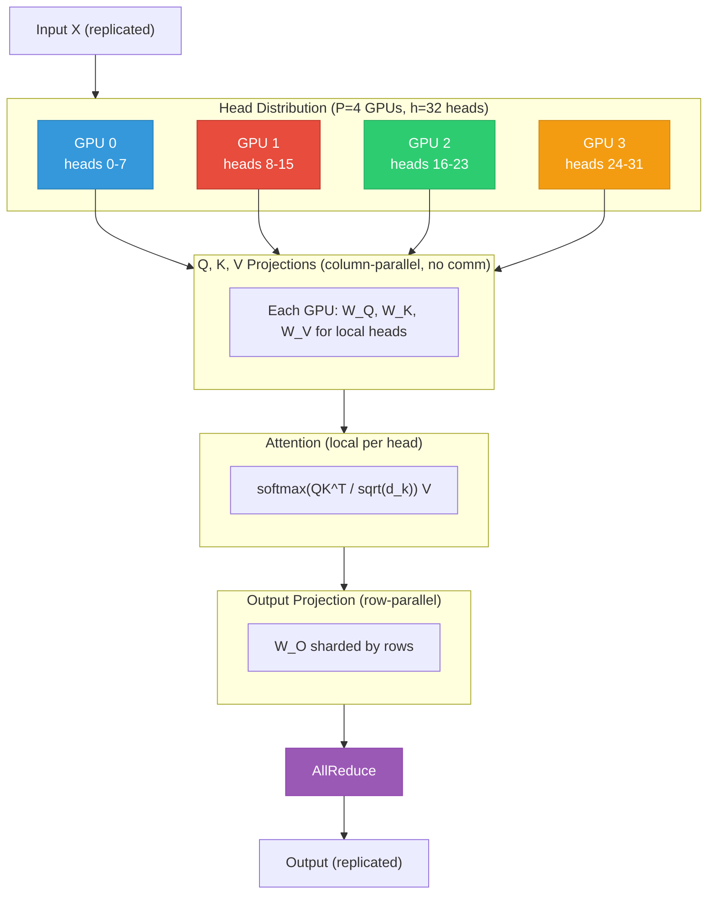

<div class="chapter-opener" markdown>
矩阵乘法是线性的：$f(aX) = af(X)$ 且 $f(X + Y) = f(X) + f(Y)$。仅凭这一性质就能实现张量并行。像 GELU 这样的非线性操作破坏了这一性质，但逐元素操作仍然可以在本地完成；只有那些把分片维度耦合起来的操作才强制要求同步。理解线性性，就能看清哪些操作可以并行、哪些操作会强制通信。
</div>

<div class="investigation-question" markdown>
**问题**：我们想把一个线性层 $Y = XW$ 分片到 8 块 GPU 上。能按列切分 $W$ 吗？按行呢？偏置怎么办？LayerNorm 呢？GELU 呢？
</div>

!!! abstract "本章导览"
    **前置知识**：[第 11 章](../collectives/11-primitives-properties.md)（AllReduce、AllGather）、[第 14 章](14-data-parallelism-associativity.md)（数据并行基础）

    **核心洞见**：线性操作（矩阵乘法）可以在多块 GPU 上划分，最后做一次 AllReduce。非线性操作（GELU、LayerNorm、Softmax）是否会强制同步，取决于分片的是哪个维度——弄清哪些操作会耦合分片，就决定了你的通信模式。

## 线性性

!!! info "与《速度的代数》的联系"
    线性性是配套书[*The Algebra of Speed*](https://ttsugriy.github.io/performance-book/)中探讨的核心代数性质之一，在单机上它支持 BLAS 级分块、向量化等优化。这里的同一性质支持一种根本不同的优化：**把一个操作拆到多台设备上**。代数相同，回报却是分布式的。

### 定义

向量空间之间的函数 $f: V \to W$ 若对所有向量 $X, Y \in V$ 和标量 $a, b$ 满足：

$$f(aX + bY) = af(X) + bf(Y)$$

则称其为**线性**的。

这等价于两个条件：

1. **可加性**：$f(X + Y) = f(X) + f(Y)$
2. **齐次性**：$f(aX) = af(X)$

### 线性性为何能实现并行

若 $f$ 线性，且把输入划分为 $X = X_1 + X_2$：

$$f(X) = f(X_1 + X_2) = f(X_1) + f(X_2)$$

我们可以独立地计算 $f(X_1)$ 和 $f(X_2)$，再把结果相加。

对矩阵乘法 $f(X) = XW$：

$$f(X_1 + X_2) = (X_1 + X_2)W = X_1W + X_2W = f(X_1) + f(X_2)$$

这种**分解**正是张量并行（tensor parallelism）的基础。

### 操作的分类

| 操作 | 线性？ | 可并行？ |
|-----------|---------|-----------------|
| 矩阵乘法 | 是 | 是（需结构化切分） |
| 偏置加法 | 仿射（线性 + 平移） | 特殊处理 |
| ReLU | 否 | 仅逐元素 |
| GELU | 否 | 仅逐元素 |
| Softmax | 否 | 需要 softmax 轴上的完整张量 |
| LayerNorm | 否 | 需要统计量 |
| Dropout | 否（随机） | 逐元素，需谨慎 |

## 列并行线性层

### 思路

对于线性层 $Y = XW + b$，其中 $W \in \mathbb{R}^{d_{in} \times d_{out}}$：

沿列（输出维度）切分 $W$：

$$W = [W_1 | W_2 | \cdots | W_P]$$

其中每个 $W_i \in \mathbb{R}^{d_{in} \times (d_{out}/P)}$。

### 计算

每块 GPU $i$ 持有：

- 完整输入 $X$（复制）
- 权重分片 $W_i$
- 偏置分片 $b_i$

计算：

$$Y_i = XW_i + b_i$$

结果按列划分：

$$Y = [Y_1 | Y_2 | \cdots | Y_P]$$

### 为什么成立

矩阵乘法对列拼接满足分配律：

$$X[W_1 | W_2] = [XW_1 | XW_2]$$

**证明**：

设 $X \in \mathbb{R}^{m \times n}$、$W_1 \in \mathbb{R}^{n \times k_1}$、$W_2 \in \mathbb{R}^{n \times k_2}$。

对 $j \leq k_1$，$XW_1$ 的 $(i, j)$ 元素：

$$(XW_1)_{ij} = \sum_{\ell=1}^{n} X_{i\ell} (W_1)_{\ell j}$$

对 $j \leq k_1$，$X[W_1 | W_2]$ 的 $(i, j)$ 元素：

$$(X[W_1 | W_2])_{ij} = \sum_{\ell=1}^{n} X_{i\ell} [W_1 | W_2]_{\ell j} = \sum_{\ell=1}^{n} X_{i\ell} (W_1)_{\ell j}$$

完全一致。$\square$

### 通信

**前向**：无需通信。每块 GPU 独立计算。

**反向**：关于 $X$ 的梯度需要 AllReduce：

$$\frac{\partial L}{\partial X} = \frac{\partial L}{\partial Y} W^T = \sum_{i=1}^{P} \frac{\partial L}{\partial Y_i} W_i^T$$

### 示意图

下图展示权重矩阵如何按列切分到多块 GPU：



**前向无通信**——每块 GPU 独立计算自己的输出分片。

## 行并行线性层

### 思路

沿行（输入维度）切分 $W$：

$$W = \begin{bmatrix} W_1 \\ W_2 \\ \vdots \\ W_P \end{bmatrix}$$

其中每个 $W_i \in \mathbb{R}^{(d_{in}/P) \times d_{out}}$。

### 计算

要求输入沿列切分：

$$X = [X_1 | X_2 | \cdots | X_P]$$

每块 GPU $i$ 持有：

- 输入分片 $X_i$
- 权重分片 $W_i$

计算部分结果：

$$Z_i = X_i W_i$$

注意：$X_i \in \mathbb{R}^{m \times (d_{in}/P)}$，$W_i \in \mathbb{R}^{(d_{in}/P) \times d_{out}}$，因此 $Z_i \in \mathbb{R}^{m \times d_{out}}$。

### 为什么需要 AllReduce

完整结果需要求和：

$$Y = XW = \sum_{i=1}^{P} X_i W_i = \sum_{i=1}^{P} Z_i$$

每块 GPU 有一个部分和 $Z_i$。AllReduce 在所有 GPU 上计算 $\sum_i Z_i$。

**证明**：

对划分的乘法：

$$XW = [X_1 | X_2 | \cdots | X_P] \begin{bmatrix} W_1 \\ W_2 \\ \vdots \\ W_P \end{bmatrix}$$

其 $(i, j)$ 元素：

$$(XW)_{ij} = \sum_{k=1}^{d_{in}} X_{ik} W_{kj} = \sum_{p=1}^{P} \sum_{k \in \text{shard } p} X_{ik} W_{kj}$$

$$= \sum_{p=1}^{P} (X_p W_p)_{ij} \quad \square$$

### 示意图

下图展示带 AllReduce 的行并行计算：



**需要 AllReduce**——部分结果必须在所有 GPU 之间求和。

### 偏置的处理

行并行带偏置 $Y = XW + b$ 时：

- 在 AllReduce **之后**加偏置（作用于完整结果）
- 或者：每块 GPU 在 AllReduce 之前加 $b/P$（由于求和，结果正确）

## Megatron-LM 模式

Shoeybi 等人（2019）提出了一种优雅的模式，把列并行与行并行结合起来。

### MLP 块

标准 Transformer MLP：

$$\text{MLP}(X) = \text{GeLU}(X W_1) W_2$$

采用 Megatron 并行后：



**关键洞见**：列并行产生的列分片输出，恰好是行并行所需要的输入！

### 为什么 GELU 不会破坏这一结构

GELU 是逐元素应用的。$Y$ 的每个元素都由一块 GPU 计算。

尽管：

$$\text{GeLU}(Y_1 + Y_2) \neq \text{GeLU}(Y_1) + \text{GeLU}(Y_2)$$

我们并没有拆分元素——我们沿隐藏维度拆分张量。每块 GPU 对其完整的切片计算 GeLU：

$$\text{GeLU}(Y) = [\text{GeLU}(Y_0) | \text{GeLU}(Y_1) | \cdots | \text{GeLU}(Y_{P-1})]$$

这之所以成立，是因为 GeLU 独立地作用于每个元素。

### 注意力块

Transformer 注意力：

$$\text{Attention}(X) = \text{softmax}\left(\frac{QK^T}{\sqrt{d_k}}\right) V$$

其中 $Q = XW^Q$，$K = XW^K$，$V = XW^V$。

**多头注意力天然可并行**：

$$\text{MultiHead}(X) = \text{Concat}(\text{head}_1, \ldots, \text{head}_h) W^O$$

每个头相互独立。有 $h$ 个头、$P$ 块 GPU 时（$P$ 整除 $h$）：

每块 GPU 计算 $h/P$ 个头。



### 通信次数统计

每个 Transformer 层：

| 组件 | 通信 |
|-----------|---------------|
| 注意力 Q、K、V 投影 | 无（列并行） |
| 注意力计算 | 无（头并行） |
| 注意力输出投影 | 1 次 AllReduce |
| MLP 上投影 | 无（列并行） |
| GeLU | 无（本地） |
| MLP 下投影 | 1 次 AllReduce |

**前向共 2 次 AllReduce（含反向共 4 次）**

## 通信分析

### 每层通信量

对一个 Transformer：

- 隐藏维度 $d$
- 张量并行度 $P$
- 序列长度 $s$
- 批大小 $b$

每次 AllReduce 同步激活张量：

$$V_{\text{AR}} = 2 \cdot \frac{P-1}{P} \cdot b \cdot s \cdot d \cdot \text{sizeof}(\text{dtype})$$

每层两次 AllReduce：

$$V_{\text{layer}} = 4 \cdot \frac{P-1}{P} \cdot b \cdot s \cdot d \cdot \text{sizeof}(\text{dtype})$$

对 FP16 和大 $P$：

$$V_{\text{layer}} \approx 8bsd \text{ bytes}$$

### 每层时间

使用 α-β 模型：

$$T_{\text{comm}} = 2 \times \left( 2(P-1)\alpha + 2\frac{P-1}{P} \cdot \frac{bsd}{\beta} \right)$$

对大张量（受带宽支配）：

$$T_{\text{comm}} \approx \frac{8bsd}{\beta}$$

### 计算-通信比

每层计算量（仅前向）：

$$C_{\text{layer}} \approx 4 \cdot b \cdot s \cdot d^2 + 2 \cdot b \cdot s^2 \cdot d$$

当 $s \ll d$ 时（LLM 的典型情形）：

$$C_{\text{layer}} \approx 4bsd^2$$

比值：

$$R = \frac{C/P}{T_{\text{comm}}} = \frac{4bsd^2 / (P \cdot F)}{8bsd / \beta} = \frac{d \cdot \beta}{2PF}$$

对 H100（$F = 989 \times 10^{12}$ FLOP/s 密集 BF16）、NVLink（$\beta = 900$ GB/s）、$d = 8192$：

$$R = \frac{8192 \times 900 \times 10^9}{2P \times 989 \times 10^{12}} = \frac{8192 \times 900}{1978P \times 10^3} \approx \frac{3.7}{P}$$

当 $P = 8$ 时：$R \approx 0.23$——受限于通信！

**这就是张量并行通常局限在节点内的原因。**

## 层归一化

### 挑战

LayerNorm：

$$\text{LN}(X) = \gamma \cdot \frac{X - \mu}{\sigma} + \beta$$

其中：

$$\mu = \frac{1}{d} \sum_{i=1}^{d} X_i, \quad \sigma = \sqrt{\frac{1}{d} \sum_{i=1}^{d} (X_i - \mu)^2}$$

计算 $\mu$ 和 $\sigma$ 需要完整的隐藏维度——无法在分片激活上完成。

### 解决方案

**方案 1：在复制激活上做预 LayerNorm**

在进入 TP 区域之前应用 LayerNorm：

```
X (replicated) → LayerNorm → X' (replicated) → Column-parallel → ...
```

这是 Megatron-LM 的做法。

**方案 2：并行 LayerNorm**

在每个分片上计算部分统计量，再 AllReduce 得到全局统计量。

GPU $i$ 计算：

$$\mu_i = \frac{1}{d/P} \sum_{j \in \text{shard } i} X_j, \quad s_i = \sum_{j \in \text{shard } i} X_j^2$$

AllReduce 得到：

$$\mu = \frac{1}{P} \sum_i \mu_i, \quad \sigma = \sqrt{\frac{1}{d} \sum_i s_i - \mu^2}$$

然后用全局统计量在本地归一化。

**代价**：每个 LayerNorm 都要额外一次 AllReduce。通常会被避免。

## 张量并行中的 Dropout

### 挑战

Dropout 应用一个随机掩码：

$$\text{Dropout}(X) = \frac{X \odot M}{1-p}$$

其中 $M$ 是二值掩码，$P(M_i = 1) = 1 - p$。

为保证可复现性，对复制的激活，各 GPU 上的掩码必须相同。

### 解决方案：同步随机数生成器

```python
class TPDropout(nn.Module):
    def __init__(self, p, tp_group):
        self.p = p
        self.tp_group = tp_group

    def forward(self, x):
        if self.training:
            # Synchronize RNG state across TP group
            seed = torch.randint(0, 2**32, (1,))
            dist.broadcast(seed, src=0, group=self.tp_group)

            # Generate identical mask on all GPUs
            gen = torch.Generator().manual_seed(seed.item())
            mask = torch.bernoulli(torch.ones_like(x) * (1 - self.p),
                                   generator=gen)

            return x * mask / (1 - self.p)
        return x
```

## 实现

### 列并行线性层

```python
import torch
import torch.nn as nn
import torch.distributed as dist

class ColumnParallelLinear(nn.Module):
    """Linear layer with column-wise weight partitioning."""

    def __init__(self, in_features, out_features, tp_group, bias=True):
        super().__init__()
        self.tp_group = tp_group
        self.tp_size = dist.get_world_size(tp_group)
        self.tp_rank = dist.get_rank(tp_group)

        # Each GPU holds out_features / tp_size columns
        self.out_features_per_gpu = out_features // self.tp_size

        # Local weight shard
        self.weight = nn.Parameter(
            torch.empty(self.out_features_per_gpu, in_features)
        )
        if bias:
            self.bias = nn.Parameter(
                torch.empty(self.out_features_per_gpu)
            )
        else:
            self.bias = None

        self._init_weights()

    def _init_weights(self):
        nn.init.kaiming_uniform_(self.weight, a=5**0.5)
        if self.bias is not None:
            nn.init.zeros_(self.bias)

    def forward(self, x):
        # x: [batch, seq, in_features] - replicated
        # out: [batch, seq, out_features_per_gpu] - column-sharded
        out = torch.matmul(x, self.weight.t())
        if self.bias is not None:
            out = out + self.bias
        return out
```

### 行并行线性层

```python
class RowParallelLinear(nn.Module):
    """Linear layer with row-wise weight partitioning."""

    def __init__(self, in_features, out_features, tp_group, bias=True):
        super().__init__()
        self.tp_group = tp_group
        self.tp_size = dist.get_world_size(tp_group)
        self.tp_rank = dist.get_rank(tp_group)

        # Each GPU holds in_features / tp_size rows
        self.in_features_per_gpu = in_features // self.tp_size

        # Local weight shard
        self.weight = nn.Parameter(
            torch.empty(out_features, self.in_features_per_gpu)
        )
        if bias:
            # Bias is replicated; add after AllReduce on all ranks
            self.bias = nn.Parameter(torch.empty(out_features))
        else:
            self.bias = None

        self._init_weights()

    def _init_weights(self):
        nn.init.kaiming_uniform_(self.weight, a=5**0.5)
        if self.bias is not None:
            nn.init.zeros_(self.bias)

    def forward(self, x):
        # x: [batch, seq, in_features_per_gpu] - column-sharded
        # Compute partial result
        partial = torch.matmul(x, self.weight.t())

        # AllReduce to sum partial results
        dist.all_reduce(partial, op=dist.ReduceOp.SUM, group=self.tp_group)

        # Add bias (same on all GPUs)
        if self.bias is not None:
            partial = partial + self.bias

        return partial
```

### Megatron MLP 块

```python
class TensorParallelMLP(nn.Module):
    """MLP block with Megatron-style tensor parallelism."""

    def __init__(self, hidden_size, ffn_hidden_size, tp_group):
        super().__init__()
        self.tp_group = tp_group

        # Up projection: column-parallel (output is sharded)
        self.up_proj = ColumnParallelLinear(
            hidden_size, ffn_hidden_size, tp_group, bias=True
        )

        # Down projection: row-parallel (input is sharded, output replicated)
        self.down_proj = RowParallelLinear(
            ffn_hidden_size, hidden_size, tp_group, bias=True
        )

        self.activation = nn.GELU()

    def forward(self, x):
        # x: [batch, seq, hidden] - replicated
        x = self.up_proj(x)  # [batch, seq, ffn/TP] - sharded
        x = self.activation(x)  # Local GELU
        x = self.down_proj(x)  # [batch, seq, hidden] - replicated
        return x
```

### 张量并行注意力

```python
class TensorParallelAttention(nn.Module):
    """Multi-head attention with tensor parallelism."""

    def __init__(self, hidden_size, num_heads, tp_group):
        super().__init__()
        self.tp_group = tp_group
        self.tp_size = dist.get_world_size(tp_group)

        self.hidden_size = hidden_size
        self.num_heads = num_heads
        self.num_heads_per_gpu = num_heads // self.tp_size
        self.head_dim = hidden_size // num_heads

        # Q, K, V projections: column-parallel
        self.qkv_proj = ColumnParallelLinear(
            hidden_size, 3 * hidden_size, tp_group, bias=True
        )

        # Output projection: row-parallel
        self.out_proj = RowParallelLinear(
            hidden_size, hidden_size, tp_group, bias=True
        )

    def forward(self, x, mask=None):
        batch, seq, _ = x.shape

        # QKV projection (column-parallel, no comm)
        qkv = self.qkv_proj(x)  # [batch, seq, 3 * hidden / TP]

        # Reshape to separate Q, K, V for local heads
        qkv = qkv.view(batch, seq, 3, self.num_heads_per_gpu, self.head_dim)
        q, k, v = qkv[:, :, 0], qkv[:, :, 1], qkv[:, :, 2]

        # Attention computation (local)
        q = q.transpose(1, 2)  # [batch, heads_per_gpu, seq, head_dim]
        k = k.transpose(1, 2)
        v = v.transpose(1, 2)

        attn_weights = torch.matmul(q, k.transpose(-2, -1))
        attn_weights = attn_weights / (self.head_dim ** 0.5)
        if mask is not None:
            attn_weights = attn_weights + mask
        attn_weights = torch.softmax(attn_weights, dim=-1)

        attn_output = torch.matmul(attn_weights, v)
        attn_output = attn_output.transpose(1, 2).reshape(
            batch, seq, self.num_heads_per_gpu * self.head_dim
        )

        # Output projection (row-parallel, AllReduce)
        output = self.out_proj(attn_output)

        return output
```

## 反向传播分析

### 梯度流

对列并行 $Y = XW$，其中 $W$ 按列分片：

**前向**：无通信
**反向**：

给定 $\frac{\partial L}{\partial Y}$（与 $Y$ 一样分片）：

$$\frac{\partial L}{\partial W_i} = X^T \frac{\partial L}{\partial Y_i}$$

本地计算——$X$ 是复制的，$\frac{\partial L}{\partial Y_i}$ 在本地。

$$\frac{\partial L}{\partial X} = \frac{\partial L}{\partial Y} W^T = \sum_i \frac{\partial L}{\partial Y_i} W_i^T$$

需要 AllReduce 汇总来自所有分片的贡献。

### 反向通信

对一个 Megatron 风格的层：

| 前向 | 反向 |
|---------|----------|
| 列并行 MLP：0 通信 | AllReduce（求 $\partial L/\partial X$） |
| 行并行 MLP：AllReduce | 0 通信（输入梯度在本地） |
| 列并行注意力：0 通信 | AllReduce |
| 行并行注意力输出：AllReduce | 0 通信 |

**每层总计**：4 次 AllReduce（2 次前向 + 2 次反向）

## 扩展极限

### 最大张量并行度

张量并行度 $P$ 受限于：

1. **头数整除性**：$P$ 必须整除注意力头数
2. **隐藏维度整除性**：$P$ 必须整除隐藏维度
3. **通信开销**：NVLink 带宽的限制

**实践中的上限**：

| 节点类型 | 最大 TP | 原因 |
|-----------|--------|--------|
| 8× A100 NVLink | 8 | 整节点，高带宽 |
| 8× H100 NVLink | 8 | 整节点，更高带宽 |
| 2 节点（16 GPU） | 16 | 节点间通信昂贵 |

### 何时使用张量并行

**使用 TP 的情形**：

- 模型放不进单 GPU 内存
- 在单节点内（快速 NVLink）
- 需要减少每 GPU 的激活内存

**不使用 TP 的情形**：

- 模型能轻松放下（DP 更简单）
- 需要跨节点边界（改用 PP）
- 批大小非常小（受限于延迟）

## 练习题

1. **偏置的划分**：在列并行线性 $Y = XW + b$ 中，证明把 $b$ 与 $W$ 的列一起划分能得到正确结果。在行并行中，为什么偏置必须在 AllReduce 之后加？

??? success "解答"
    **第 1 部分：列并行的偏置划分**

    列并行：$Y = XW + b$，其中 $W = [W_1 | W_2 | \cdots | W_P]$

    输出 $Y = [Y_1 | Y_2 | \cdots | Y_P]$ 按列划分。

    偏置同样划分：$b = [b_1 | b_2 | \cdots | b_P]$

    在 GPU $i$ 上：

    $$Y_i = XW_i + b_i$$

    **为什么正确：**

    完整计算是：

    $$Y = XW + b = [XW_1 | XW_2 | \cdots | XW_P] + [b_1 | b_2 | \cdots | b_P]$$

    由于偏置加法是逐元素的，且列划分是对齐的：

    $$= [XW_1 + b_1 | XW_2 + b_2 | \cdots | XW_P + b_P] = [Y_1 | Y_2 | \cdots | Y_P] \quad \checkmark$$

    **第 2 部分：行并行的偏置处理**

    行并行：$Y = XW + b$，其中 $W = \begin{bmatrix} W_1 \\ W_2 \\ \vdots \\ W_P \end{bmatrix}$

    在 GPU $i$ 上：

    $$Z_i = X_i W_i$$

    完整结果需要：$Y = \sum_{i=1}^{P} Z_i + b$

    **为什么偏置必须在 AllReduce 之后：**

    如果每块 GPU 在 AllReduce 之前加 $b$：

    $$\hat{Z}_i = X_i W_i + b$$

    AllReduce 之后：

    $$\hat{Y} = \sum_{i=1}^{P} \hat{Z}_i = \sum_{i=1}^{P} (X_i W_i + b) = \sum_{i=1}^{P} X_i W_i + Pb = XW + Pb$$

    这是**错的**——偏置被放大了 $P$ 倍！

    **正确的做法：**

    | 方案 | 实现 |
    |----------|----------------|
    | AllReduce 之后加 | $Y = \text{AllReduce}(\sum_i Z_i) + b$ |
    | 加缩放后的偏置 | 每块 GPU 加 $b/P$，再 AllReduce |
    | 只在一个 rank 上加 | 仅 rank 0 加 $b$，再 AllReduce |

    第一种最简单、最常见。

2. **通信量推导**：对一个 $d = 4096$、$s = 2048$、$b = 4$、TP = 8 的 Transformer，计算前向每层精确传输的字节数。使用 FP16。

??? success "解答"
    **已知：**

    - 隐藏维度：$d = 4096$
    - 序列长度：$s = 2048$
    - 批大小：$b = 4$
    - 张量并行度：$P = 8$
    - 数据类型：FP16（每元素 2 字节）

    **AllReduce 通信量公式（环形算法）：**

    $$V_{\text{AR}} = 2 \times \frac{P-1}{P} \times \text{tensor size}$$

    **每次 AllReduce 的张量大小：**

    每次 AllReduce 同步激活张量：

    $$\text{Tensor size} = b \times s \times d \times \text{sizeof(FP16)}$$

    $$= 4 \times 2048 \times 4096 \times 2 = 67,108,864 \text{ bytes} = 64 \text{ MB}$$

    **每次 AllReduce 的通信量：**

    $$V_{\text{AR}} = 2 \times \frac{8-1}{8} \times 64 \text{ MB} = 2 \times \frac{7}{8} \times 64 = 112 \text{ MB}$$

    **前向每层通信：**

    | 组件 | AllReduce 次数 | 通信量 |
    |-----------|------------|--------|
    | 注意力输出投影 | 1 | 112 MB |
    | MLP 下投影 | 1 | 112 MB |
    | **总计** | **2** | **224 MB** |

    $$\boxed{V_{\text{layer}}^{\text{forward}} = 224 \text{ MB}}$$

    **每 GPU 带宽计算：**

    在环形 AllReduce 中，每块 GPU 发送和接收：

    $$V_{\text{per-GPU}} = 2 \times \frac{P-1}{P} \times 64 \text{ MB} = 112 \text{ MB per AllReduce}$$

    两次 AllReduce：每 GPU 每层 $224$ MB。

    **对整个模型（例如 80 层）：**

    $$V_{\text{total}}^{\text{forward}} = 80 \times 224 \text{ MB} = 17.92 \text{ GB}$$

3. **计算-通信比**：对同一模型，假设 H100 为 989 TFLOP/s（密集 BF16）、NVLink 为 900 GB/s，计算 $R$。该层受计算还是受通信支配？

??? success "解答"
    **已知（沿用上一题）：**

    - $d = 4096$、$s = 2048$、$b = 4$、$P = 8$
    - H100：$F = 989 \times 10^{12}$ FLOP/s（密集 BF16 Tensor Core）
    - NVLink：$\beta = 900 \times 10^9$ 字节/秒

    **每层计算量（前向）：**

    对一个 Transformer 层：

    $$C_{\text{layer}} \approx 4bsd^2 + 2bs^2d$$

    代入 $d = 4096$、$s = 2048$：
    - 第一项：$4 \times 4 \times 2048 \times 4096^2 = 5.50 \times 10^{11}$ FLOPs
    - 第二项：$2 \times 4 \times 2048^2 \times 4096 = 1.37 \times 10^{11}$ FLOPs

    $$C_{\text{layer}} = 5.50 \times 10^{11} + 1.37 \times 10^{11} = 6.87 \times 10^{11} \text{ FLOPs}$$

    **每 GPU 计算量（TP=8）：**

    $$C_{\text{per-GPU}} = \frac{C_{\text{layer}}}{P} = \frac{6.87 \times 10^{11}}{8} = 8.59 \times 10^{10} \text{ FLOPs}$$

    **每 GPU 计算时间：**

    $$T_{\text{compute}} = \frac{C_{\text{per-GPU}}}{F} = \frac{8.59 \times 10^{10}}{989 \times 10^{12}} = 86.9 \text{ μs}$$

    **通信时间：**

    每层通信量：224 MB = $2.24 \times 10^8$ 字节

    使用受带宽支配的模型（2 次 AllReduce）：

    $$T_{\text{comm}} = \frac{V_{\text{layer}}}{\beta} = \frac{2.24 \times 10^8}{900 \times 10^9} = 249 \text{ μs}$$

    **计算-通信比：**

    $$R = \frac{T_{\text{compute}}}{T_{\text{comm}}} = \frac{86.9}{249} = \boxed{0.35}$$

    **结论：**

    $$\boxed{\text{受通信支配}}$$

    该层花在通信上的时间约为计算的 3 倍！

    | 指标 | 数值 |
    |--------|-------|
    | 计算时间 | 86.9 μs |
    | 通信时间 | 249 μs |
    | 比值 $R$ | 0.35 |
    | 区间 | 受通信支配 |

    **含义：**

    - 对这套配置，TP=8 过于激进
    - 可考虑 TP=4（$R$ 翻倍到约 0.34……实际上这里原文如此）或 TP=2（$R$ 约 0.68）
    - 或者使用序列并行来重叠通信

4. **LayerNorm 的并行**：推导从分片张量上的部分统计量计算全局均值和方差的公式。需要多大的 AllReduce 通信量？

??? success "解答"
    **在分片的隐藏维度上做 LayerNorm：**

    给定激活 $X$，隐藏维度 $d$ 被分片到 $P$ 块 GPU 上。

    GPU $i$ 持有大小为 $d/P$ 的 $X_i$。

    **全局均值：**

    $$\mu = \frac{1}{d} \sum_{j=1}^{d} X_j = \frac{1}{d} \sum_{i=1}^{P} \sum_{j \in \text{shard } i} X_j$$

    每块 GPU 计算本地和：

    $$S_i = \sum_{j \in \text{shard } i} X_j$$

    AllReduce 得到全局和：

    $$S = \sum_{i=1}^{P} S_i$$

    全局均值：

    $$\mu = \frac{S}{d}$$

    **全局方差：**

    $$\sigma^2 = \frac{1}{d} \sum_{j=1}^{d} (X_j - \mu)^2 = \frac{1}{d} \sum_{j=1}^{d} X_j^2 - \mu^2$$

    每块 GPU 计算本地平方和：

    $$Q_i = \sum_{j \in \text{shard } i} X_j^2$$

    AllReduce 得到全局平方和：

    $$Q = \sum_{i=1}^{P} Q_i$$

    全局方差：

    $$\sigma^2 = \frac{Q}{d} - \mu^2$$

    **完整算法：**

    ```python
    def parallel_layernorm(x_shard, tp_group, d, gamma, beta):
        P = dist.get_world_size(tp_group)

        # Local statistics
        local_sum = x_shard.sum(dim=-1, keepdim=True)
        local_sq_sum = (x_shard ** 2).sum(dim=-1, keepdim=True)

        # AllReduce statistics
        stats = torch.cat([local_sum, local_sq_sum], dim=-1)
        dist.all_reduce(stats, group=tp_group)
        global_sum, global_sq_sum = stats.split(1, dim=-1)

        # Global mean and variance
        mu = global_sum / d
        var = global_sq_sum / d - mu ** 2
        std = torch.sqrt(var + 1e-6)

        # Normalize locally
        x_norm = (x_shard - mu) / std

        # Apply local gamma/beta shards
        return x_norm * gamma_shard + beta_shard
    ```

    **AllReduce 通信量：**

    每次 LayerNorm，我们对每个 token 位置 AllReduce 2 个标量：

    | 统计量 | 形状 | 大小（FP32） |
    |-----------|-------|-------------|
    | 和 | $[b, s, 1]$ | $4bs$ 字节 |
    | 平方和 | $[b, s, 1]$ | $4bs$ 字节 |
    | **总计** | | $8bs$ 字节 |

    **对 $b=4$、$s=2048$：**

    $$V_{\text{LN}} = 8 \times 4 \times 2048 = 65,536 \text{ bytes} = \boxed{64 \text{ KB}}$$

    **与激活 AllReduce 的对比：**

    | AllReduce 类型 | 通信量 |
    |----------------|--------|
    | 激活（行并行） | $8bsd = 128$ MB |
    | LayerNorm 统计量 | $8bs = 64$ KB |
    | **比值** | **2000×** |

    与激活 AllReduce 相比，LayerNorm 的 AllReduce 可以忽略不计。不过，Megatron-LM 仍然通过在张量并行开始之前对复制激活应用 LayerNorm 来避免它。

5. **GeLU 的位置**：为什么 GeLU 必须位于列并行层与行并行层之间，而不能在两者之前或之后？若 GeLU 放在行并行之后会出什么问题？

??? success "解答"
    **正确的位置：列并行 → GeLU → 行并行**

    ```
    X (replicated) → ColPar W₁ → Y (sharded) → GeLU → Row Par W₂ → Z (replicated)
    ```

    **为什么 GeLU 位于列并行与行并行之间可行：**

    列并行之后：
    - 输出 $Y$ 按列分片：$Y = [Y_0 | Y_1 | \cdots | Y_{P-1}]$
    - 每个 $Y_i$ 含完整的元素（不是部分和）

    GeLU 是逐元素的：

    $$\text{GeLU}([Y_0 | Y_1 | \cdots]) = [\text{GeLU}(Y_0) | \text{GeLU}(Y_1) | \cdots]$$

    每块 GPU 独立地对本地分片应用 GeLU，无需通信！

    **若 GeLU 放在列并行之前？**

    ```
    X (replicated) → GeLU → X' (replicated) → ColPar W₁ → Y (sharded)
    ```

    这其实没问题——对复制输入做 GeLU 只是本地计算。但它不符合标准 MLP 结构：$\text{GeLU}(XW_1)W_2 \neq \text{GeLU}(X)W_1W_2$。

    **若 GeLU 放在行并行之后？**

    ```
    X → ColPar W₁ → Y (sharded) → RowPar W₂ → Z (replicated) → GeLU
    ```

    这改变了数学函数：

    $$\text{Original: } \text{GeLU}(XW_1)W_2$$

    $$\text{Modified: } \text{GeLU}(XW_1 W_2)$$

    两者**并不等价**！非线性必须位于两个线性变换之间。

    **数学上会出什么问题：**

    MLP 的表达能力来自层间的非线性。去掉它：

    $$XW_1W_2 = X(W_1W_2) = XW_{\text{combined}}$$

    这塌缩成了单一线性层。GeLU 必须打破这种复合。

    **汇总：**

    | GeLU 位置 | 有效？ | 问题 |
    |----------------|--------|-------|
    | 列并行与行并行之间 | ✓ | 正确 |
    | 列并行之前 | ✗ | 函数错误 |
    | 行并行之后 | ✗ | 函数错误 |
    | 前后都有 | ✗ | 函数错误 |

    **关键洞见：** GeLU 的位置受 MLP 数学结构约束，而不受张量并行约束。TP 只是恰好与正确位置配合得天衣无缝，因为列并行的输出是元素完整的。

6. **注意力头数的约束**：有 32 个注意力头、TP = 6 时，会出什么问题？你会如何处理这种情况？

??? success "解答"
    **问题所在：**

    有 $h = 32$ 个头、$P = 6$ 块 GPU：

    $$\frac{h}{P} = \frac{32}{6} = 5.33...$$

    头数不能整除！每块 GPU 无法拥有相同数量的头。

    **实践中会出什么问题：**

    1. **内存不均**：有些 GPU 有 5 个头，另一些有 6 个
    2. **计算不均**：各 GPU 负载失衡
    3. **同步问题**：AllReduce 的尺寸不同会很麻烦
    4. **实现复杂**：需要填充或特殊处理

    **解决方案：**

    **方案 1：选择兼容的 TP 度**

    使用 $P \in \{1, 2, 4, 8, 16, 32\}$（32 的约数）：

    | TP 度 | 每 GPU 头数 | 兼容？ |
    |-----------|---------------|-------------|
    | 2 | 16 | ✓ |
    | 4 | 8 | ✓ |
    | 6 | 5.33 | ✗ |
    | 8 | 4 | ✓ |

    **建议：** 用 TP=4 或 TP=8，而不是 TP=6。

    **方案 2：填充注意力头**

    加入虚拟头使头数可整除：

    $$h' = \lceil h / P \rceil \times P = \lceil 32/6 \rceil \times 6 = 6 \times 6 = 36$$

    加入 4 个虚拟头（置零或掩掉）。

    **缺点：**
    - 浪费计算（12.5% 开销）
    - 虚拟头带来内存开销
    - 实现复杂

    **方案 3：分组查询注意力（GQA）**

    像 Llama 2 这样的现代架构使用 KV 头更少的 GQA：
    - 查询头：32
    - KV 头：8（各组共享）

    当 $h_{kv} = 8$ 时，TP=8 可行：每 GPU 1 个 KV 头。

    **方案 4：混合并行**

    在部分分组内使用 TP：
    - GPU 0-3：对头 0-15 使用 TP=4
    - GPU 4-5：对头 16-31 使用 TP=2（16 个头，各 8 个）

    这很复杂，很少使用。

    **最佳实践：**

    $$\boxed{\text{设计 TP 度使其整除头数}}$$

    常见配置：

    | 模型 | 头数 | 有效 TP |
    |-------|-------|----------|
    | GPT-3 | 96 | 1, 2, 3, 4, 6, 8, 12, 16, 24, 32, 48 |
    | Llama 70B | 64 | 1, 2, 4, 8, 16, 32, 64 |
    | Llama 7B | 32 | 1, 2, 4, 8, 16, 32 |

7. **反向分析**：对列并行线性层 $Y = XW$，推导梯度公式，并说明 $\nabla_X L$ 需要 AllReduce 而 $\nabla_W L$ 不需要。

??? success "解答"
    **设定：**

    列并行线性：$Y = XW$，其中：
    - $X \in \mathbb{R}^{m \times d_{in}}$（在所有 GPU 上复制）
    - $W = [W_0 | W_1 | \cdots | W_{P-1}]$，$W_i \in \mathbb{R}^{d_{in} \times (d_{out}/P)}$
    - $Y = [Y_0 | Y_1 | \cdots | Y_{P-1}]$，$Y_i = XW_i$

    **已知：** $\frac{\partial L}{\partial Y}$（与 $Y$ 一样分片）

    GPU $i$ 持有：$\frac{\partial L}{\partial Y_i} \in \mathbb{R}^{m \times (d_{out}/P)}$

    **关于 $W_i$（本地权重分片）的梯度：**

    利用链式法则：

    $$\frac{\partial L}{\partial W_i} = \frac{\partial Y_i}{\partial W_i}^T \frac{\partial L}{\partial Y_i}$$

    由于 $Y_i = XW_i$：

    $$\frac{\partial L}{\partial W_i} = X^T \frac{\partial L}{\partial Y_i}$$

    **分析：**
    - $X$ 是复制的（所有 GPU 都有）
    - $\frac{\partial L}{\partial Y_i}$ 在 GPU $i$ 本地
    - 结果：$\frac{\partial L}{\partial W_i} \in \mathbb{R}^{d_{in} \times (d_{out}/P)}$

    $$\boxed{\nabla_W L \text{ 不需要通信}}$$

    每块 GPU 独立计算本地梯度。

    **关于 $X$ 的梯度：**

    利用链式法则：

    $$\frac{\partial L}{\partial X} = \sum_{j=1}^{d_{out}} \frac{\partial L}{\partial Y_j} \frac{\partial Y_j}{\partial X}$$

    由于 $Y = XW$：

    $$\frac{\partial L}{\partial X} = \frac{\partial L}{\partial Y} W^T$$

    用列划分展开：

    $$= \frac{\partial L}{\partial Y} [W_0 | W_1 | \cdots | W_{P-1}]^T$$

    $$= \frac{\partial L}{\partial Y} \begin{bmatrix} W_0^T \\ W_1^T \\ \vdots \\ W_{P-1}^T \end{bmatrix}$$

    $$= [\frac{\partial L}{\partial Y_0} | \cdots | \frac{\partial L}{\partial Y_{P-1}}] \begin{bmatrix} W_0^T \\ \vdots \\ W_{P-1}^T \end{bmatrix}$$

    $$= \sum_{i=0}^{P-1} \frac{\partial L}{\partial Y_i} W_i^T$$

    **分析：**

    GPU $i$ 可计算：$\frac{\partial L}{\partial Y_i} W_i^T \in \mathbb{R}^{m \times d_{in}}$

    但完整梯度是所有 GPU 的**和**：

    $$\frac{\partial L}{\partial X} = \sum_{i=0}^{P-1} \left( \frac{\partial L}{\partial Y_i} W_i^T \right)$$

    $$\boxed{\nabla_X L \text{ 需要 AllReduce}}$$

    **汇总：**

    | 梯度 | 公式 | 通信 |
    |----------|---------|---------------|
    | $\nabla_{W_i} L$ | $X^T \frac{\partial L}{\partial Y_i}$ | 无（本地） |
    | $\nabla_X L$ | $\sum_i \frac{\partial L}{\partial Y_i} W_i^T$ | AllReduce（求和） |

    **通信模式：**

    ```
    Forward:  X (replicated) → [Y₀|Y₁|...|Yₚ₋₁] (sharded) — no comm

    Backward: [∂L/∂Y₀|...|∂L/∂Yₚ₋₁] (sharded)
              ↓
              GPU i: ∂L/∂Yᵢ · Wᵢᵀ (local partial)
              ↓
              AllReduce(sum) → ∂L/∂X (replicated)
    ```

    这就是为什么 Megatron 把列并行（前向无通信）与行并行（输入梯度反向无通信）配对，从而实现通信的均衡。

## 旋钮与权衡

| 旋钮 | 主要效果 | 代价 |
|---|---|---|
| 张量并行度（T） | 拆分大型矩阵乘法 | 更多激活 AllReduce/AllGather |
| 节点内放置 | 更低延迟、更高带宽 | 限制拓扑与扩展 |
| 分片布局（行/列） | 改变通信阶段 | 需要匹配层序 |
| 融合（如 QKV） | 更少的集合通信 | 更复杂的内核与调度 |

## 关键要点

1. **线性性使并行成立**：$f(X_1 + X_2) = f(X_1) + f(X_2)$ 允许独立计算。

2. **列并行前向无通信**：切分输出维度，无需 AllReduce。

3. **行并行需要 AllReduce**：切分输入维度，必须求部分结果之和。

4. **Megatron 模式把它们串起来**：列并行 → 非线性 → 行并行 → AllReduce。

5. **每层 2 次 AllReduce**：一次用于注意力输出，一次用于 MLP 输出。

6. **非线性操作需谨慎**：GeLU 可作用在分片张量上；LayerNorm 不行。

7. **张量并行通信密集**：最好在 NVLink 互连的节点内使用。

8. **反向使通信翻倍**：每层共 4 次 AllReduce（前向 + 反向）。