```mermaid
gantt
    title Single Batch Pipeline (4 Stages) - 75% Bubble
    dateFormat X
    axisFormat %s

    section Stage 0
    Forward F₀    :f0, 0, 1
    Idle          :crit, 1, 6
    Backward B₀   :b0, 7, 8

    section Stage 1
    Idle          :crit, 0, 1
    Forward F₁    :f1, 1, 2
    Idle          :crit, 2, 6
    Backward B₁   :b1, 6, 7

    section Stage 2
    Idle          :crit, 0, 2
    Forward F₂    :f2, 2, 3
    Idle          :crit, 3, 5
    Backward B₂   :b2, 5, 6

    section Stage 3
    Idle          :crit, 0, 3
    Forward F₃    :f3, 3, 4
    Backward B₃   :b3, 4, 5
```

<div class="chapter-opener" markdown>
神经网络是层的复合：$f = f_L \circ f_{L-1} \circ \cdots \circ f_1$。这种顺序结构使流水线并行（pipeline parallelism）成为可能，但会产生必须尽量缩小的空闲时间"气泡"（bubble）。
</div>

<div class="investigation-question" markdown>
**问题**：如果把一个 32 层的模型拆成 4 个阶段、每个阶段 8 层，有多少时间浪费在"流水线气泡"上？能把气泡降到零吗？
</div>

!!! abstract "本章导览"
    **前置知识**：[第 4 章](../foundations/04-alpha-beta-model.md)（α-β 通信成本模型）、[第 14 章](14-data-parallelism-associativity.md)（数据并行背景）

    **核心洞见**：流水线并行利用神经网络的顺序结构——各阶段并发处理不同的微批次。气泡比例 $(P-1)/(M+P-1)$ 会随微批次数 M 增大而缩小，但激活内存会增长。交错调度（1F1B）和零气泡（ZeroBubble）技术能把开销推向零。

## 可分离性

神经网络顺序地复合函数：

$$f(x) = f_L(f_{L-1}(\cdots f_1(x)))$$

这种复合有一个关键性质：**可分离性**（separability）。只要每个函数 $f_i$ 拿到 $f_{i-1}$ 的输出，它就能在自己的设备上执行。

**定义（可分离的函数复合）**：若在仅给定 $f_{i-1}$ 输出的情况下，每个分量 $f_i$ 都能独立计算，则称复合函数 $f = f_L \circ \cdots \circ f_1$ 是*可分离*的。

**可分离性为何能实现并行**：

关键在于时间维度上的流水线化。当阶段 $i$ 处理批次 $b$ 时，阶段 $i-1$ 可以处理批次 $b+1$：

```
Time:        t₀    t₁    t₂    t₃    t₄
            ─────────────────────────────
Stage 0:   [B₀]  [B₁]  [B₂]  [B₃]  [B₄]
Stage 1:         [B₀]  [B₁]  [B₂]  [B₃]
Stage 2:               [B₀]  [B₁]  [B₂]
Stage 3:                     [B₀]  [B₁]
```

经过最初的"填充"阶段后，所有阶段同时工作。

### 数学基础

设 $h_i$ 表示阶段 $i$ 的隐藏状态（激活）：

$$h_0 = x$$

$$h_i = f_i(h_{i-1}) \quad \text{for } i = 1, \ldots, L$$

$$y = h_L$$

反向传播计算梯度：

$$\frac{\partial L}{\partial h_{L-1}} = \frac{\partial L}{\partial h_L} \cdot \frac{\partial h_L}{\partial h_{L-1}}$$

由链式法则，它可以分解为：

$$\frac{\partial L}{\partial h_i} = \frac{\partial L}{\partial h_{i+1}} \cdot \frac{\partial f_{i+1}}{\partial h_i}$$

每个阶段只需拿到下一阶段的梯度，就能算出自己的梯度。

<div class="algorithm-stepper" markdown>
<div class="stepper-controls">
<button class="stepper-prev">← 上一步</button>
<span class="step-indicator">第 1 步，共 6 步</span>
<button class="stepper-next">下一步 →</button>
<button class="stepper-play">▶ 播放</button>
</div>

<div class="step active" markdown>
**流水线设置**——模型被拆成 4 个阶段，分布在 4 块 GPU 上

<div class="tensor-viz">
<div class="partition gpu-0">GPU 0<br/>Layers 1-8</div>
<div class="partition gpu-1">GPU 1<br/>Layers 9-16</div>
<div class="partition gpu-2">GPU 2<br/>Layers 17-24</div>
<div class="partition gpu-3">GPU 3<br/>Layers 25-32</div>
</div>

每块 GPU 持有模型的 1/P。数据从左→右流动（前向），从右→左流动（反向）。
</div>

<div class="step" markdown>
**前向阶段开始**——批次进入阶段 0

<div class="tensor-viz">
<div class="partition gpu-0" style="border: 3px solid #fbbf24;">GPU 0<br/><strong>F₀</strong> 🔥</div>
<div class="partition" style="background: #374151;">GPU 1<br/>idle</div>
<div class="partition" style="background: #374151;">GPU 2<br/>idle</div>
<div class="partition" style="background: #374151;">GPU 3<br/>idle</div>
</div>

只有 GPU 0 在工作。**4 块 GPU 中有 3 块空闲**——这就是"气泡"。
</div>

<div class="step" markdown>
**前向传播**——激活流过各阶段

<div class="tensor-viz">
<div class="partition" style="background: #374151;">GPU 0<br/>idle</div>
<div class="partition gpu-1" style="border: 3px solid #fbbf24;">GPU 1<br/><strong>F₁</strong> 🔥</div>
<div class="partition" style="background: #374151;">GPU 2<br/>idle</div>
<div class="partition" style="background: #374151;">GPU 3<br/>idle</div>
</div>

GPU 0 完成前向，把激活发给 GPU 1。仍然有 75% 空闲。
</div>

<div class="step" markdown>
**前向继续**——阶段 2 与阶段 3

<div class="tensor-viz">
<div class="partition" style="background: #374151;">GPU 0<br/>idle</div>
<div class="partition" style="background: #374151;">GPU 1<br/>idle</div>
<div class="partition" style="background: #374151;">GPU 2<br/>idle</div>
<div class="partition gpu-3" style="border: 3px solid #fbbf24;">GPU 3<br/><strong>F₃</strong> 🔥</div>
</div>

阶段 3 终于开始计算。损失被算出。现在反向可以开始了。
</div>

<div class="step" markdown>
**反向阶段**——梯度从右→左流动

<div class="tensor-viz">
<div class="partition" style="background: #374151;">GPU 0<br/>idle</div>
<div class="partition" style="background: #374151;">GPU 1<br/>idle</div>
<div class="partition gpu-2" style="border: 3px solid #ef4444;">GPU 2<br/><strong>B₂</strong> 🔥</div>
<div class="partition" style="background: #374151;">GPU 3<br/>done</div>
</div>

梯度反向传播。同样的气泡问题——同一时刻只有一块 GPU 活跃。
</div>

<div class="step" markdown>
**完成**——一个批次做完了，但是……

<div class="tensor-viz">
<div class="partition complete">GPU 0<br/>✓ done</div>
<div class="partition complete">GPU 1<br/>✓ done</div>
<div class="partition complete">GPU 2<br/>✓ done</div>
<div class="partition complete">GPU 3<br/>✓ done</div>
</div>

**问题**：每块 GPU 在 8 个时间槽里只工作了 2 个 = **75% 的气泡开销！**

**解决方案**：让多个微批次流水起来，使所有 GPU 都保持忙碌。
</div>
</div>

## 流水线气泡问题

有 $P$ 个流水线阶段和单个批次时，我们面临根本性的低效。

### 单批次执行

```
Time →
Stage 0: [F₀]            [B₀]
Stage 1:     [F₁]        [B₁]
Stage 2:         [F₂]    [B₂]
Stage 3:             [F₃][B₃]
         ────────────────────────
              ↑ Idle time (bubbles)
```



其中：

- $F_i$：阶段 $i$ 的前向传播
- $B_i$：阶段 $i$ 的反向传播

### 气泡分析

!!! question "直觉检查"
    有 $P$ 个流水线阶段和 $m$ 个微批次时，在流水线填充和排空期间，某些阶段必须等待。浪费的比例会随 $P$ 增大而增大，还是会随 $m$ 增大而减小，还是两者兼有？在阅读推导之前，先猜一猜气泡比例的形式。

设 $t_F$、$t_B$ 为每阶段前向和反向的时间（此处先假设各阶段相同）。

**单个批次的总时间**：

$$T_{\text{total}} = P \cdot t_F + P \cdot t_B = P(t_F + t_B)$$

**每阶段的有用计算**：

$$T_{\text{useful}} = t_F + t_B$$

**气泡比例**：

$$\text{Bubble} = 1 - \frac{T_{\text{useful}}}{T_{\text{total}}} = 1 - \frac{1}{P} = \frac{P-1}{P}$$

**当 $P = 4$ 时**：75% 的空闲时间。这是灾难性的。

根本问题在于：在流水线中，每个阶段必须等待来自上一阶段的输入（前向）或来自下一阶段的梯度（反向）。

## GPipe：微批次流水线

Huang 等人（2019）引入微批次（micro-batching）来减少气泡。

### 微批次策略

把最小批次 $B$ 拆成 $m$ 个微批次 $\{B_1, \ldots, B_m\}$：

```
Micro-batch size: b = B/m
```

现在让微批次流水起来：

```
Time →
Stage 0: [F₀₀][F₀₁][F₀₂][F₀₃]            [B₀₃][B₀₂][B₀₁][B₀₀]
Stage 1:     [F₁₀][F₁₁][F₁₂][F₁₃]        [B₁₃][B₁₂][B₁₁][B₁₀]
Stage 2:         [F₂₀][F₂₁][F₂₂][F₂₃]    [B₂₃][B₂₂][B₂₁][B₂₀]
Stage 3:             [F₃₀][F₃₁][F₃₂][F₃₃][B₃₃][B₃₂][B₃₁][B₃₀]
                                      ↑
                               Pipeline flush
```



```mermaid
gantt
    title GPipe Schedule (4 Stages, 4 Micro-batches) - 43% Bubble
    dateFormat X
    axisFormat %s

    section Stage 0
    F₀ :f00, 0, 1
    F₁ :f01, 1, 2
    F₂ :f02, 2, 3
    F₃ :f03, 3, 4
    Idle :crit, 4, 7
    B₃ :b03, 7, 8
    B₂ :b02, 8, 9
    B₁ :b01, 9, 10
    B₀ :b00, 10, 11

    section Stage 1
    Idle :crit, 0, 1
    F₀ :f10, 1, 2
    F₁ :f11, 2, 3
    F₂ :f12, 3, 4
    F₃ :f13, 4, 5
    Idle :crit, 5, 6
    B₃ :b13, 6, 7
    B₂ :b12, 7, 8
    B₁ :b11, 8, 9
    B₀ :b10, 9, 10

    section Stage 2
    Idle :crit, 0, 2
    F₀ :f20, 2, 3
    F₁ :f21, 3, 4
    F₂ :f22, 4, 5
    F₃ :f23, 5, 6
    B₃ :b23, 6, 7
    B₂ :b22, 7, 8
    B₁ :b21, 8, 9
    B₀ :b20, 9, 10

    section Stage 3
    Idle :crit, 0, 3
    F₀ :f30, 3, 4
    F₁ :f31, 4, 5
    F₂ :f32, 5, 6
    F₃ :f33, 6, 7
    B₃ :b33, 7, 8
    B₂ :b32, 8, 9
    B₁ :b31, 9, 10
    B₀ :b30, 10, 11
```

### 微批次下的气泡分析

**时间线分解**：

1. **填充阶段**：$(P-1)$ 个时间单位，供第一个微批次穿过流水线
2. **稳定阶段**：$m$ 个前向并行执行
3. **排空阶段**：等待所有前向完成才能开始反向
4. **反向填充**：$(P-1)$ 个时间单位
5. **反向稳定阶段**：$m$ 个反向
6. **最后排空**：$(P-1)$ 个时间单位

**总时间**（以 $t_F$ 为单位，假设 $t_B = t_F$）：

$$T_{\text{total}} = 2(P - 1 + m)$$

**每阶段的有用时间**：

$$T_{\text{useful}} = 2m$$

**气泡比例**：

$$\text{Bubble} = \frac{T_{\text{total}} - T_{\text{useful}}}{T_{\text{total}}} = \frac{2(P-1)}{2(P-1+m)} = \frac{P-1}{P-1+m}$$

**示例**：

| $P$ | $m$ | 气泡比例 |
|-----|-----|-----------------|
| 4 | 1 | 75% |
| 4 | 4 | 43% |
| 4 | 16 | 16% |
| 4 | 32 | 8.6% |
| 4 | 64 | 4.5% |
| 8 | 64 | 9.9% |

**经验法则**：要气泡 < 20%，需 $m \geq 4P$。

### 内存代价

GPipe 必须为所有在途微批次保存激活：

$$\text{Activation memory} = m \cdot \text{activation size per micro-batch}$$

对一个隐藏维度 $H$、序列长度 $S$、微批次大小 $b$ 的 Transformer：

$$\text{Activations per micro-batch} \approx S \cdot b \cdot H \cdot L_{\text{per-stage}} \cdot 2$$

系数 2 是因为每层要存输入和输出两份激活。

当 $m = 32$ 时，内存增长 32 倍。这往往是难以承受的。

### GPipe 中的梯度累积

梯度在微批次之间累积：

```python
def gpipe_step(model_stages, micro_batches):
    """GPipe forward and backward pass."""
    # Forward pass: pipeline micro-batches
    activations = {}  # Store for backward
    for mb_idx, micro_batch in enumerate(micro_batches):
        x = micro_batch
        for stage_idx, stage in enumerate(model_stages):
            if (stage_idx, mb_idx) not in activations:
                activations[(stage_idx, mb_idx)] = []
            activations[(stage_idx, mb_idx)].append(x)
            x = stage.forward(x)

    # Backward pass: reverse order
    for mb_idx in reversed(range(len(micro_batches))):
        grad = initial_grad(mb_idx)
        for stage_idx in reversed(range(len(model_stages))):
            stage = model_stages[stage_idx]
            saved = activations[(stage_idx, mb_idx)]
            grad = stage.backward(saved, grad)  # Accumulates gradients

    # Single optimizer step after all micro-batches
    optimizer.step()
```

## 1F1B：省内存的调度

1F1B（One Forward One Backward，一前一后）调度由 PipeDream 提出，通过交错前向和反向来控制内存。

### 1F1B 调度

不再是所有前向再做所有反向：

```
GPipe:
Stage 0: [F₀][F₁][F₂][F₃][F₄][F₅][F₆][F₇]      [B₇][B₆][B₅][B₄][B₃][B₂][B₁][B₀]
                                         ↑ Peak memory: 8 activations

1F1B:
Stage 0: [F₀][F₁][F₂][F₃][B₀][F₄][B₁][F₅][B₂][F₆][B₃][F₇][B₄][B₅][B₆][B₇]
                    ↑ Peak memory: 4 activations
```

关键差别在交错模式下清晰可见：

```mermaid
gantt
    title 1F1B Schedule (4 Stages, 8 Micro-batches)
    dateFormat X
    axisFormat %s

    section Stage 0
    F₀ :f0, 0, 1
    F₁ :f1, 1, 2
    F₂ :f2, 2, 3
    F₃ :f3, 3, 4
    B₀ :b0, 4, 5
    F₄ :f4, 5, 6
    B₁ :b1, 6, 7
    F₅ :f5, 7, 8
    B₂ :b2, 8, 9
    F₆ :f6, 9, 10
    B₃ :b3, 10, 11
    F₇ :f7, 11, 12
    B₄ :b4, 12, 13
    B₅ :b5, 13, 14
    B₆ :b6, 14, 15
    B₇ :b7, 15, 16

    section Stage 1
    Idle :crit, 0, 1
    F₀ :f10, 1, 2
    F₁ :f11, 2, 3
    F₂ :f12, 3, 4
    B₀ :b10, 4, 5
    F₃ :f13, 5, 6
    B₁ :b11, 6, 7
    F₄ :f14, 7, 8
    B₂ :b12, 8, 9
    F₅ :f15, 9, 10
    B₃ :b13, 10, 11
    F₆ :f16, 11, 12
    B₄ :b14, 12, 13
    F₇ :f17, 13, 14
    B₅ :b15, 14, 15
    B₆ :b16, 15, 16
    B₇ :b17, 16, 17

    section Stage 2
    Idle :crit, 0, 2
    F₀ :f20, 2, 3
    F₁ :f21, 3, 4
    B₀ :b20, 4, 5
    F₂ :f22, 5, 6
    B₁ :b21, 6, 7
    F₃ :f23, 7, 8
    B₂ :b22, 8, 9
    F₄ :f24, 9, 10
    B₃ :b23, 10, 11
    F₅ :f25, 11, 12
    B₄ :b24, 12, 13
    F₆ :f26, 13, 14
    B₅ :b25, 14, 15
    F₇ :f27, 15, 16
    B₆ :b26, 16, 17
    B₇ :b27, 17, 18

    section Stage 3
    Idle :crit, 0, 3
    F₀ :f30, 3, 4
    B₀ :b30, 4, 5
    F₁ :f31, 5, 6
    B₁ :b31, 6, 7
    F₂ :f32, 7, 8
    B₂ :b32, 8, 9
    F₃ :f33, 9, 10
    B₃ :b33, 10, 11
    F₄ :f34, 11, 12
    B₄ :b34, 12, 13
    F₅ :f35, 13, 14
    B₅ :b35, 14, 15
    F₆ :f36, 15, 16
    B₆ :b36, 16, 17
    F₇ :f37, 17, 18
    B₇ :b37, 18, 19
```



### 内存上界

在 1F1B 中，每个阶段最多保存 $P$ 个激活：

$$\text{Peak activations} = P \text{ (not } m \text{)}$$

这是因为一旦对应前向的梯度可用，我们就立刻执行反向。

### 1F1B 调度的构造

对阶段 $s$、$P$ 个阶段、$m$ 个微批次：

**预热阶段**（阶段 $s$ 等待更早阶段传来的 $s$ 个前向）：

- 执行 $s$ 次前向

**稳定阶段**（交替 1 前向、1 反向）：

- 对从 $s$ 到 $m - P + s$ 的微批次 $i$：

  - 对微批次 $i - s$ 做反向
  - 对微批次 $i$ 做前向

**冷却阶段**（排空剩余反向）：

- 执行剩余的 $P - s - 1$ 次反向

```python
def schedule_1f1b(stage_id, num_stages, num_micro_batches):
    """Generate 1F1B schedule for a single stage."""
    P = num_stages
    m = num_micro_batches
    s = stage_id

    schedule = []

    # Warmup: s forward passes
    for i in range(s):
        schedule.append(('F', i))

    # Steady state: 1F1B
    for i in range(s, m):
        backward_idx = i - s
        if backward_idx < m:
            schedule.append(('B', backward_idx))
        if i < m:
            schedule.append(('F', i))

    # Cooldown: remaining backwards
    for i in range(m - P + s + 1, m):
        schedule.append(('B', i))

    return schedule
```

### 气泡对比

1F1B 的气泡比例与 GPipe **相同**：

$$\text{Bubble} = \frac{P-1}{P-1+m}$$

它的好处是内存，而非减少气泡。

## 交错流水线并行

Narayanan 等人（2021）引入了带虚拟阶段（virtual stage）的交错调度。

### 虚拟阶段

不是给每台设备分配连续的层，而是分配**多个不连续的块**：

```
Physical stages: 4 devices
Virtual stages: 8 (2 per device)

Device 0: Stage 0, Stage 4
Device 1: Stage 1, Stage 5
Device 2: Stage 2, Stage 6
Device 3: Stage 3, Stage 7
```

### 带虚拟阶段的执行

```
Device 0: [V0,F₀][V4,F₀][V0,F₁][V4,F₁]...[V4,B₁][V0,B₁][V4,B₀][V0,B₀]
Device 1:     [V1,F₀][V5,F₀][V1,F₁][V5,F₁]...
```

其中 $V_i$ 表示虚拟阶段 $i$。

### 气泡的减少

每台设备有 $v$ 个虚拟阶段（共 $Pv$ 个虚拟阶段），标准 1F1B 的气泡为：

$$\text{Bubble} = \frac{P - 1}{m + P - 1}$$

采用交错后，常用的大 $m$ 近似为：

$$\text{Bubble}_{\text{interleaved}} \approx \frac{P-1}{m \cdot v}$$

当该近似成立时，气泡缩小 $v$ 倍。

**示例**：$P = 4$、$m = 8$、$v = 2$
- 标准：气泡 = 3/11 = 27%
- 交错：气泡 = 3/(8×2) = 19%

### 代价：通信

交错需要更多跨设备通信：

- 标准：每微批次 2 次点对点（前向 + 反向）
- 有 $v$ 个虚拟阶段的交错：每微批次 $2v$ 次点对点

## 零气泡流水线并行

Qi 等人（2023）通过拆分反向传播实现了接近零的气泡。

### 反向传播的分解

反向传播计算两件事：

1. **输入梯度** $\nabla_h L$：上一阶段需要
2. **权重梯度** $\nabla_W L$：优化器更新需要

两者可以分开计算：

$$B = B_h + B_W$$

其中：

- $B_h$：计算关于输入的梯度（必须按顺序进行）
- $B_W$：计算关于权重的梯度（可以延后）

### 零气泡调度

洞见在于：$B_W$ 可以填补气泡时间槽：

```
Standard 1F1B:
Stage 0: [F][F][F][F][B][F][B][F][B][B][B][B][ ][ ][ ]
                                         ↑ bubbles

Zero-Bubble:
Stage 0: [F][F][F][F][Bh][F][Bh][F][Bh][Bh][Bh][Bh][Bw][Bw][Bw]
                                                  ↑ weight grads fill bubbles
```

### ZB-H1 调度

最简单的零气泡调度（ZB-H1）：

```
Stage 0: [F₀][F₁][F₂][F₃][Bh₀][F₄][Bh₁][F₅][Bh₂][F₆][Bh₃][F₇]
         [Bh₄][Bh₅][Bh₆][Bh₇][Bw₀][Bw₁][Bw₂][Bw₃][Bw₄][Bw₅][Bw₆][Bw₇]
```

所有气泡都被权重梯度计算填满。

### ZB-H2 调度

进一步优化允许重叠：

$$\text{Bubble}_{\text{ZB-H2}} \approx 0$$

在负载完全均衡时，可实现零气泡。

### 内存代价

零气泡调度需要保存：

- 用于 $B_h$ 计算的激活
- 用于延后的 $B_W$ 计算的中间值

峰值内存相比 1F1B 可能增加约 30%。

## 通信分析

流水线并行的通信模式很轻量。

### 点对点通信

每个阶段把激活发给下一个阶段：

**前向**：阶段 $i$ → 阶段 $i+1$
**反向**：阶段 $i+1$ → 阶段 $i$

**激活张量大小**：

$$\text{Size} = b \cdot S \cdot H \cdot \text{sizeof(dtype)}$$

其中：

- $b$：微批次大小
- $S$：序列长度
- $H$：隐藏维度

**示例**：$b = 1$、$S = 2048$、$H = 4096$、dtype = bf16
$$\text{Size} = 1 \times 2048 \times 4096 \times 2 = 16 \text{ MB}$$

### 每步通信量

**每微批次每阶段**：

- 1 次发送（前向激活）
- 1 次接收（反向梯度）

**每个最小批次总计**：

$$\text{Volume} = 2 \cdot (P-1) \cdot m \cdot b \cdot S \cdot H \cdot \text{sizeof}$$

### 与数据并行的对比

数据并行的 AllReduce 通信量：

$$\text{Volume}_{\text{DP}} = 2 \cdot \frac{P-1}{P} \cdot \Psi \cdot \text{sizeof}$$

流水线并行的通信量：

$$\text{Volume}_{\text{PP}} = 2 \cdot (P-1) \cdot m \cdot b \cdot S \cdot H \cdot \text{sizeof}$$

对大参数量 $\Psi$ 的模型：

- $\Psi \gg m \cdot b \cdot S \cdot H$，因此 PP 的通信更少
- PP 使用 P2P（比集合通信有更高的带宽利用率）

**流水线并行的通信很高效**。

## 负载均衡

阶段时间不等会产生气泡。

### 负载不均的问题

若各阶段时间为 $t_0, t_1, \ldots, t_{P-1}$：

$$E = \frac{\sum_i t_i}{P \cdot t_{\max}} \quad \Rightarrow \quad \text{Bubble} = 1 - E$$

其中 $t_{\max} = \max_i t_i$。

### 层分配策略

**均分层数**（朴素做法）：
```python
layers_per_stage = total_layers // num_stages
```

它常常失效，因为：

- 第一层（嵌入）占内存大
- 最后一层（LM head）计算量大
- 注意力层的开销随序列长度变化

**基于剖析的分配**：

```python
def balance_stages(layer_times, num_stages):
    """Assign layers to stages for balanced execution."""
    total_time = sum(layer_times)
    target_time = total_time / num_stages

    stages = []
    current_stage = []
    current_time = 0

    for layer, time in enumerate(layer_times):
        if current_time + time > target_time * 1.1 and current_stage:
            stages.append(current_stage)
            current_stage = [layer]
            current_time = time
        else:
            current_stage.append(layer)
            current_time += time

    stages.append(current_stage)
    return stages
```

### 感知内存的均衡

同时均衡计算与内存：

```python
def balance_stages_multi_objective(layers, num_stages,
                                    memory_weight=0.5):
    """Balance compute and memory across stages."""
    # Get layer statistics
    compute_times = [profile_compute(l) for l in layers]
    memory_sizes = [profile_memory(l) for l in layers]

    # Objective: minimize max(compute) + λ * max(memory)
    best_assignment = None
    best_score = float('inf')

    for assignment in generate_assignments(len(layers), num_stages):
        stage_computes = compute_stage_totals(compute_times, assignment)
        stage_memories = compute_stage_totals(memory_sizes, assignment)

        score = (max(stage_computes) +
                 memory_weight * max(stage_memories))

        if score < best_score:
            best_score = score
            best_assignment = assignment

    return best_assignment
```

## 实现

一套完整的流水线并行实现。

### 阶段模块封装

```python
import torch
import torch.distributed as dist
from dataclasses import dataclass
from typing import List, Optional, Tuple

@dataclass
class PipelineConfig:
    num_stages: int
    num_micro_batches: int
    stage_id: int
    device: torch.device
    activation_shape: Optional[Tuple[int, ...]] = None
    activation_dtype: torch.dtype = torch.float16

class PipelineStage(nn.Module):
    """Wrapper for a pipeline stage."""

    def __init__(self, module: nn.Module, config: PipelineConfig):
        super().__init__()
        self.module = module
        self.config = config
        self.stage_id = config.stage_id
        self.num_stages = config.num_stages
        self.is_first = (self.stage_id == 0)
        self.is_last = (self.stage_id == self.num_stages - 1)

        # Communication buffers (preallocate if shape is known)
        if self.config.activation_shape is not None:
            self.recv_buffer = torch.empty(
                self.config.activation_shape,
                device=self.config.device,
                dtype=self.config.activation_dtype,
            )
        else:
            self.recv_buffer = None
        self.send_buffer = None

    def recv_forward(self) -> torch.Tensor:
        """Receive activation from previous stage."""
        if self.is_first:
            return None

        if self.recv_buffer is None:
            raise RuntimeError("recv_buffer is not initialized; set activation_shape in PipelineConfig")

        # Wait for activation from previous stage
        dist.recv(self.recv_buffer, src=self.stage_id - 1)
        return self.recv_buffer.clone().requires_grad_()

    def send_forward(self, activation: torch.Tensor):
        """Send activation to next stage."""
        if self.is_last:
            return

        self.send_buffer = activation.detach()
        dist.send(self.send_buffer, dst=self.stage_id + 1)

    def recv_backward(self) -> torch.Tensor:
        """Receive gradient from next stage."""
        if self.is_last:
            return None

        if self.recv_buffer is None:
            raise RuntimeError("recv_buffer is not initialized; set activation_shape in PipelineConfig")

        dist.recv(self.recv_buffer, src=self.stage_id + 1)
        return self.recv_buffer.clone()

    def send_backward(self, grad: torch.Tensor):
        """Send gradient to previous stage."""
        if self.is_first:
            return

        dist.send(grad, dst=self.stage_id - 1)

    def forward(self, x: torch.Tensor) -> torch.Tensor:
        return self.module(x)
```

### GPipe 调度器

```python
class GPipeScheduler:
    """GPipe: all forwards, then all backwards."""

    def __init__(self, stage: PipelineStage, config: PipelineConfig):
        self.stage = stage
        self.config = config
        self.num_micro_batches = config.num_micro_batches

    def run_batch(self, inputs: Optional[List[torch.Tensor]] = None):
        """Execute one full batch with micro-batching."""
        m = self.num_micro_batches

        # Storage for activations (needed for backward)
        input_activations = [None] * m
        output_activations = [None] * m

        # Forward pass: all micro-batches
        for i in range(m):
            if self.stage.is_first:
                x = inputs[i]
            else:
                x = self.stage.recv_forward()

            input_activations[i] = x
            with torch.enable_grad():
                y = self.stage(x)
            output_activations[i] = y

            self.stage.send_forward(y)

        # Backward pass: reverse order
        for i in reversed(range(m)):
            if self.stage.is_last:
                loss = compute_loss(output_activations[i])
                loss.backward()
                grad = input_activations[i].grad
            else:
                grad = self.stage.recv_backward()
                output_activations[i].backward(grad)
                grad = input_activations[i].grad

            self.stage.send_backward(grad)

        return output_activations
```

### 1F1B 调度器

```python
class OneFOneBScheduler:
    """1F1B: interleaved forward and backward for memory efficiency."""

    def __init__(self, stage: PipelineStage, config: PipelineConfig):
        self.stage = stage
        self.config = config
        self.num_micro_batches = config.num_micro_batches
        self.num_stages = config.num_stages
        self.stage_id = config.stage_id

    def run_batch(self, inputs: Optional[List[torch.Tensor]] = None):
        """Execute with 1F1B schedule."""
        m = self.num_micro_batches
        P = self.num_stages
        s = self.stage_id

        input_acts = {}
        output_acts = {}

        num_warmup = min(s + 1, m)
        num_steady = m - num_warmup
        num_cooldown = P - s - 1

        # Warmup: only forward passes
        for i in range(num_warmup):
            self._forward_step(i, inputs, input_acts, output_acts)

        # Steady state: 1F1B
        for i in range(num_steady):
            fwd_idx = num_warmup + i
            bwd_idx = i

            # Backward first (lower memory)
            self._backward_step(bwd_idx, input_acts, output_acts)

            # Then forward
            self._forward_step(fwd_idx, inputs, input_acts, output_acts)

        # Cooldown: only backward passes
        for i in range(num_steady, m):
            self._backward_step(i, input_acts, output_acts)

        return output_acts

    def _forward_step(self, idx, inputs, input_acts, output_acts):
        if self.stage.is_first:
            x = inputs[idx]
        else:
            x = self.stage.recv_forward()

        input_acts[idx] = x
        with torch.enable_grad():
            y = self.stage(x)
        output_acts[idx] = y

        self.stage.send_forward(y)

    def _backward_step(self, idx, input_acts, output_acts):
        if self.stage.is_last:
            loss = compute_loss(output_acts[idx])
            loss.backward()
        else:
            grad = self.stage.recv_backward()
            output_acts[idx].backward(grad)

        grad = input_acts[idx].grad
        self.stage.send_backward(grad)

        # Free memory
        del input_acts[idx]
        del output_acts[idx]
```

### 零气泡调度器（简化版）

```python
class ZeroBubbleScheduler:
    """Zero-bubble scheduling with split backward."""

    def __init__(self, stage: PipelineStage, config: PipelineConfig):
        self.stage = stage
        self.config = config
        self.stage_id = config.stage_id
        self.num_stages = config.num_stages
        self.num_micro_batches = config.num_micro_batches

    def run_batch(self, inputs: Optional[List[torch.Tensor]] = None):
        """Execute with zero-bubble schedule."""
        m = self.num_micro_batches
        P = self.num_stages
        s = self.stage_id

        input_acts = {}
        output_acts = {}
        pending_weight_grads = []

        # Generate schedule
        schedule = self._generate_zb_schedule(s, P, m)

        for op, idx in schedule:
            if op == 'F':
                self._forward_step(idx, inputs, input_acts, output_acts)
            elif op == 'Bh':
                # Backward for input gradient only
                self._backward_input_step(idx, input_acts, output_acts)
                pending_weight_grads.append(idx)
            elif op == 'Bw':
                # Backward for weight gradient (delayed)
                self._backward_weight_step(pending_weight_grads.pop(0))

        return output_acts

    def _generate_zb_schedule(self, stage_id, num_stages, num_micro_batches):
        """Generate zero-bubble schedule."""
        schedule = []
        P = num_stages
        m = num_micro_batches
        s = stage_id

        # Warmup forwards
        for i in range(s + 1):
            schedule.append(('F', i))

        # Steady state: F and Bh interleaved
        for i in range(s + 1, m):
            schedule.append(('Bh', i - s - 1))
            schedule.append(('F', i))

        # Remaining Bh
        for i in range(m - s - 1, m):
            schedule.append(('Bh', i))

        # All Bw at the end (fills bubbles)
        for i in range(m):
            schedule.append(('Bw', i))

        return schedule

    def _backward_input_step(self, idx, input_acts, output_acts):
        """Compute only input gradients."""
        # Requires custom autograd to split backward
        with torch.no_grad():
            if self.stage.is_last:
                grad = compute_loss_grad(output_acts[idx])
            else:
                grad = self.stage.recv_backward()

        # Compute dL/dh only, defer dL/dW
        input_grad = self._compute_input_grad(output_acts[idx], grad)
        self.stage.send_backward(input_grad)

    def _backward_weight_step(self, idx):
        """Compute weight gradients (deferred)."""
        # Use saved tensors to compute weight gradients
        self._compute_weight_grad(idx)
```

## 效率分析

### 吞吐模型

流水线并行的**每秒 token 数**：

$$\text{Throughput} = \frac{m \cdot b \cdot S}{T_{\text{batch}}}$$

其中：

$$T_{\text{batch}} = (m + P - 1) \cdot t_{\text{stage}} \cdot (1 + \text{overhead})$$

### 扩展效率

**流水线并行效率**：

$$E_{\text{PP}} = \frac{\text{Ideal throughput}}{\text{Actual throughput}} = \frac{m}{m + P - 1}$$

**当 $P = 8$、$m = 32$ 时**：$E = 32/39 \approx 82\%$

### 内存效率

**每设备内存**（1F1B 调度）：

$$M_{\text{stage}} = M_{\text{params}} + P \cdot M_{\text{act}} + M_{\text{grad}}$$

其中：

- $M_{\text{params}}$：本阶段参数（$\approx \Psi/P$）
- $M_{\text{act}}$：每微批次激活
- $M_{\text{grad}}$：梯度累积缓冲区

## 常见陷阱

### 1. 微批次不足

**症状**：气泡开销高（> 20%）

**解决方案**：增大 $m$，直到 $m \geq 4P$

### 2. 负载不均

**症状**：某些阶段提前结束，等待其他阶段

**解决方案**：剖析并重新均衡层的分配

### 3. GPipe 内存溢出

**症状**：微批次较多时 OOM

**解决方案**：改用 1F1B 调度

### 4. 梯度累积不正确

**症状**：梯度缩放错误

**解决方案**：反向之前把损失除以 $m$：

```python
loss = loss / num_micro_batches
loss.backward()
```

### 5. 通信死锁

**症状**：训练卡住

**解决方案**：确保 send/recv 严格配对；使用非阻塞通信并配合正确的同步

## 练习题

1. **气泡计算**：一条流水线有 8 个阶段、48 个微批次。计算下列情形的气泡比例：(a) GPipe 调度，(b) 每设备 2 个虚拟阶段的交错调度。

??? success "解答"
    **已知：**

    - $P = 8$ 个流水线阶段
    - $m = 48$ 个微批次
    - $v = 2$ 个虚拟阶段每设备（交错情形）

    **(a) GPipe 调度：**

    气泡比例公式为：

    $$\text{Bubble} = \frac{P-1}{P-1+m}$$

    代入：

    $$\text{Bubble}_{\text{GPipe}} = \frac{8-1}{8-1+48} = \frac{7}{55} = \boxed{12.7\%}$$

    **(b) 交错调度，$v = 2$：**

    交错常用的大 $m$ 近似为：

    $$\text{Bubble}_{\text{interleaved}} \approx \frac{P-1}{m \cdot v}$$

    代入：

    $$\text{Bubble}_{\text{interleaved}} = \frac{8-1}{48 \times 2} = \frac{7}{96} = \boxed{7.3\%}$$

    **对比：**

    | 调度 | 气泡比例 | 改善 |
    |----------|-----------------|-------------|
    | GPipe | 12.7% | 基线 |
    | 交错（$v=2$） | 7.3% | 好 1.74 倍 |

    **权衡：** 交错把气泡缩小了 $v$ 倍，但把通信放大了 $v$ 倍（每微批次的跨设备传输多 2 倍）。

2. **内存对比**：比较 4 个阶段、16 个微批次下 GPipe 与 1F1B 的峰值激活内存，每个激活 32 MB。

??? success "解答"
    **已知：**

    - $P = 4$ 个流水线阶段
    - $m = 16$ 个微批次
    - 每微批次激活大小：32 MB

    **GPipe 峰值内存：**

    在 GPipe 中，所有前向完成后才开始任何反向。每个阶段必须为全部 $m$ 个微批次保存激活：

    $$M_{\text{GPipe}} = m \times \text{activation size} = 16 \times 32 \text{ MB} = \boxed{512 \text{ MB}}$$

    **1F1B 峰值内存：**

    在 1F1B 中，我们交错前向和反向。关键洞见是每个阶段任意时刻最多保存 $P$ 个激活：

    - 阶段 0 最多保存 4 个激活（预热 $P$ 次前向）
    - 之后每做 1 次反向（释放 1 个）再做 1 次前向

    $$M_{\text{1F1B}} = P \times \text{activation size} = 4 \times 32 \text{ MB} = \boxed{128 \text{ MB}}$$

    **对比：**

    | 调度 | 峰值激活数 | 峰值内存 | 比值 |
    |----------|------------------|-------------|-------|
    | GPipe | $m = 16$ | 512 MB | 4× |
    | 1F1B | $P = 4$ | 128 MB | 1× |

    **内存下降：**
    $$\text{Savings} = \frac{m - P}{m} = \frac{16 - 4}{16} = \boxed{75\%}$$

    **关键洞见：** 1F1B 在梯度一可用时立即执行反向，释放激活存储，从而实现内存下降。内存上界是 $O(P)$ 而非 $O(m)$。

    **何时重要：** 对微批次很多的大模型（$m \gg P$），GPipe 需要多 $m/P = 4$ 倍的激活内存，可能导致 OOM。

3. **负载均衡**：8 个层的耗时分别为 [10, 10, 10, 10, 20, 20, 20, 20] 毫秒，分到 4 个阶段，求最优分配。相比均分，气泡开销是多少？

??? success "解答"
    **已知：**

    - 8 个层的耗时：[10, 10, 10, 10, 20, 20, 20, 20] 毫秒
    - 4 个流水线阶段
    - 总时间：$10 \times 4 + 20 \times 4 = 120$ 毫秒

    **均分（朴素做法）：**

    每阶段分 2 层：

    | 阶段 | 层 | 时间 |
    |-------|--------|------|
    | 0 | [0, 1] | 10 + 10 = 20 ms |
    | 1 | [2, 3] | 10 + 10 = 20 ms |
    | 2 | [4, 5] | 20 + 20 = 40 ms |
    | 3 | [6, 7] | 20 + 20 = 40 ms |

    - $t_{\max} = 40$ 毫秒
    - 目标（完美均衡）：$120/4 = 30$ 毫秒

    $$\text{Bubble}_{\text{naive}} = \frac{t_{\max} - t_{\text{avg}}}{t_{\max}} = \frac{40 - 30}{40} = 25\%$$

    **最优分配：**

    混合快慢层来实现均衡：

    | 阶段 | 层 | 时间 |
    |-------|--------|------|
    | 0 | [0, 4] | 10 + 20 = 30 ms |
    | 1 | [1, 5] | 10 + 20 = 30 ms |
    | 2 | [2, 6] | 10 + 20 = 30 ms |
    | 3 | [3, 7] | 10 + 20 = 30 ms |

    - $t_{\max} = 30$ 毫秒
    - 所有阶段完美均衡！

    $$\text{Bubble}_{\text{optimal}} = \frac{30 - 30}{30} = \boxed{0\%}$$

    **改善：**

    | 分配 | $t_{\max}$ | 气泡开销 | 效率 |
    |------------|------------|-----------------|------------|
    | 均分（朴素） | 40 ms | 25% | 75% |
    | 最优（混合） | 30 ms | 0% | 100% |

    **最优分配带来的加速：**
    $$\text{Speedup} = \frac{40}{30} = \boxed{1.33\times}$$

    **算法洞见：** 这是多处理器调度问题的一个变体。对本例，把最快的层与最慢的层配对即可完美均衡。一般情况下需要贪心或动态规划方法。

    **注意：** 最优分配可能不保持层的顺序，若非相邻的层落到同一阶段，可能增加通信。实践中我们常把分配限制在连续层范围，并接受一定的不均衡。

4. **通信量**：对一个 $H = 8192$、$S = 4096$、$b = 2$、bf16 的 Transformer，计算激活张量大小。与 70B 参数模型的梯度大小做比较。

??? success "解答"
    **已知：**

    - 隐藏维度：$H = 8192$
    - 序列长度：$S = 4096$
    - 微批次大小：$b = 2$
    - 数据类型：bf16（每元素 2 字节）
    - 模型参数：$\Psi = 70 \times 10^9$

    **激活张量大小（每微批次、每个阶段边界）：**

    $$\text{Activation size} = b \times S \times H \times \text{sizeof(bf16)}$$

    $$= 2 \times 4096 \times 8192 \times 2 \text{ bytes}$$

    $$= 134,217,728 \text{ bytes} = \boxed{128 \text{ MB}}$$

    **梯度大小（数据并行中的 AllReduce）：**

    $$\text{Gradient size} = \Psi \times \text{sizeof(bf16)}$$

    $$= 70 \times 10^9 \times 2 \text{ bytes}$$

    $$= 140 \times 10^9 \text{ bytes} = \boxed{140 \text{ GB}}$$

    **对比：**

    | 数量 | 大小 | 比值 |
    |----------|------|-------|
    | 激活（PP） | 128 MB | 1× |
    | 梯度（DP） | 140 GB | 1,094× |

    $$\text{Ratio} = \frac{140 \text{ GB}}{128 \text{ MB}} = \frac{140,000}{128} \approx \boxed{1,094\times}$$

    **通信模式对比：**

    | 并行方式 | 每步通信量 | 模式 | 带宽效率 |
    |-------------|-----------------|---------|----------------------|
    | 流水线（PP） | $2(P-1) \cdot m \cdot 128$ MB | 点对点 | 高（~95%） |
    | 数据（DP） | $2 \cdot \frac{P-1}{P} \cdot 140$ GB | AllReduce（环形） | 中（~85%） |

    当 $P = 8$ 个阶段、$m = 32$ 个微批次时：

    - PP 通信量：$2 \times 7 \times 32 \times 128 \text{ MB} = 57.3 \text{ GB}$
    - DP 通信量：$2 \times 0.875 \times 140 \text{ GB} = 245 \text{ GB}$

    **结论：** 对这套配置，流水线并行的通信量比数据并行少约 4.3 倍，而且使用更高效的点对点传输。

5. **零气泡分析**：在 ZB-H1 调度中，权重梯度最后计算。若每次 $B_W$ 耗时是 $B_h$ 的 30%，实际气泡比例是多少？

??? success "解答"
    **已知：**

    - ZB-H1 调度：权重梯度（$B_W$）最后计算
    - $t_{B_W} = 0.3 \times t_{B_h}$
    - 假设 $t_F = t_{B_h} = 1$ 单位（归一化）

    **标准 1F1B 气泡分析（供参考）：**

    有 $P$ 个阶段和 $m$ 个微批次：

    $$\text{Bubble}_{1F1B} = \frac{P-1}{P-1+m}$$

    **ZB-H1 调度结构：**

    在 ZB-H1 中，反向被拆分：

    - $B_h$：计算输入梯度（有顺序依赖）
    - $B_W$：计算权重梯度（可延后）

    $B_W$ 操作填补了原本是气泡的时间。

    **每阶段的时间分析：**

    对 $m$ 个微批次：

    - 前向：$m \times t_F = m$ 单位
    - 输入梯度：$m \times t_{B_h} = m$ 单位
    - 权重梯度：$m \times t_{B_W} = 0.3m$ 单位

    **总有用工作量：** $m + m + 0.3m = 2.3m$ 单位

    **调度时长：**

    调度由以下构成：

    1. **预热阶段**：$(P-1)$ 次前向
    2. **稳定阶段**：$m - (P-1)$ 次交错的 F 和 $B_h$
    3. **排空阶段**：剩余 $(P-1)$ 次 $B_h$
    4. **$B_W$ 阶段**：$m$ 次权重梯度计算（填补气泡）

    关键洞见：$B_W$ 操作可以与气泡重叠。

    **可用气泡时间槽：** $(P-1)$ 个时间单位（标准 1F1B 中）

    **需要的 $B_W$ 时间：** $0.3m$ 单位

    **情形分析：**

    若 $0.3m \leq P - 1$（气泡时间充裕）：
    - 所有 $B_W$ 都能塞进气泡 → **零气泡**

    若 $0.3m > P - 1$（$B_W$ 多于气泡）：
    - 超出时间 = $0.3m - (P-1)$
    - 这成为新的气泡

    **具体例子（$P = 8$、$m = 32$）：**

    - 气泡时间槽：$P - 1 = 7$ 单位
    - $B_W$ 时间：$0.3 \times 32 = 9.6$ 单位
    - 超出：$9.6 - 7 = 2.6$ 单位

    **实际气泡比例：**

    $$\text{Bubble}_{ZB-H1} = \frac{\max(0, 0.3m - (P-1))}{2m + 0.3m} = \frac{2.6}{73.6} = \boxed{3.5\%}$$

    **与标准 1F1B 对比：**

    $$\text{Bubble}_{1F1B} = \frac{7}{7 + 32} = 17.9\%$$

    **改善：**

    | 调度 | 气泡 | 降低 |
    |----------|--------|-----------|
    | 1F1B | 17.9% | 基线 |
    | ZB-H1 | 3.5% | 好 5.1 倍 |

    **通用公式：**

    $$\text{Bubble}_{ZB-H1} = \frac{\max(0, \alpha \cdot m - (P-1))}{(2 + \alpha) \cdot m}$$

    其中 $\alpha = t_{B_W}/t_{B_h}$。

6. **吞吐优化**：你有一个 32 层的模型分布在 8 块 GPU 上。每阶段前向 10 毫秒、反向 20 毫秒。有 64 个微批次时，计算：

   - 整个批次的时间
   - 流水线效率
   - 每秒微批次数（吞吐）

??? success "解答"
    **已知：**

    - 32 层分布在 8 块 GPU 上 → 每阶段 4 层
    - $P = 8$ 个流水线阶段
    - $m = 64$ 个微批次
    - $t_F = 10$ 毫秒（每阶段前向）
    - $t_B = 20$ 毫秒（每阶段反向）

    **整个批次的时间：**

    使用 1F1B/GPipe 公式：

    $$T_{\text{batch}} = (P - 1)(t_F + t_B) + m(t_F + t_B)$$

    第一项是流水线填充/排空开销，第二项是稳定状态。

    $$T_{\text{batch}} = (P - 1 + m)(t_F + t_B)$$

    $$= (8 - 1 + 64)(10 + 20)$$

    $$= 71 \times 30 \text{ ms}$$

    $$= \boxed{2130 \text{ ms} = 2.13 \text{ seconds}}$$

    **流水线效率：**

    该效率衡量有用工作量与总时间之比：

    $$E = \frac{m}{m + P - 1} = \frac{64}{64 + 7} = \frac{64}{71} = \boxed{90.1\%}$$

    或者用气泡比例：

    $$\text{Bubble} = \frac{P - 1}{m + P - 1} = \frac{7}{71} = 9.9\%$$

    **每秒微批次数：**

    $$\text{Throughput} = \frac{m}{T_{\text{batch}}} = \frac{64}{2.13 \text{ s}} = \boxed{30.0 \text{ micro-batches/s}}$$

    **每秒 token 数（若每个微批次有 $b \cdot S$ 个 token）：**

    取 $b = 4$、$S = 2048$：

    $$\text{Tokens/s} = 30.0 \times 4 \times 2048 = 245,760 \text{ tokens/s}$$

    **汇总：**

    | 指标 | 数值 |
    |--------|-------|
    | 整个批次时间 | 2.13 秒 |
    | 流水线效率 | 90.1% |
    | 气泡比例 | 9.9% |
    | 吞吐 | 30.0 微批次/秒 |

    **优化洞见：** 之所以能达到高效率（90.1%），是因为 $m = 64 \gg P = 8$，符合"气泡 < 20% 需 $m \geq 4P$"的经验法则。$m/P = 8$，我们在高效区间内游刃有余。

7. **实现**：实现一个支持梯度检查点（gradient checkpointing）以减少激活内存的流水线阶段。它与 1F1B 调度如何相互作用？

??? success "解答"
    **梯度检查点与流水线并行：**

    梯度检查点通过在反向传播时重算激活（而非保存它们）来减少激活内存。

    **实现：**

    ```python
    import torch
    import torch.nn as nn
    from torch.utils.checkpoint import checkpoint_sequential

    class CheckpointedPipelineStage(nn.Module):
        """Pipeline stage with gradient checkpointing support."""

        def __init__(self, layers: nn.ModuleList, checkpoint_segments: int = 2):
            super().__init__()
            self.layers = layers
            self.checkpoint_segments = checkpoint_segments
            # Only store boundary activations, not intermediate
            self.boundary_activations = {}

        def forward(self, x: torch.Tensor, micro_batch_idx: int) -> torch.Tensor:
            """Forward pass with checkpointing."""
            # Store input for backward (boundary activation)
            self.boundary_activations[micro_batch_idx] = x.detach().requires_grad_()

            # Use gradient checkpointing for internal layers
            if self.training and self.checkpoint_segments > 1:
                # checkpoint_sequential handles recomputation
                y = checkpoint_sequential(
                    self.layers,
                    self.checkpoint_segments,
                    x
                )
            else:
                y = x
                for layer in self.layers:
                    y = layer(y)

            return y

        def backward_recompute(self, micro_batch_idx: int, grad_output: torch.Tensor):
            """Backward pass with activation recomputation."""
            x = self.boundary_activations.pop(micro_batch_idx)

            # Recompute forward pass to get intermediate activations
            with torch.enable_grad():
                y = checkpoint_sequential(
                    self.layers,
                    self.checkpoint_segments,
                    x
                )
                y.backward(grad_output)

            return x.grad

    class OneFOneBWithCheckpointing:
        """1F1B scheduler with gradient checkpointing."""

        def __init__(self, stage: CheckpointedPipelineStage, config):
            self.stage = stage
            self.num_stages = config.num_stages
            self.stage_id = config.stage_id
            self.num_micro_batches = config.num_micro_batches

        def run_batch(self, inputs=None):
            P = self.num_stages
            m = self.num_micro_batches
            s = self.stage_id

            outputs = {}
            num_warmup = min(s + 1, m)

            # Warmup: only forward passes
            for i in range(num_warmup):
                outputs[i] = self._forward_step(i, inputs)

            # Steady state: 1F1B
            for i in range(num_warmup, m):
                bwd_idx = i - num_warmup
                # Backward with recomputation (frees memory immediately)
                self._backward_step(bwd_idx, outputs)
                # Forward (uses freed memory)
                outputs[i] = self._forward_step(i, inputs)

            # Cooldown: remaining backwards
            for i in range(m - num_warmup, m):
                self._backward_step(i, outputs)

            return outputs

        def _forward_step(self, idx, inputs):
            if self.stage_id == 0:
                x = inputs[idx]
            else:
                x = recv_forward()
            y = self.stage(x, micro_batch_idx=idx)
            send_forward(y)
            return y

        def _backward_step(self, idx, outputs):
            if self.stage_id == self.num_stages - 1:
                grad = compute_loss_grad(outputs[idx])
            else:
                grad = recv_backward()

            # Recompute activations and compute gradients
            input_grad = self.stage.backward_recompute(idx, grad)
            send_backward(input_grad)

            # Free output memory
            del outputs[idx]
    ```

    **带检查点的内存分析：**

    | 组成部分 | 无检查点 | 有检查点 |
    |-----------|----------------------|-------------------|
    | 每微批次保存的激活 | 所有层的输出 | 仅边界 |
    | 每阶段内存（1F1B） | $P \times L \times M_{act}$ | $P \times M_{boundary}$ |
    | 重算开销 | 无 | 多约 33% 计算 |

    其中：
    - $L$ = 每阶段的层数
    - $M_{act}$ = 每层激活大小
    - $M_{boundary}$ = 边界激活大小

    **内存节省：**

    对一个 8 层、检查点段为 2 的阶段：

    $$\text{Savings} = 1 - \frac{2}{8} = \boxed{75\%}$$

    **与 1F1B 调度的相互作用：**

    1. **时间**：反向耗时更长（重算开销），但每次反向之后立即释放内存。

    2. **峰值内存**：仍以 $P$ 个微批次为上界（1F1B 的性质），但每个微批次占用的内存更少。

    3. **组合节省：**
       - 1F1B：从 $m$ 个激活降到 $P$ 个
       - 检查点：每个激活缩为 $(1 - 1/\text{segments})$
       - 合计：$P \times \frac{1}{\text{segments}} \times M_{act}$

    **示例：** $m = 32$、$P = 4$、4 个检查点段：

    | 调度 | 峰值内存 |
    |----------|-------------|
    | GPipe（无 ckpt） | $32 \times M_{full}$ |
    | GPipe（ckpt） | $32 \times \frac{M_{full}}{4}$ |
    | 1F1B（无 ckpt） | $4 \times M_{full}$ |
    | 1F1B（ckpt） | $4 \times \frac{M_{full}}{4} = M_{full}$ |

    **权衡汇总：**

    | 方面 | 效果 |
    |--------|--------|
    | 内存 | 按检查点段数下降 |
    | 计算 | 增加约 33%（每次反向多一次前向） |
    | 气泡比例 | 不变（调度相同） |
    | 实现复杂度 | 更高（需处理重算） |

## 旋钮与权衡

| 旋钮 | 主要效果 | 代价 |
|---|---|---|
| 流水线阶段数（P） | 容纳更大的模型 | 更多气泡与激活流量 |
| 微批次数（m） | 减少气泡 | 增加激活内存 |
| 调度（1F1B、交错） | 更好的利用率 | 更高的编排复杂度 |
| 重计算 | 降低激活内存 | 增加计算开销 |

## 关键要点

1. **可分离性使流水线化成立**：顺序复合 $f_L \circ \cdots \circ f_1$ 天然可并行。

2. **气泡是代价**：流水线并行用计算效率换取模型并行。

3. **微批次减少气泡**：气泡比例 = $(P-1)/(P-1+m)$。

4. **1F1B 限制内存**：峰值激活为 $O(P)$ 而非 $O(m)$。

5. **零气泡可以做到**：把反向拆成 $B_h$ 和 $B_W$ 可填满气泡。

6. **负载均衡很重要**：不均衡的阶段会放大气泡。

7. **通信很便宜**：点对点激活传输比 AllReduce 梯度同步少。

8. **谨慎扩展**：效率 $m/(m+P-1)$ 随 $P$ 增大而下降；需要相应地增加微批次。